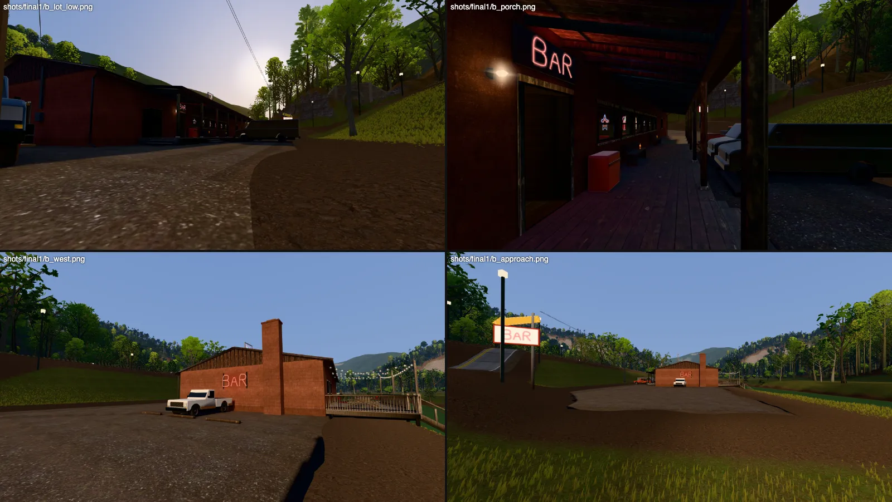
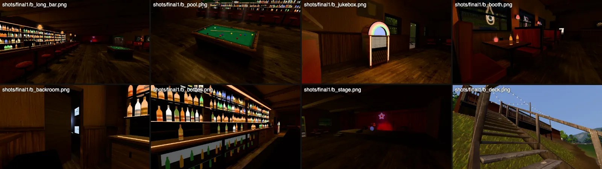
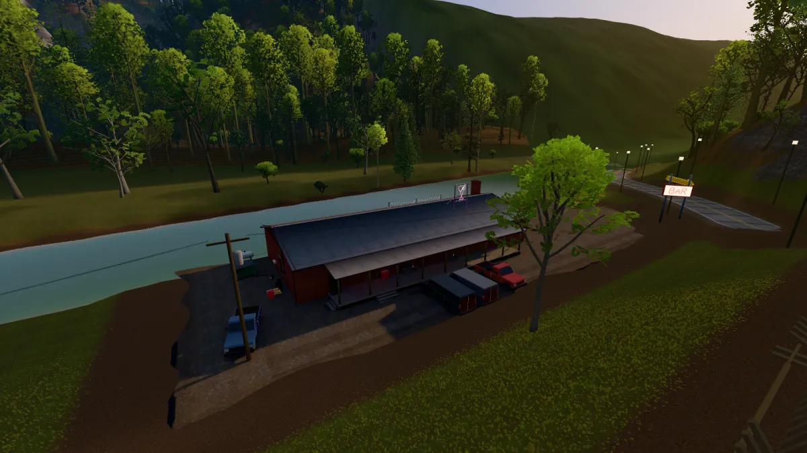

# THE BAR (town2_bar): Sourwood's roadhouse

Status: built, baked and placed, 2026-10-22 (wave 2, the bar's building agent; prompts/town_building.md).
The brief is design/town/brief.md section 4 and its six shots.



*Outside, in the engine (Metal, q3): the lot at knee height, the porch along the wall, the west gable from the highway end, the approach past the pole sign.*



*Inside: long down the bar from the door, the pool table, the jukebox, a booth, the back room's door ajar from the bartender's aisle, the bottle wall, the stage, the river deck.*



*From the hillside over the river: the porch, the vans, the lot west to the highway and the pole sign, the river deck, the rooftop cocktail sign.*

## 1. What it is

The one place in town the polish never reached. It is a long, low 1950s roadhouse on the river at the west edge of town, across the tracks. The highway curves past its gravel lot under Tunnel Knob.

**References.** These were used for massing, materials and light. None of them is copied.
- **Twin Peaks' Roadhouse (Bang Bang Bar).** The exterior was the Colonial Inn in Fall City, Washington. From it: the long, dark, low hall, the stage with a red curtain, booths and the pool table in pools of light.
- **True Detective, season 1.** From its Louisiana dives: painted cinder block, a tin roof, beer neon in every window, a gravel lot of pickups.
- **From Dusk Till Dawn's Titty Twister lot.** From it: a sign you see from the highway, the lot as a stage at sunset, and neon on the shadow side.
- **No Country for Old Men's motel and gas-station lots.** From them: low sun, long shadows and parked trucks.
- **Appalachian river roadhouses and honky-tonks** (the French Broad and Nantahala river bars). From them: the deck on posts over the bank with steps to the water, and a jon boat tied at the landing.

## 2. The building

**Frame.** The asset frame has x along the building (+X is the west gable, at the highway end) and the front (-Y) on the lot. z = 0 is the pad (the lot's grade).

The world places it at yaw 180, so the porch faces north, toward the lot and the road, and the deck faces south, to the river.

The asset origin, the building's centre, is at estate (-2112, -804.5). The pad / footprint covers the building, the porch and the lot west to the highway: x -26..47, y -17..8 (73 x 25 m).

**The shell** (`town2_bar_shell.py`):
- **Size.** 32 x 14 m. The walls are 0.25 m painted cinder block on a block stem wall. The floor is at +0.45 m and the ceiling is 3.2 m clear.
- **Block.** A Poly Haven concrete_block_wall scan, graded to a weathered oxblood paint.
- **Gables and trim.** Dark-stained board-and-batten gables. Cream window and door trim, with double-hung sashes.
- **Roof.** A shallow 1:4 gable of worn corrugated iron. It has a wavy corrugated eave edge, fascia, a gutter, downspouts, and a block chimney on the west gable.
- **Inside finishes.** Worn dark floorboards (old_wooden_floor_02). A dark wood wainscot with a cap rail under stained knotty pine (stained_pine). A smoke-dark board ceiling on exposed beams.
- **The porch.** 24 m long and 3 m deep, with cream posts, a haint-blue board ceiling, steps and a shed roof.
- **The river deck.** Posts down into the bank, 22 steps down to a landing on piles at the water, and a rowboat tied there.

**Inside** (`town2_bar_interior.py`):
- **The bar.**
  - 14 m long, with an oxblood diamond-tufted vinyl front between dark wood pilasters.
  - A padded vinyl arm rail, a varnished bullnose top and a brass foot rail.
  - Two chrome beer towers, 13 chrome stools and a return with the bartender's gap.
  - Behind it, a stainless under-bar.
- **The back-bar.**
  - Cabinets and a lit three-door beer cooler.
  - Foxed mirrors between pilasters.
  - Three glass shelves of about 300 bottles in 12 label styles, each tier lit from below by an amber strip.
  - A lit valance, a brass register and a pictogram bar mirror.
- **The booths.** Six oxblood tuck-and-roll booths under the front windows. Each has a red netted-glass candle lamp and a red-shaded sconce on the pier.
- **Window neon.** A pictogram in every window: a star, a cocktail, a bottle, BAR, a mug, a horseshoe and a guitar. Each reads correctly from the lot.
- **The pool table.** A 7 ft coin-op bar-box with a game in progress, under a three-shade green lamp with a faint smoke cone. There is a cue rack, and a dartboard in its open cabinet.
- **The jukebox.** A bubbler with lit pilasters, the rainbow arch and the selection cards.
- **The stage.** A pleated red velvet curtain, a valance and side legs, and a blue-and-red neon star hung on chains. On it are drums, two amps, a mic, a wedge and a guitar, lit by three gelled PAR cans on a pipe.
- **Elsewhere in the room.**
  - Café tables and chrome chairs on the dance floor, and two ceiling fans.
  - A CRT on a bracket showing a ball game.
  - A cigarette machine, coat hooks and amber schoolhouse pendants over the bar.
- **The corridor.** The restroom doors (closed), a payphone, a mop bucket, a caged bulb, a red exit box and the back exit (closed).

**The back room (the turn)** has two doors:
- **The door behind the bar's end,** ajar 28 degrees. From the bartender's aisle, its gap shows the wall of four security monitors, their blue light spilling out, and a white mask on a nail beside them.
- **The corridor door,** open. This is the way in.

Inside the back room:
- **Masks.** Two hook rails of blank white masks, our own shell modelled after the invaders' (`invader_gear`'s mask isn't imported), and two dark work jackets.
- **The briefing table.** A folding table with six chairs. On it are the estate house's blueprint (drawn from `blender/levels/plan.py`'s ground floor), photos, charging radios and a coffee can.
- **On the walls.** A cork board with blank pinned sheets and a red string, and a topo map with a red road.
- **Storage.** Kegs, beer crates and cases, a wire shelf, and an old green safe.

There is no text anywhere apart from BAR in neon.

**Outside** (`town2_bar_lot.py`, `town2_bar_vehicles.py`):
- **The lot.** Gravel (the Poly Haven gravel scan) in 6 m tiles. It has packed, darker ruts along the drive, and a ragged edge that fades browner and sinks under the grass. There are railroad-tie wheel stops.
- **Vehicles.** The invaders' two dark cargo vans, backed in to the porch, nose out. Three pickups: a rusty red 1990s truck with a toolbox, a white 1980s square-body by the west gable and a blue one at the east end. They are side-profile bodies with greenhouses, wheel-well liners, lathed tyres on steel rims, chrome and rust.
- **Signs.**
  - At the highway, a pole sign: a backlit cabinet with BAR in red neon on both faces and a yellow arrow with marquee bulbs.
  - BAR in big red neon on the west gable, facing the highway.
  - A pink-and-green neon cocktail glass on a steel frame over the roof.
  - BAR in neon over the open front door, and a caged porch light.
- **Utility pole.** It carries a transformer, a cobra-head lamp (off, it isn't dusk yet), the service drop to the east gable and lines out to the road.
- **Clutter.** A dumpster, a propane tank, and kegs, crates and a pallet by the back exit.
- **On the porch.** Benches, a red cooler, a sand-bucket ashtray and an ice machine.
- **On the deck.** Three picnic tables, a barrel smoker, festoon lights on sagging wires and two plastic chairs.

## 3. Light

**What the bake covers.** Everything is baked by `blender/town/bar/build.py` in Cycles (Metal):
- The golden-hour sun and sky of `mansion.py` LOOKS["golden"], rotated into the asset frame. These are the same numbers as the wild runtime's `lightUniforms`, so the outside matches the terrain.
- The terrain around the site, loaded from the town's `terrain.npz` for the bounce and the bank.
- About 110 lamps:
  - pendants, booth sconces and candles;
  - the pool lamp's three spots;
  - the shelf strips and the back-bar valance;
  - the cooler, the jukebox and the TV;
  - three stage PARs;
  - the monitors (blue);
  - every neon sign (coloured points);
  - the porch light and the festoons;
  - the pole sign and the gable neon.

The emissive pieces emit too.

**How it is stored:**
- **Two lightmaps, both on TEXCOORD_1.** `T_Town2_Bar_LightmapIn` is 1024² and covers floor, pine, wood, vinyl and props. `T_Town2_Bar_LightmapOut` is 1024x512 and covers block, siding, roof, deck, gravel, outside props and glass.
- **Encoding.** Each lightmap has its own range: 99.5th percentile, hue-preserving clip, 8-bit sRGB. The extras hold `lightmapIntensity` = scale x π, because three.js divides by π.
- **Interior exposure.** The interior is given 1.8x (`P["interior_exposure"]`). The runtime has no eye adaptation, and a physically dim bar read black after the lot.
- **Charts.** Our own skyline packer packs them in texel space at about 20 texels/m inside and 18 outside. Blender's packer left most of the atlas empty with about 1000 islands.
- **Small or thin parts** (bottles, hardware, bevels, slats, cushions, the curtain) get no chart. Their light is baked per vertex into COLOR_0, and their lightmap UV reads a white corner texel. This saved thousands of islands whose margins had shrunk the atlas to 1%.
- **Reflections.** Two 512x256 panoramas, one inside at the bar and one outside on the lot, give glossy reflections only. Their irradiance is dropped in the shader; the lightmap is the diffuse.
- **The neon glows.** The runtime has no bloom, so the neon gets alpha-blended emissive cards: ribbons along every tube, halos on bulbs and lamps, and a faint smoke cone under the pool lamp. These are one material, `M_Town2_Bar_Glow`, kept out of the bake.

## 4. Numbers

| | measured | budget (prompts/town_building.md) |
|---|---|---|
| triangles | 152.9k LOD0 (props 71k, outside props + vehicles 32k, vinyl 20k, wood 10k, deck 6k), LOD1 94 | 60-150k |
| draw calls (the building in view) | 13 materials (5 inside, 7 outside + glass, 1 glow); LOD1: 1 | ≤ 25 |
| GPU textures | 20.9 MB of maps (lightmaps 5.6 + 2.8, six 512² maps 1.4 each, eight 256² maps 0.35 each, two env 0.7 each) + ~3 MB of PMREM targets for the two panoramas (GPU only): ~24 MB, a little over | ≤ ~20 MB |
| download | 3.25 MB geometry (Draco) + 0.5 MB textures | ≤ 6 MB |
| colliders | 172 boxes (walls split at the doors, the bar, stools, booths, tables, the stage, the porch and its steps, the deck, 22 stair treads, the landing, vehicles, the sign) | |

`wild_bench.mjs` (views bar_lot, bar_porch and bar_room; the whole town in view):
- **M4 Metal, 2400x1350, q3.** 2.5-2.7 ms render (GPU 1.8-2.0 ms), 45 draw calls, 0.63M triangles. Budget: ≤ 5 ms and 40-50 calls.
- **SwiftShader, 1280x720, q0.** The machine was under a load of 35-50 from other agents, so these numbers vary about 2x between runs. One A/B on bar_room (back to back, same load):

  | | bar_room |
  |---|---|
  | bar with its reflections | 328 ms |
  | bar without reflections | 114 ms |
  | no bar (`&sites=0`) | 84 ms |

  The reflections' PMREM sampling was the cost, so `town.js` now turns site reflections off on a software renderer (`&senv=1` forces them on).

  The bar then costs about 30 ms on SwiftShader. It adds about 15 draw calls (34 vs 19) and about 156k triangles.

  The default run afterwards measured 145-250 ms across the three views at that load. The budget is ≤ 200 ms, so the bar may be OVER on SwiftShader; the load made it unmeasurable. Re-bench on a quiet machine.

**Walk tests:**
- `node blender/town/bar/walk.mjs` walks the real player along four routes:
  - lot → porch steps → inside;
  - across the room → deck door → deck → down the stair → the landing;
  - round the bar's return into the bartender's aisle;
  - down the corridor → the back room.

  PASS.
- `node viewer/tools/wild_walkin.mjs bar` (the bar is added as `site_bar`): PASS, 4 m inside.
- `node viewer/tools/wild_routes.mjs --world laurel_town` (the road route ends at the bar's lot): road 1,384 m and river 1,271 m, both 0 stuck and 0 falls.
- LOD: the 13 LOD0 nodes show at 41 m and only `Town2Bar_LOD1` at 200 m (`town.update`). From the strip and Main Street the bar is behind the rail embankment and trees, so LOD1 is mostly seen from the river and the hillsides.

## 5. How to build

```sh
# geometry + lightmap UVs + Cycles bake (512 spp ~4 min; --draft = 48) + envs + LOD1 + export (+ --renders: Cycles previews in build/town2_bar/renders)
/Applications/Blender.app/Contents/MacOS/Blender -b --factory-startup --python blender/town/bar/build.py -- --samples 512
# the town picks up the sidecar's colliders (and the footprint) at its world step
/Applications/Blender.app/Contents/Resources/5.0/python/bin/python3.11 blender/wilderness/levels/laurel_town.py --steps world
# look: viewer/wild.html?world=laurel_town&view=bar_lot | bar_porch | bar_room
GT_BASE=http://localhost:<port> node blender/town/bar/walk.mjs
```

## 6. Known limits

- **The stage reads dim in the engine.** The curtain and the drums are vertex-lit, so the PAR cans' pools are soft. The Cycles preview shows more.
- **The jukebox's arch is pastel.** The real Wurlitzer palette is more orange.
- **The vans and pickups are clean silhouettes.** They are good from the lot at 5-20 m, but crude closer than 2 m. They are static geometry baked into the lot's light: the townspeople's AI can't drive them.
- **There is no dusk LOOK.** The brief's dusk version is a LOOK away: rebuild with `P["look"]`, once mansion.py has one.
- **The ajar door is static.** It and the other open doors are geometry, not interactables (the wild runtime has none yet).
- **The deck's posts end inside the bank.** Their feet are hidden by the terrain, which the world step doesn't flatten beyond the pad.
- **The bar's site needs the town rebuilt** (laurel_town.py) after any change to the sidecar.
