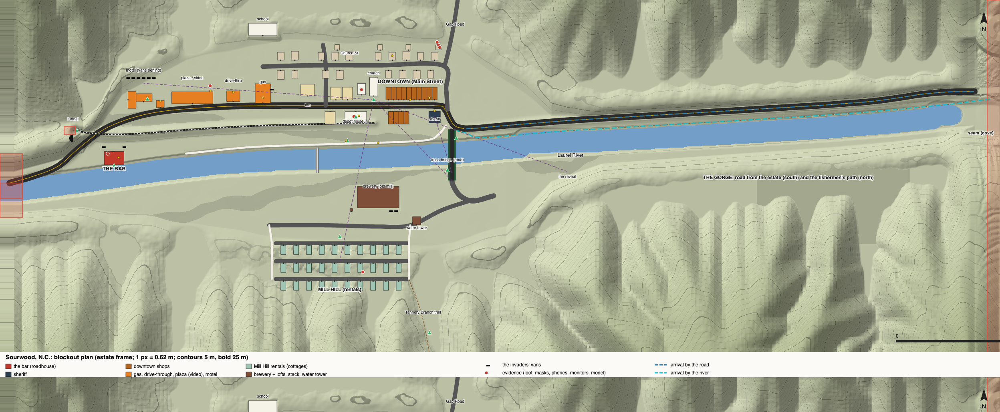
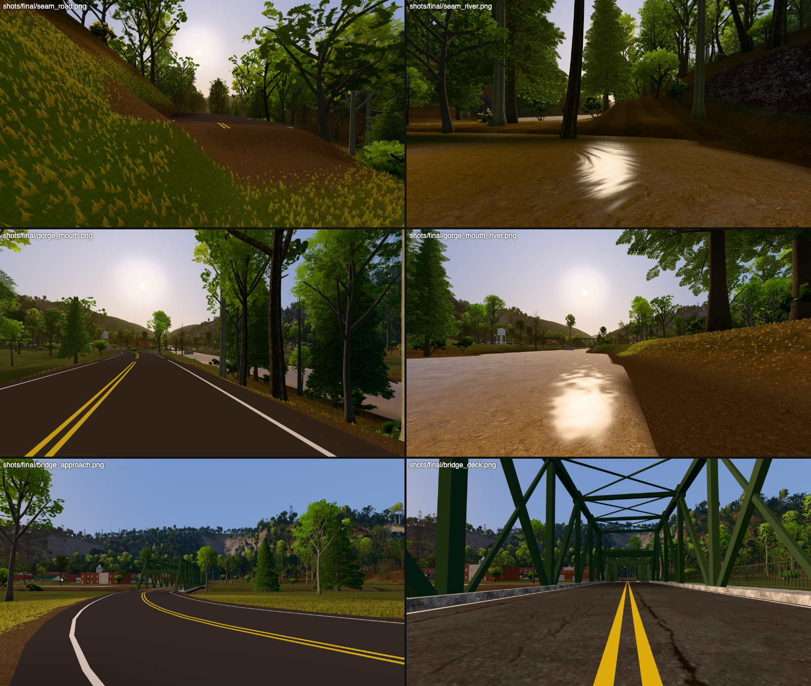
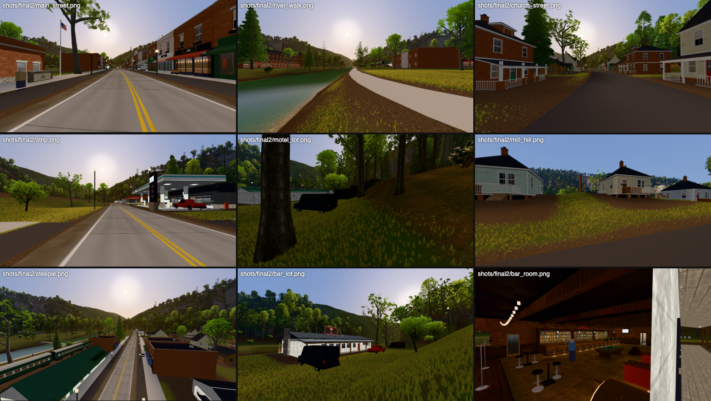

# Sourwood, N.C.: the town downstream

Status: design + playable blockout, 2026-10-22 (wave 2, the town workstream).
The buildings come from the kit workstream (`design/town/kit_status.md`, built to `kit_request.md` v2).
75 of the 85 placements are real kit glTFs; the rest are massing boxes until the kit has them.



*`map.svg` is drawn from the level's own data (`blender/wilderness/levels/laurel_town_map.py`), in the estate frame, 1 px = 0.62 m, contours every 5 m. The map shows:*
- *buildings by type; the two arrivals (dashed blue);*
- *the purple sightlines; the green hiding places; the red exits;*
- *the black vans; the red evidence; the yellow townspeople.*

```sh
PY=/Applications/Blender.app/Contents/Resources/5.0/python/bin/python3.11
$PY blender/wilderness/levels/laurel_town.py                  # guide + terrain + world, ~45 s (numpy only, no slot)
$PY blender/wilderness/levels/laurel_town.py --steps world    # the world step only (~15 s): after a kit update
$PY blender/wilderness/levels/laurel_town_map.py && node viewer/tools/svg_png.mjs design/town/map.svg design/town/map.png
http://localhost:8765/viewer/wild.html?world=laurel_town      # spawns on the road at the seam; keys 1-0 jump between views
  &view=main_street | bar_room | bar_lot | gorge_mouth | steeple | ...   &kit=0 massing only   &town=0 no town   &exits=0
node viewer/tools/wild_seam.mjs                                # walks cove -> town -> cove across the seam
node viewer/tools/wild_routes.mjs --world laurel_town          # the road and river arrivals with the real player
node viewer/tools/wild_walkin.mjs                              # through the front door of six walk-ins
node viewer/tools/wild_cracks.mjs --world laurel_town          # terrain seams (must print 0)
node viewer/tools/wild_shots.mjs <label> --world laurel_town   # every view
```

## 1. What the town is

Per the user, Sourwood is **a present-day, well-kept, quaint mountain town**. It is the kind a tech billionaire drives through on the way to his estate and likes the look of. It is not an old mill town, though it was one once. It seems safe. It is in cahoots with the invaders.

**The name.** Sourwood is the understory tree in the cove (the kit's `sourwood`). Its honey is the region's prized one. The name is sweet and sour at once, and nobody in the game ever says it.

**What it draws from** (real places, looked up):
- **Marshall, N.C.** (Madison County seat): the historic core is one Main Street squeezed between the French Broad River and a cliff, with the railroad alongside. Downtown Sourwood is one street deep between the river and the hill for the same reason.
- **Hot Springs, N.C.**: a turnpike stop that grew into a rail resort on the French Broad (the railroad arrived in 1882). It is a resort town again now, on rafting and hikers. That is where Sourwood's outfitter, its inn and its "too nice for its size" feel come from.
- **Bryson City and Dillsboro**: the old Southern Railway depot downtown, with a heritage excursion train (the Great Smoky Mountains Railroad runs the old Murphy Branch, built 1880-1891 with convict-lease labour, freight to the late 1980s). Sourwood's depot is the museum, with a tourist train parked at it, and the line leaves town through a tunnel.
- **Wesser / the Nantahala Gorge**: the river, the rail grade and the road share one gorge, with the rafting outfitter at its mouth. Sourwood's approach is exactly that.
- **Andrews and Sylva** (chestnut-tannin extract plants and tanneries, about 1900-1950, killed by the chestnut blight): the old brick mill on the south bank was an extract plant. Its stack is a landmark. Its mill hill of identical four-room houses was bought up and painted pastel as vacation rentals, the way old mill villages (Saxapahaw and others) were gentrified. The ghost chestnuts in the cove are where its wood came from.
- **Proctor / Fontana's lost towns** (a Ritter Lumber company town of about 1,000, cut out by 1928, then drowned by TVA): the regional memory of towns that live and die by one owner. The history museum's real subject is that.
- **Highlands, Blowing Rock, Cashiers, Saluda's main street today** (the polish): stone bases, board-and-batten, black standing seam, flower baskets, acorn lamps.
- **The strip at the highway end** (the real-world mix):
  - a chain-style burger drive-through;
  - a canopy gas station with a convenience store;
  - a 1980s strip plaza whose **video store** somehow survived;
  - a renovated motor lodge.

**The economy, as the environment shows it.** Rafting (the outfitter, rafts, the put-in), the heritage train and the museum, the inn, boutiques, coffee, a brewery in the old mill, and vacation rentals. There is one more business no one advertises: the town services the invaders. Their vans are fuelled at the gas station, they sleep at the motel, they get their briefing in the church hall, and their staging room is behind the bar. The town is far too prosperous for its size, and that is the first thing a sharp player might notice: new sidewalks, fresh paint, every flower basket watered, no litter, no vacancies.

**A little strange, not generic.**
- Every rental on Mill Hill is the same house in a different pastel, with the same key lockbox by every door, and every one is booked.
- The video store is still open in 2026.
- The museum's centrepiece is a scale model of **the estate**: the house, the lawn, the hedge, tiny figures.
- The real-estate office's window shows estates for sale (blank photo boards).
- The church's steeple is the one thing you can see from anywhere.

## 2. Getting there: the road and the river

**Its own world, not a continuation of laurel_fork.** The runtime's CDLOD terrain needs size / leaf to be a power of two over a 1025² heightfield. So a square is 1536 m, and the cove's square ends at estate x -768. The town lies 0.7-1.5 km past it.
- The town square is centred at estate (-1500, -810). It has the cove's y transform and its 1.5 m lattice, so column i in the town is column i - 1000 in the cove.
- It overlaps the cove square by 36 m (x -768..-732). There, its heights and water are **the cove's own, copied node for node**.
- West of the seam, the town's guide terrain ramps any mismatch out over 40 m.
- `viewer/wild/town.js` `Exits` handles the crossing:
  - walking west past x -762 in the cove reloads the page into `laurel_town` at the same estate point, facing the same way;
  - walking east past x -750 in the town reloads it into the cove.
  - The fade is 0.35 s and the load is about 1.3 s.
  - The cove needs no rebuild: its exit is a fallback table in `town.js`.
- **`wild_seam.mjs`: PASS.** Cove (-763.1, -785.9) at ground -164.74 → town (-765.0, -785.9) at ground -164.80; town (-748.9) → cove (-748.0), dz 0.006 m. The player lands on the ground in both directions, with no page errors.

**The road from the estate** (the user: a real road, lane markings, from the gate down the valley, along the river, into town). The mansion-landscape workstream builds the road from the gate to the cove square's west edge. **Handoff point** (`laurel_town.ROAD_IN`):
- estate (-768, -786), z -164.8, on the old river road's grade (laurel_fork `river_road`);
- heading 265° (west);
- two 3.6 m lanes and 1.5 m shoulders.

From there the town carries it:
1. **Down the gorge** on a bench cut into the south wall, at 2-5% (842 m), with double yellow centre lines and white edge lines.
2. **Across the south flats**, past the brewery's yard, and onto the **green truss bridge**: two 39 m Pratt spans on a stone pier, the kit's `town_truss_span`. The cove's backdrop already shows it.
3. **Into downtown** as Main Street: angle parking, sidewalks, acorn lamps.
4. **Out west** as the highway: past the strip and the motel, past the roadhouse, round the toe of Tunnel Knob, out of the square.

If the landscape agent's road ends somewhere else on the seam, only `ROAD_IN` and the first two points of `ROAD_GORGE` move.

**The river.** The Laurel River leaves the cove's Narrows at x -768 (water -184.7) and runs through the gorge (a riffle at the gorge mouth) onto the town's flats. It is 34-37 m wide, with water at -188.3 by the bridge and -190.4 at the west edge, and continues west as a ribbon beyond the square.
- A **fishermen's path** follows the north bank down the gorge, low by the water, wading the shallows in two places (15 s). It comes up onto the road at the truss bridge's north end and becomes the **river walk** (the greenway) along downtown's back.
- The river walk ends at the outfitter's raft racks and the footbridge to Mill Hill.

**Two arrivals, two first impressions** (the shots below):
- **By the road**, the player comes out of the trees at the gorge mouth (the "reveal") and sees the town in the order the sightline gives it: the steeple, the green truss, the water tower and the mill stack over the trees, then the shopfronts across the bridge. Then they cross the bridge **in full view of the sheriff's window**.
- **By the river**, they arrive low and unseen at the town's back: the river walk behind the south-side shops and the depot's freight platform. The first thing they see of Sourwood is its back lots.



*Arriving (Metal, q3): on the road at the seam; wading out of the Narrows; the gorge mouth on the road and from the river; the road's curve onto the truss bridge; on the bridge deck, looking into downtown.*



*Main Street from the bridge corner; the river walk; Church Street; the strip (gas station, drive-through, plaza); the motel's back lot and its vans; Mill Hill's rentals (the same house); from the steeple's bell deck; the roadhouse's lot; inside the bar (the kit's room in its own baked lamplight).*

## 3. The plan (estate frame; the map is the reference)

| place | where | what |
|---|---|---|
| **The gorge** | x -768..-1450 | river in the bottom, the road on a bench on the south wall, the fishermen's path on the north bank; walls 37-42°, unwalkable (the 40° limit) |
| **The reveal** | (-1405, -828) on the road | the valley opens; the sightline to the steeple, the truss and the tower |
| **Truss bridge** | x -1585, y -842..-762 | the road into town; deck about 5 m over the water; the south abutment's bank is a hiding place |
| **Downtown** | Main Street, y -725, x -1590..-1850 | north side: 10 shopfronts (gear, coffee, sweets, bank, gallery, bakery, books, pharmacy), **the church** (steeple 21.9 m) and its fellowship hall, the outfitter, the realty, the inn. South side (backs to the river walk): **the sheriff's office** on the bridge corner, four shops (diner, ice cream, antiques, wine bar), **the depot museum** with the heritage train, a tasting room |
| **Church Street** | y -662 | restored houses (Victorian, foursquare, craftsman), garages (**the loot garage**: the estate's own furniture), the school on the bench above |
| **The strip** | x -1860..-2090, the highway | **gas station + convenience store**, **burger drive-through**, **strip plaza** (vacant, laundromat, pharmacy, **video store**), **motor lodge** (two wings, an L; the back lot against the hill is where the vans are) |
| **The roadhouse (the bar)** | (-2112, -807), on the river, at the spur's toe | the last building before the highway leaves town, across the heritage line's level crossing; gravel lot; river deck behind |
| **Tunnel Knob** | x -2160..-2268 | a spur pinching the north bank: the highway squeezes round its river face, the heritage line goes through it (the portal) |
| **South bank** | y -850..-1000 | the old mill (brewery taproom + lofts; vans behind), the stack, the water tower; **Mill Hill**: three terraced rows of 10 identical cottages (rentals) with stairs at each end; the footbridge to the river walk |
| **Hollows** | Gap Branch (north, x -1570), Tannery Branch (south, x -1612), two more | the county road north up Gap Branch (an exit); the Tannery Branch trail south to the ridge (an exit, back into the wilderness) |

## 4. The bar (hero location)

**The roadhouse** (`town_bar`, the kit's showpiece: 25k triangles, walk-in) is the one place in town the polish never reached. It is a long, low 1950s cinder-block-and-board building with a deep porch. Neon in the windows: **BAR**, a beer bottle, a cocktail glass, a star. It sits on a gravel lot at the edge of town, across the tracks, by the river, under the dark of the tunnel portal. Inside are the following:
- a 14 m bar with a back-bar of lit bottles;
- five red booths, each with its own small lamp;
- a pool table under one hanging lamp;
- a jukebox;
- a small stage with a red curtain;
- a hall to the restrooms and the back exit;
- **the back room**, door ajar 28°: a table, a hook rail (where the invaders' masks hang), monitors, a safe, kegs.

The deck at the back has steps down to the water.

**The shots** (references: Twin Peaks' Roadhouse / Bang Bang Bar, From Dusk Till Dawn's Titty Twister lot, No Country's motel and gas station, True Detective's Louisiana bars). In order:
1. **The lot, low, at the golden hour.** The camera is at knee height on the gravel. The neon reads pink and green on the porch's shadow side, with the river and Tunnel Knob behind. Two dark vans are parked nose-out at the porch. (`view=bar_lot`; the game's LOOK is golden hour today; dusk is a LOOK away.)
2. **The porch, along the wall.** The bottle neon, the board ceiling, the vans beyond the porch posts (`view=bar_porch`).
3. **Long down the bar from the door.** A long lens: the bottle wall glowing, stools in a row, the bartender halfway down, polishing a glass. Everything else is dark between pools of light.
4. **Top-down on the pool table's cone of light.** A game in progress, nobody playing it.
5. **The jukebox, close.** It is the brightest thing in the room. The song on it stops when the player comes in.
6. **The back room door, ajar.** Through the gap: the hook rail, the masks on it, the monitors' blue light.

`view=bar_room` is from the stage end. The kit bakes the room's lamplight into its vertex colours, and the runtime draws a walk-in's interior unlit in that light: a film-set look at no runtime cost.

**Why the turn happens here.** It is the one place where the town's two faces meet: tourists' cars and invaders' vans share the lot. The bartender is the only townsperson who never pretends. The bar is also where the player, looking for help, would naturally go last: after the sheriff didn't help, after the phones didn't work.

## 5. The turn: told by the environment and behaviour only (no text)

**What reads first as relief** (from the gorge mouth and the bridge):
- the steeple; the green truss bridge; the lit shopfronts at golden hour;
- flower baskets; the American flag on the bank;
- a woman watering the baskets; a jogger on the river walk; a barista; the museum's docent; the outfitter at the raft racks; a man on a porch;
- the sheriff's SUV at his office: help, apparently.

The road even has fresh lane paint.

**The details that turn it**, roughly in the order a player meets them on either arrival. Each is placed in the blockout (`laurel_town.EVIDENCE`, red on the map):
1. **The sheriff watches you cross the bridge** from the bench outside his office. When you are halfway over, he gets up, goes inside to the desk at his window (the kit's window desk, phone included) and **makes a call**. That is the first beat, seen from the bridge deck. *(Behaviour: see section 6.)*
2. **The river walk's back lots** (the river arrival sees these first): the depot's freight platform, the shops' back doors, and two dark vans behind the brewery on the south bank.
3. **The museum's vitrine: a scale model of the estate.** The house, the lawn, the hedge, the gate, tiny figures on the lawn. The player knows this house.
4. **The motel's back lot: six identical dark vans** nose-out against the hill, out of sight of Main Street (that is why they are there). They are the same vans that brought the invaders to the estate. The motel's lobby is lit and the doors all match.
5. **The gas station's back lot**: another van, doors open. Behind the counter, a CB radio on the back shelf.
6. **The video store's back room: a wall of old TVs showing the estate's security cameras live.** (The tablet's camera feeds are the same views. The town has been watching the house.)
7. **The open garage on Church Street: the estate's own furniture.** Placed from the mansion's own glTFs, so the player recognises them: a dining chair, the office lamp, the great room's art, still wrapped.
8. **Mill Hill: the invaders' masks drying on a clothesline** behind one of the identical rentals (the invader character's `Invader_Mask`). Every rental is "booked": a van or a rental car in each drive.
9. **The church's fellowship hall: every phone on one long table.** Dozens of mobile phones laid out in rows, screens dark: the guests', and the staff's.
10. **The bar's back room: the masks on the hook rail**, the monitors, a table set for a briefing.

None of these carries a word. Signs are pictograms, plus BAR in neon.

## 6. The turn as gameplay

The design is below. The townspeople's AI is not built in this workstream: the posts are placed (`town.people`), and the behaviour belongs to the invader-behaviour workstream. It reuses the Grimble's senses: the sight cone, the notice meter, hearing with wall muffling, and doors blocking sight.

**The townspeople are not hostile. They report.** Each has a post and a phone, and when they notice the player they act normal: a wave, a nod, the barista's "morning" gesture. Then they **report**: they turn away and make a call (the phone at their post), or walk to the nearest one. A report raises the town's **alarm**, a signal like `power` (`window.__signals` `town_alarm` 0-3). Reports carry the player's last seen position.

| alarm | trigger | what changes |
|---|---|---|
| 0 **Welcome** | arriving | people at their posts; the sheriff on his bench; music in the bar |
| 1 **Watchful** | the sheriff's call (always, when you cross the bridge or reach Main Street), or being seen near evidence | people stop and watch you pass; curtains move; **the porch-light chain**: when a house reports, the next house's porch light comes on, so a line of lights runs along the street ahead of you (the phone tree made visible); the cruiser starts a slow patrol |
| 2 **Closing** | two more reports, being seen inside an off-limits room (the video store's back room, the garage, the church hall, the bar's back room), or carrying a weapon openly | the shops close their doors one by one; the bartender locks the front door; vans leave the motel lot to the bridge (blocking the way you came) and to the highway |
| 3 **The hunt** | taking evidence, or alarm 2 for 2 minutes | **the church bell rings** (heard from anywhere: the signal). Every porch light goes out at once (the town's own switch, reusing `power`). Invaders come out of the motel and the bar's back room. The sheriff's SUV parks across the highway at Tunnel Knob (the roadblock) |

**How the player stays ahead.**
- **Cut the phones**: the telephone junction box on a pole behind the depot (`town_phone_box` was in kit request v1 and dropped from v2; it needs adding back). Reports stop travelling; people have to run to tell someone.
- **Cut the town's power** at the brewery's transformer. The porch-light chain stops working, but the bell still rings.
- **Stay unseen**: move along the river walk, through the back lots, under the bridges. Townspeople only report what they see, and they see what the invaders see (the same sight rules).

**Hiding places** (green on the map, `laurel_town.HIDES`):
- under the depot's freight platform (1.15 m crawl space; the kit built it);
- the river banks under both truss spans;
- under the bar's river deck;
- the motel's ice-machine alcove;
- the steeple's bell deck, which sees the whole town but is a dead end;
- the outfitter's raft racks;
- under a downhill rental's deck on Mill Hill;
- the tunnel mouth's dark;
- the rhododendron in the Tannery Branch hollow.

**Ways out** (red on the map, `laurel_town.EXITS`; only the cove one is wired today, the rest are marked for later levels):
1. **Back up the gorge** by road, river or path, into the cove. The vans at alarm 2 block the bridge, so the river is the way.
2. **The heritage line's tunnel** under Tunnel Knob, on foot in the dark. Invaders won't follow far.
3. **Downstream**: steal a raft from the outfitter's racks and go with the current, past the bar's deck and round the spur.
4. **The highway west**, past the roadblock.
5. **The county road north** up Gap Branch.
6. **The Tannery Branch trail south** to the ridge, back into the wilderness.

## 7. The blockout (what is built)

| | |
|---|---|
| `blender/wilderness/levels/laurel_town.py` | the level config: the frame, the river, the valley as an analytic field (floor, flood terrace, hillsides with spurs and hollows), the layout as data (buildings by kit name placed by their fronts, streets, the road, the heritage line, bridges, exits, hiding places, evidence, vehicles, people, views). `build_guide` writes the macro terrain as a `.npy` guide for `terrain.build`. Steps: the valley; stream-power erosion on the hills only; the cove's heights at the seam; pits filled; the road's bench; the lots flattened to the kit's footprints. Then `terrain.build` with no shapes, no detail and no erosion: hydrology (the Laurel River as an inflow of 340 km²) and the streets as graded paths |
| `blender/wilderness/levels/laurel_town_world.py` | the world step: the cove's heights and water patched in node for node; trees and shrubs (the cove's species: hillside forest thinned to 55% beyond 60 m of the floor, yard trees in town); light (terrain + canopy + **the buildings' shadows**); splat; the backdrop ring (the cove's fine terrain and backdrop where they are, the valley function beyond); colliders (trees, the kit's own colliders for kit buildings, massing for the rest, bridges, vehicles); world.json `town` |
| `blender/wilderness/levels/laurel_town_map.py`, `viewer/tools/svg_png.mjs` | the plan from the data |
| `viewer/wild/town.js` | the runtime. Massing for non-kit buildings, roofs, the streets' asphalt with lane markings and sidewalks, bridges, the tunnel portal, vehicles, evidence, people, streetlights: one lit draw + one emissive draw. **The kit**: every placement baked into world space and merged per 250 m zone x LOD x material (LOD0 within 260 m, LOD1 beyond), the atlas lit like the wilderness, the glow unlit, walk-in rooms in their baked light. `Exits` handles world-to-world reloads |
| `viewer/wild/main.js` | `[town]`-marked hooks: the Town and its LOD update; exits; no estate stand-in when a world has none; `epos` through the world's own estate offset; a level's own grass (mown lawns) and view keys |
| tests | `viewer/tools/wild_seam.mjs` (new), `wild_walkin.mjs` (new), `wild_routes.mjs`, `wild_cracks.mjs`, `wild_shots.mjs`, `wild_bench.mjs` |

**Checks (final build).**
- **Seam**: `wild_seam.mjs` PASS (numbers in section 2).
- **Routes** (`wild_routes.mjs`, the real player, 60 Hz, running):
  - **road**: seam → gorge → truss bridge → Main Street → the strip → the bar's lot. 1,489 m in 3.7 min; 0 stuck, 0 falls. The feet are up to 7.7 m over the terrain on the bridge deck, over the river.
  - **river**: fishermen's path → river walk. 1,271 m in 3.3 min; 0 stuck, 0 falls; 15 s wading.
- **Walk-ins** (`wild_walkin.mjs`): the bar, gas station, drive-through, sheriff's office, depot museum and church are entered through their front doors. PASS.
- **Terrain seams**: `wild_cracks.mjs --world laurel_town`: 0 of 120 views.
- **Cost** (`wild_bench.mjs town_kit`, six views incl. the bar room):

  | | measured | budget (runtime.md) |
  |---|---|---|
  | M4 Metal 2400x1350 q3, render | 1.5-3.0 ms | ≤ 5 ms |
  | draw calls | ≤ 45 | ≤ 40-50 |
  | triangles | ≤ 0.90M | ≤ 1.5M |
  | SwiftShader 1280x720 q0 | 51-124 ms (max direction 162) | ≤ 200 ms |
  | download | 13.3 MB | ≤ 15 MB |
  | GPU textures | 136 MB | ≤ 150 MB |
  | load (M4) | 1.3 s | |

  - The kit is 4-6 draw calls in view: one atlas mesh and one glow mesh per zone in range.
  - Earlier, before the forest was thinned and with the machine under a load of about 31, SwiftShader read 204-317 ms. At that same load the cove's own Poplar Cove read 343 ms.

**What doesn't work yet.**
- **The townspeople are stand-ins** (boxes at their posts). There is no reporting AI, no alarm signal, no porch-light chain and no bell. Section 6 is the contract for the invader-behaviour workstream. They could be the invader character with an everyday outfit and no mask (`outfits` in `design/invaders/character.md`): ask that workstream for an unmasked head.
- **The kit hasn't built yet**: the church hall, inn, motel, school, garages, sheds, footbridge, tunnel portal and train. They are massing boxes. Evidence the kit has built (crates, CRT wall, phone table, estate model) is placed from it; masks and the loot are boxes until the invader mask and the mansion's furniture glTFs are placed.
- **Evidence placement inside the walk-ins is approximate.** The kit gives spots (`crt_wall_spot` in the plaza, the depot's model table, the bar's hook rail); move `EVIDENCE` onto them.
- **The tunnel** is a portal with a dark bore against the hill. The heightfield can't hold a real bore, so the exit is the portal mouth.
- **The river is wadeable everywhere**, as in the cove: there is no swimming and no rafts to ride yet.
- **The cove's backdrop still shows its own guess at the town**: a flat basin at -191 and 38 random houses (`laurel_fork_world.town_meta`). It should read `build/wilderness/laurel_town/world/world.json` `town.buildings` and the town's heights. That is a small marked block in laurel_fork_world, left for the merge (it is the cove's file).
- **Golden hour only**: the bar's dusk shot needs a dusk LOOK.

**Build order (merge).**
- `laurel_town.py` reads three things from other workstreams:
  - the cove's terrain run (`build/wilderness/laurel_fork/terrain.npz`, for the seam);
  - `laurel_fork.terrain_overrides` (its backdrop holes);
  - the kit's sidecars (`assets/models/town_*.json`, for the footprints).
- So rebuild the town **after** the cove is rebuilt and **after** the kit branch is merged. Otherwise the seam patch is stale, or the lots revert to the v2 placeholder sizes.
- Two constants are other workstreams' to move:
  - the river leaves the cove at estate y ≈ -736 (`RIVER[0]`, the hydrology inflow at (-800, -742));
  - the road grade meets the seam at (-768, -786), z -164.8 (`ROAD_IN`, `ROAD_GORGE[0:2]`).

  If the river or landscape agent moves either, these move with it.

## 8. Kit coordination
- `kit_request.md` v2 (the user's modern-town update) is what the kit agent built to. `kit_status.md` lives in the kit agent's worktree and is the source of truth for sizes.
- The layout reads the kit's sidecars (`assets/models/<name>.json`: footprint, colliders, `below_m`) at build time, and places the kit by footprint centre with the asset origin's offset.
- When the kit adds an asset: re-run `laurel_town.py`. That is the full build, because footprints change the lots.
- Kit numbers to watch: 75 placements, about 0.4M kit triangles at LOD0 when everything is in range. One 2048 atlas, now shared: the first pass uploaded one copy per glTF material (158 MB of textures, 13 MB downloaded) until `town.js` loaded it once.
