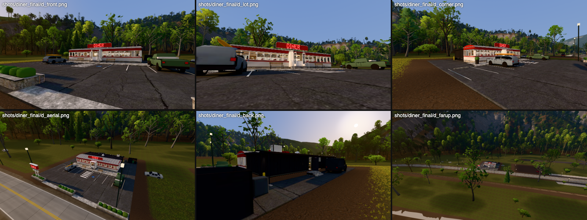
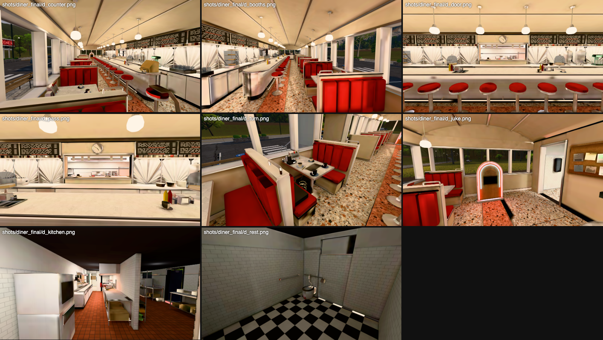

# The diner (Sourwood, N.C.)

Status: built, baked and placed, 2026-10-22 (wave 2, town building workstream `diner`).
It is a walk-in at the mansion's fidelity on the strip at the highway end of town, site `diner` in `laurel_town.py`.



*Outside (Metal, q3, golden hour): the lot from the road; low in the lot; the west corner; from above; the service yard behind the annex; the far version at about 115 m.*



*Inside: down the counter from the east end; down the booths from the west end; the back-bar from the vestibule; the pass-through into the kitchen; the booth by the door (the turn); the jukebox, the bulletin board and the restroom hall; the kitchen; a restroom.*

## Which diner, and why

**A restored 1950s-style stainless dining car, trucked in and set on a fieldstone plinth, with a black board-and-batten kitchen annex behind it.** The car is the Northeast's prefabricated dining car (O'Mahony, Kullman, Silk City). The annex, stone and standing-seam roof are the mountain town's polish.

- **It is a real pattern.** Prefabricated cars were built to travel by truck or rail, and restored ones still get moved to new towns. The clearest case is the **Road Island Diner** (Jerry O'Mahony car No. 1107, 1939, 60 x 16 ft, Streamline Moderne). It was shown at the 1939 World's Fair, ran for decades in Fall River, Mass., and Middletown, R.I., was bought in 2007 and moved to **Oakley, Utah**, a small mountain town. It reopened there after a year of restoration (NRHP 2009). Sourwood's car is the same idea in the Blue Ridge. North Carolina has its own moved car: **Sam's Diner** in Kill Devil Hills, a c.1940 Kullman car relocated in 1996.
- **It fits "too nice for its size"** (brief section 1). Somebody paid to bring a $500k restored car to a town of this size and fitted it out properly: new terrazzo, new opal pendants, an espresso machine behind the counter, ADA restrooms, a paved lot with an accessible stall. It is a tourists' destination, like the outfitter and the inn.
- **It is cinematic in its own register.** The bar is the dark roadhouse. The diner is the bright, clean, everyone-is-friendly place: chrome, red vinyl and neon, with a waitress who never stops watching the door. The town looks safest here.
- **The program fits the car.** O'Mahony's plan for a 16 ft car puts the door in the middle of the long side. Booths run down the window side, the counter and stools down the middle, and the back-bar along the back wall with a pass-through to the kitchen. That gives every item the brief asks for without inventing a building.

**References:**
- **Road Island Diner** (O'Mahony #1107, Oakley UT): the type, the 60 x 16 ft size, the relocation.
- **Mickey's Dining Car** (St. Paul, 1937 O'Mahony): the enamel letter band over a ribbon of windows, and the counter-and-stools interior.
- **The Modern Diner** (Pawtucket R.I., 1940 Sterling Streamliner): the stainless skin and stripes.
- **Miss Worcester** and the **Blue Benn**: Worcester Lunch Car and Silk City interiors. Back-bars with sunburst stainless, cracked-ice laminate, booths with wall boxes.
- **Sam's Diner** (Kill Devil Hills, N.C.): a moved car in North Carolina.
- The town's own polish references (brief section 1: Highlands, Blowing Rock): fieldstone bases, black board-and-batten, black standing seam, stone planters.

## What it is (asset frame: metres, origin at the lot's centre, front to the highway = -Y)

| part | what |
|---|---|
| **The lot** (30 x 30 m, the site) | asphalt (a Poly Haven scan), the highway's edge at y -15 with two driveway aprons; stone-edged planters along the road; 9 head-in stalls with white stripes and concrete wheel stops; an accessible stall (blue hatching, pictogram); a zebra walkway to the steps; a concrete walk along the car with two oak-and-steel benches, black planters and a bike staple |
| **The pylon sign** at the west drive | stainless posts on a fieldstone base; a red-enamel cabinet in a stainless band with **DINER** in red single-stroke neon on both faces; a chaser-bulb arrow pointing into the lot; **OPEN** in blue neon |
| **The car** (18.3 x 4.9 m, floor 0.54 m up three steps) | horizontal-fluted stainless skirt with two enamel pinstripes; a continuous ribbon of 24 windows between stainless mullions, curved corners; a porcelain-enamel letter band with chrome beads, an eave visor, a low barrel roof with seams and red gable ends; the roof sign (DINER in red neon, a blue underline); the centre vestibule (fluted skirt, glass-block sides, the doors hooked open, granite steps and chrome rails) |
| **The dining room** | terrazzo floor with a red band and brass strips under the stools; cream enamel wainscot, stainless sills, an enamel vault with stainless ribs. **8 booths**: high backs in channel-tufted red vinyl, cracked-ice tables with ribbed aluminium edges, a chrome wall box on every table. **The counter**: 11.7 m, rounded ends, laminate top, fluted stainless apron, chrome foot rail, and 16 chrome pedestal stools with red seats. **The back-bar**: stainless cabinets, sunburst stainless backsplash, a mug shelf with an under-light, menu letterboards (blank letter strips), two coffee urns, a jade malt mixer, toasters, plates, glass racks, the revolving pie case. **Pies** under glass domes on the counter (cherry lattice with a slice gone, coconut cream, lemon meringue, a layer cake). **The pass-through**: stainless sill, ticket rail with blank tickets, heat lamps, plates waiting, the clock over it. **The coffee station** at the east end (a two-warmer brewer, a matte-black espresso machine, cups, mugs). A brass register and a card reader. **The jukebox** at the west end (after a Wurlitzer 1015: arched walnut cabinet, bubble-tube arches in red and blue neon, a selection panel, a grille). **The bulletin board** (cork, blank papers and a flyer, an old photo). 16 opal schoolhouse pendants |
| **The annex** (17.7 x 6 m) | black board-and-batten on the car's fieldstone; a standing-seam shed roof with gutter, downspouts, the hood's exhaust fan and the walk-in's condenser; a frosted window per restroom, a kitchen window; the back door propped open over a three-step stoop, with a caged light |
| **The kitchen** | quarry-tile floor, subway tile. **The cook line** facing the pass: six-burner range (stockpot, pan), a flat-top griddle on a chef base (patties and buns on it), a charbroiler, two fryers (baskets), a dump station under a heat lamp, a worktable. **The hood**: baffle filters, lights, fire-suppression pipe. **The cold prep table** under the pass. **Back of house**: a three-compartment sink, the dish machine and table, a prep table with a stand mixer, wire shelving with dry goods. **The walk-in cooler** with its door and latch. Two reach-ins, an ice machine, aprons on hooks. The swinging stainless door with a porthole, hooked open |
| **The restrooms and the hall** | a terrazzo hall with coat hooks and a framed photo; two single rooms (checker floor, subway tile): wall-hung toilets with flush valves, basins, mirrors, grab bars, towel dispensers, bins, a changing table; pictogram plaques (no lettering) |
| **The yard** | a board-fenced dumpster enclosure (one gate ajar), a grease bin, bollards, a yard light |
| **The cars** | a blue-grey wagon with a kayak on its bars, in a front stall; a faded green crew-cab pickup; behind the annex, out of the highway's sight, **a plain charcoal cargo van** with glass only in the cab |

## The turn (environmental only, brief "The turn")

None of it is text. A player who has been in the house can read every piece of it.

- **The booth nearest the door, east side**, which sees the whole lot and the highway:
  - four coffee cups, a scanner radio with an amber display;
  - **a pencil sketch on squared paper of the estate's ground floor**, drawn from `plan.py`'s rooms, with a red route from the west lawn to the great room's glass and an X on the stair hall;
  - under the table, two black duffels, one open on zip ties and a coil of rope;
  - on the bench, a long hard case with **a white hard mask** (the invaders') lying on it.
- **The waitress's post.** Her stool stands alone past the counter's east end, turned to face the front door, with her cardigan over it. Her coffee (lipstick on the rim) is on the counter's end. **The wall phone's handset is off the hook** and laid on the counter by the register, its coiled cord stretched from the wall: a call in progress. This is where the waitress who watches the door would stand (the townspeople's AI is another workstream: put her post here).
- **Four handheld radios in a charging dock** on the pass's upper shelf, visible from the counter through the pass-through.
- **The van behind the annex**, parked where Main Street can't see it.

## How it's built

```sh
B=/Applications/Blender.app/Contents/MacOS/Blender
$B -b --factory-startup --python blender/town/diner/build.py -- --samples 1024        # ~4-8 min (GPU slot), writes the model
$B -b --factory-startup --python blender/town/diner/build.py -- --no-bake --no-export --render counter,front   # Cycles previews only
PY=/Applications/Blender.app/Contents/Resources/5.0/python/bin/python3.11
$PY blender/wilderness/levels/laurel_town.py --steps world            # picks up the sidecar (colliders, kit_offset)
$PY blender/town/diner/tools/views.py                                 # the preview cameras as wild_shots views (d_*)
node viewer/tools/wild_shots.mjs diner --world laurel_town --extra blender/town/diner/views.json --views d_front,d_counter,...
GT_BASE=... node blender/town/diner/tools/walk.mjs                    # four routes with the real player
http://localhost:8765/viewer/wild.html?world=laurel_town&view=diner_lot   (or &view=diner_room)
```

- **The generator** is `blender/assets/town2_diner.py`, with its `P` (layout, colours, cars) and `build()`. The parts are:
  - `_car` (the shell), `_annex`, `_rest` (restrooms, the kitchen door), `_fit` (the dining room), `_kitchen`, `_site` (lot, signs, neon glyphs), `_props` (table sets, the turn), `_cars`, `_lod` (the far version);
  - `_geo` (bmesh primitives, path sweeps, flutes, single-stroke neon, decal quads, and the `Parts` registry with tint, density weight, zone, colliders and sheen);
  - `_mats` (the palette and the generated or scanned textures), `_decals` (the decal atlas).
- **One material per role, merged per material at export: 17 meshes inside the 25 budget.** Variation comes from a linear vertex tint (COLOR_0) and world-scale box UVs. The materials are:
  - paint, steel (brushed), chrome, terrazzo, checker, laminate (cracked ice), quarry, subway, stone, asphalt, concrete, wood, decal;
  - glass;
  - three emissives: neon red, neon blue, lamp warm / lamp cool.
- **Hidden faces are deleted before UVs.** That covers faces under the floors, inside the wall cavities and above the vault. `town2_diner.dead_volumes` lists the volumes; 983 faces go.
- **Lightmap: one 2048 x 1024 atlas.** The left square holds the interior, the right square the exterior.
  - UVs: smart-projected at one texel density (times a part's weight: the lot 0.3, small props 0.2-0.4), then packed with an absolute 3 px margin. A relative margin left the atlas 90% empty with 13k islands.
  - The bake is in Cycles: the golden look's sun (0.94, 0.12, -0.32) at 6, a horizon-to-zenith sky at 0.85, a ground plane round the lot, plus the diner's own lights. Those are 16 pendants (point lights in the globes, the globes hidden), back-bar strip lights, kitchen troffers and hood lights, restroom discs, heat lamps, the jukebox and the yard light. The neon emits in the bake, and the glass is hidden so the sun comes in.
  - Non-metals bake DIFFUSE (the light). Metals bake their GLOSSY pass (reflections seen along the normal). Steel is 35% gloss and 65% diffuse, chrome 75% gloss, and they export as non-metals: the town runtime has no environment map, so a metal would render black.
  - Denoising is Open Image Denoise. The atlas is stored as sRGB of light / scale, and `lightmapIntensity` = pi x scale (MeshStandardMaterial gives colour x lightmap x intensity / pi).
  - Fluting and the back-bar's sunburst sit below the lightmap's resolution. They get a per-face "sheen" tint (faces that look up are brighter) so they still read.
- **LOD1**, `Town2Diner_LOD1` (lodDistance 90 m): about 1.5k triangles of plain volumes. The full building's look is baked onto it (COMBINED, selected to active, 0.25 m cage) into one 512 emissive map, so the windows carry the lit interior and the neon its glow.
- **The sidecar** `assets/models/town2_diner.json` holds:
  - the footprint (the 30 x 30 lot: the world builder flattens that pad);
  - 169 colliders in the Blender frame: walls split at every door and window, the floor slabs, steps, the counter, every booth, stool, table, piece of kitchen equipment, restroom fixture and car, planters, benches, signs;
  - the entrances (the front door, the kitchen's back door).

## Numbers (measured)

| | diner | budget (prompts/town_building.md) |
|---|---|---|
| triangles | 135.8k LOD0 (interior included), ~1.5k LOD1 | 60-150k |
| draw calls | +17-19 in view (17 meshes, LOD1 instead beyond 90 m: 1) | <= ~25 |
| GPU textures | 19.5 MB: lightmap 2048 x 1024 11.2 MB, 4 x 512 maps, 8 x 256 maps | <= ~20 MB |
| download | 1.8 MB (glTF + Draco bin 1.3 MB, WebP textures incl. the lightmap 0.5 MB) | <= ~6 MB |
| bake | ~4 min at 1024 spp on the M4 Pro (lightmap + glossy + far map) | |

`wild_bench.mjs` (`WILD_QS="&world=laurel_town"`) took the views `diner_lot`, `diner_room` and `strip`, with the diner and without it (its sidecar moved aside). The machine was at load 31-46 with other agents' builds running.

| | without the diner | with it |
|---|---|---|
| M4 Metal 2400x1350 q3, render+finish (diner_room) | 2.35 ms | 3.02 ms |
| M4 Metal 2400x1350 q3, render+finish (diner_lot) | 2.31 ms | 2.21 ms |
| M4 Metal 2400x1350 q3, render+finish (strip) | 2.19 ms | 2.78 ms |
| draw calls | 30-33 | 48-52 |
| triangles | 475-623k | 606-660k |
| SwiftShader 1280x720 q0 (diner_lot) | 79 ms | 158 ms |
| SwiftShader 1280x720 q0 (diner_room) | 97 ms | 255 ms |
| SwiftShader 1280x720 q0 (strip) | 148 ms | 187 ms |

SwiftShader inside the diner is over the 200 ms line under this load. The kit town's own bench at load ~31 read 204-317 ms, so re-measure on a quiet machine.

Tests:
- `blender/town/diner/tools/walk.mjs` **PASS**, with the real wild player at 60 Hz walking every leg:
  - front: lot, steps, aisle, behind the counter, kitchen door, kitchen, back of house, back door, yard (14/14);
  - restrooms: hall and both rooms (13/13);
  - staff loop: hall, staff door, kitchen, back to the counter (14/14);
  - round the lot and the yard (7/7).
- Feet are at 0.54 m on the car's floor, -0.07 on the lot.

## Hooks in other files (small, marked `[diner]`)

- `blender/wilderness/levels/laurel_town.py`:
  - `KIT["site_diner"] = (30, 30, 6.2, ...)` on its own line;
  - the diner's `F(...)` front at y -721.5 (the lot meets the highway's edge);
  - two views, `diner_lot` and `diner_room`.
- `viewer/wild/town.js` `loadSites` / `update`:
  - **one texture per lightmap file.** Every lightmapped material names the same atlas, and loading it per material uploaded 13 copies, about 145 MB. The bar and the gas station hit the same issue.
  - **A site's `<Root>_LOD1` node** shows beyond its `lodDistance` (node extras, default 90 m) and hides the rest; the comment promised this but `update()` didn't do it.

## Not done / known limits

- **The cars are lofted bodies at ~2-3k triangles.** They read as cars at lot distance but look simple up close. The town's kit vehicles (500 triangles) and the mansion's EV (40k) were too low and too heavy respectively.
- **No interactables in the wild runtime.** Doors are modelled open (the vestibule doors hooked back, the kitchen door hooked open, the restroom and staff doors open, the back door propped). The walk-in cooler's door is closed, and its inside isn't modelled.
- **One lighting state.** Golden hour with the diner open. A dusk look, or the lights going out at alarm 3 (brief section 6), needs an off bake, as the mansion does.
- **Static metal.** Reflections are baked along the normal, not view-dependent. A small env-map hook in `loadSites` (an equirect from the bake) would make the chrome move with the eye, at one texture's cost.
- **No aerial perspective.** The site's MeshStandardMaterials don't get the wild runtime's haze, so the far version is slightly crisper than the terrain at 300 m or more.
- **The waitress and townspeople** are the invader-behaviour workstream's. Her post is the stool at the counter's east end, at asset (6.35, 3.05), facing the door.
