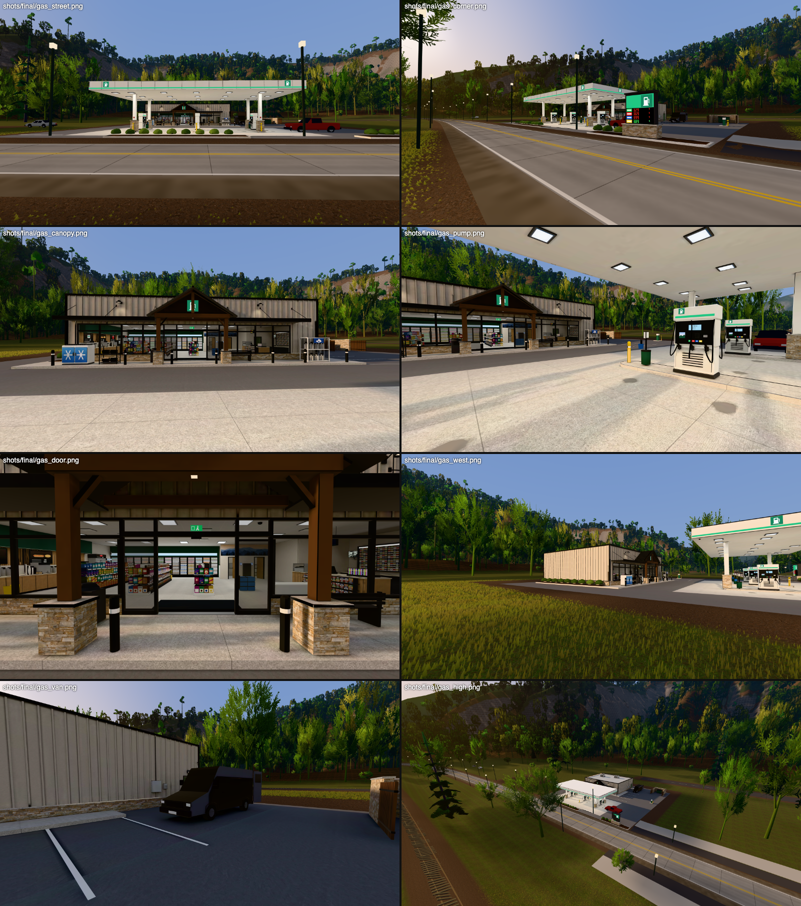
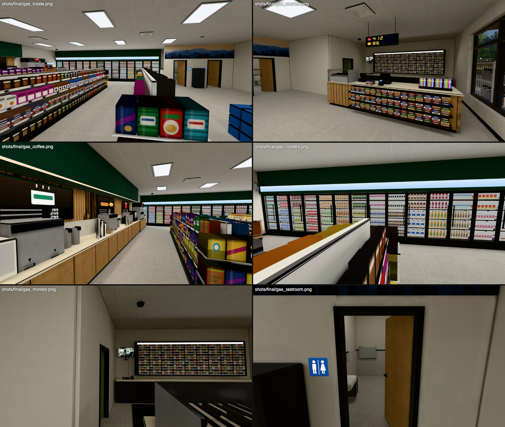

# The gas station (town2_gas)

Status: built, lightmapped and placed, 2026-10-22 (wave 2, the town-building workstream). It replaces the kit's `town_gas_station`, and none of that one's look is reused.




*In-engine shots (`viewer/wild.html?world=laurel_town`, golden LOOK, `&veg=0`).*
- Outside: the street, the east corner with the price sign, the store from under the canopy, a pump, the entry portico, the sunlit west side, the van out back, from the hill.
- Inside: down the aisle to the coolers, the cash wrap, the coffee bar, the cooler wall, the security monitor by the tobacco wall, a restroom.

## What it is

Sourwood's station at the highway end of Main Street, on the north side. It is a small-town independent of the kind that has been rebuilt with tourist money. The canopy and pumps look like a Shell or Marathon-branded independent but carry no brand: a white fascia, a green accent band and a pump pictogram. The store is small-format, with a Sheetz/Wawa interior scaled down to about 280 m².

The building takes the mountain-town polish from Blowing Rock, Highlands and Cashiers:
- a ledgestone base and stone-wrapped canopy columns;
- light board-and-batten;
- a black storefront under a steel awning;
- a heavy-timber gable portico over the entry, with cedar posts on stone piers, a king-post truss and a black standing-seam roof.

**References matched:**
- The canopy and forecourt: a modern 16 ft canopy with LED flat-lens fixtures, as on any Marathon/Shell rebuild.
- The dispensers: Gilbarco Encore / Wayne Anthem multi-product units. Each has a white hydraulics cabinet, a dark glass head with an LCD, a card reader and a media screen, three nozzles a side and an ad topper.
- The coffee bar and roller grill: a small Wawa / Sheetz.
- The cooler wall's scale and glow: Buc-ee's.
- The small independents' cash wrap: an oak front and a quartz top, with the scratch-ticket case, the jackpot sign hung over it and the cigarette wall behind.
- The outdoor fixtures: a Leer-type ice merchandiser and a Blue Rhino-style propane exchange cage.

## Layout

The station's frame is metres, origin at the lot's floor centre, front at -Y toward Main Street. The lot is 44 x 40 m and fully paved. Its site in `laurel_town.py` is now 44 x 40 m, front on the road's edge at estate y -720.6, centre x -1880.

| part | where (local) | what |
|---|---|---|
| road strip | y -20..-18.5 | two driveways (x -22..-11, 2..12); curbed beds of clipped boxwood; the monument price sign at x 17.5 (ledgestone base, pump mark, four LED price lines; both faces) |
| forecourt | x -16.5..10.5, y -18..-4 | broom-finish concrete (saw-cut joints), oil stains at the pumps |
| canopy | x -15..9, y -16.5..-5.5, clear 4.9 m | white fascia with seams, a green LED band all round, pump marks; 21 flat-lens LEDs; 4 columns (white steel on ledgestone wraps, an E-stop, an extinguisher); 2 camera domes |
| islands | x -11, -3, 5 (6.6 m, bullnose) | a dispenser each (the east one with a green diesel nozzle), safety bollards, a trash and squeegee stand |
| store | x -16..4, y 3.2..17.2, floor +0.15, ceiling 3.35, parapet 5.2 | stone base (0.65 m) with a cast cap; board-and-batten with real battens; black coping; two rooftop units |
| storefront | bays x -15.2..-8.8 and -4.4..1.6, entry -8.8..-4.4 | black aluminium; auto sliding doors parked open; awning with tie rods and downlights; the timber portico; gooseneck lights |
| sidewalk | y 1..3.2 | ice merchandiser, firewood rack, trash can, bench, propane cage, black bollards |
| side lot | x 6..22 | five head-in stalls; the air machine on its pad |
| back lot | y 9..20, east | **the van**, the dumpster enclosure (ledgestone, cedar gates open), the stockroom's steel door propped on a cinder block, a wall pack, meters, a bullet camera |

**Inside**, in the store-local frame:
- **Coffee bar** (west wall, y 4.3..11.4):
  - oak cabinets under a quartz top, with a tile backsplash and an oak slat wall;
  - a green soffit with an under-light;
  - three menu boards (pictures and prices, no words);
  - three brewer stations with decanters and airpots, cup towers, lid racks and a cappuccino machine.
- **Fountain and frozen drinks** (y 11.6..14.6).
- **Cooler wall** (north, 14 doors). Each door has five shelves of drinks: emissive cards of bottles, cans, cartons and beer cases, in two rows for depth. A frost light-box header runs above the doors.
- **Three gondolas** (chips; snacks and candy; auto and household) with price strips and end caps. The goods are boxes textured from a packaging atlas: six bag designs over sixteen colours, candy, boxes, pouches, jugs, and no words.
- **Cash wrap** (east). It carries the register and customer display, the card reader, the scratch-ticket case (lit), the lottery terminal, the roller grill under its sneeze guard, and an impulse candy rack on the customer face. The jackpot sign hangs over it.
- **Behind the counter:**
  - the back counter and the tobacco wall (packs in a grid, a lit header);
  - the **security monitor** on its arm, facing the store;
  - the **CB radio** on the back counter, with its mic on a coiled cord, a power supply and a mug.
- **Other fixtures:** an ATM, an ice-cream chest freezer, a stack of water cases, a wet-floor sign and the entry mat.
- **North-east:**
  - a Blue Ridge mural over two single-occupancy restrooms (the doors stand ajar; tile wainscot, toilet, basin, mirror, grab bars, dryer, changing station);
  - the **stockroom** (door ajar behind the counter): shelving of cased stock, a mop sink and bucket, a hand truck, a desk with a second monitor (the same feeds), and a stack of the same black crates that are in the van;
  - exit signs and the back door.

## The turn (environmental only)

- **The van out back:** a dark high-roof cargo van, nose south, beside the stockroom door. Its rear doors swing open. Inside are black plastic crates, duffels, a coil of rope and a blue tarp. The same crates are stacked inside the stockroom door.
- **The security monitor** shows a four-camera DVR view: the pumps, the door, the register, and the back lot with the van in it.
  - The feeds are rendered from the station itself (make.py `render_feeds`). They are washed, greenish, vignetted and scan-lined, with a blank time bar.
  - The same feeds are on the stockroom desk's monitor. The clerk watches the van.
- **The CB radio** on the back shelf (brief item 5).

## How it is built

```sh
# build + lightmap UVs + Cycles bake + CCTV feeds + export (+ sidecar); ~3 min at 512 samples, ~2 at 64
/Applications/Blender.app/Contents/MacOS/Blender -b --factory-startup --python blender/town/gas/make.py -- --samples 512
# one iteration: the above, the town world step (colliders, placement), eye-height shots
GT_BASE=http://localhost:<port> bash blender/town/gas/cycle.sh <label> [samples|0] [views]
```

**`blender/assets/town2_gas.py`** holds the layout, the lot, the canopy, the shell (walls split round openings, battens, coping), the storefront, the portico, the yard and the LOD1.

**`town2_gas_out.py`** holds the outdoor pieces:
- the dispenser, island, column and stand;
- the monument sign, ice chest, propane cage, firewood, air machine, trash can, bench, shrubs and beds;
- the rooftop units, the dumpster enclosure and the van.

**`town2_gas_in.py`** holds the interior.

**`town2_gas_kit.py`** is the geometry kit:
- brushes write straight into one bmesh per (zone, material);
- UVs are world-scale box UVs, or atlas cells;
- transform stack, colliders and bake lights;
- per-face lightmap weight `lmw`;
- lightmap groups: a shelf's goods share one chart, split by facing.

**`town2_gas_mat.py` and `town2_gas_tex.py`** make the materials and textures:
- Poly Haven scans (CC0, fetched into `build/town/gas/ph/`), tinted: `brushed_concrete_03`, `clean_asphalt`, `rustic_stone_wall_02` (ledgestone), `white_oak_veneer`, and `terrazzo_tiles` (laid as 60 cm tiles).
- Painted in numpy:
  - the paint palette: 54 swatches with a roughness map, one material for every flat colour;
  - the goods atlas, including the mural;
  - the cooler cards;
  - the emissive sign atlas (LED panels, price digits, pump screens, menu boards, pictograms, lottery, the CCTV quad).

**`blender/town/gas/make.py`** runs the pipeline:
1. **Lightmap UVs.** Smart-project cuts the charts. Each chart is measured in metres, weighted, and skyline-packed by the project's packer (`common._skyline_pack`).
2. **Bake.** Cycles DIFFUSE (direct + indirect) per zone, OIDN-denoised (bake.py's `denoise`).
   - Encoded as bake.py does: sRGB of light / scale (the 99th percentile), with `lightmapIntensity = pi x scale`.
   - Lit by the golden LOOK's sun and a sky gradient (the LOOK's colours half-way to grey, x 1.5 strength, to sit with the wilderness runtime's ground). A warm surround plane gives the bounce.
   - The station's lamps are area lights (canopy LEDs, troffers, a glow per cooler door, the coffee soffit, the tobacco header, restrooms and stockroom, the roller grill) and spots (awning, goosenecks, portico, the back door's wall pack). The emissive meshes and the glass are hidden from the bake.
3. **Reflections.** Two 256 x 128 panoramas: inside, and under the canopy.
4. **Extras and export.** Material extras: `lightmap`, `lightmapIntensity`, `envMap`, `envMapIntensity`. The LOD1 node's `lodDistance` is 140 m.

**Zones:**
- `ext`, lightmap 1024²;
- `int`, lightmap 2048 x 1024;
- `lod1`, lightmap 256²;
- `*_g`: unlit (emissive, glass), no lightmap.

## Numbers

**Triangles.** LOD0 is about 75.7k:

| part | triangles |
|---|---|
| outside | 24.9k |
| inside | 49.6k |
| emissive and glass | 1k |

LOD1 is 132 triangles.

**Draw calls:** 16 near (LOD0); 6 beyond 140 m (LOD1).

| zone | materials |
|---|---|
| ext | asphalt, concrete, stone, siding, paint, goods |
| ext_g | glass, signs |
| int | floor, ceiling, paint, oak, goods |
| int_g | glass, signs, drinks |

**Lightmap density:** ext 21 texels/m at weight 1 (the lot at 0.3, the roof and canopy top 0.1-0.15); int 39 texels/m.

**Download:** 1.5 MB (bin 676 KB Draco; textures 0.85 MB WebP).

**GPU textures:** about +24 MB. The town measured 104 MB without the station (`&veg=0`) and 127.8 MB with it.
- The lightmaps are about 12.6 MB (no mip chain: the town.js hook).
- The material maps are 512 px or less.
- The two panoramas are small.

This is a little over the brief's ~20 MB. The interior lightmap at 1536 x 1024 would save about 2 MB.

**Bench** (`WILD_QS="&world=laurel_town&veg=0" node viewer/tools/wild_bench.mjs gas_final --views gas_lot,gas_store,strip,main_street --no-walk`):

| profile | measure | gas_lot | gas_store | strip | main_street |
|---|---|---|---|---|---|
| M4 Metal 2400x1350 q3 | render (ms) | 2.07 | 2.47 | 2.15 | 2.65 |
| M4 Metal | GPU (ms) | 2.0 | 2.0 | 1.7 | 1.7 |
| M4 Metal | calls | 44 | 44 | 44 | 33 |
| M4 Metal | triangles (max) | 490k | 593k | 582k | 568k |
| SwiftShader 1280x720 | first run (ms) | 99 | 147 | 180 | 81 |
| SwiftShader | second run (ms) | 187 | 318 | 91 | – |

- The SwiftShader runs were made with the machine at a load of 18-21, which made them very noisy. With `&town=0` the same views read 110 / 93.
- Treat the soft numbers as indicative. On a quiet machine they should be rerun against the ≤ 200 ms gate.

**Walk-in:** `node viewer/tools/wild_walkin.mjs gas` PASSES (2.5 m inside, feet on the floor). The sliding doors are open and the sidewalk and floor are colliders. The van, the gondolas, the counters, the coolers and the partitions all collide. Restroom and stockroom doors stand ajar, and the back door is propped open.

## Known limits / next

- **Lighting:**
  - The van reads dark in the store's evening shadow. That is intended (a dark van), but it is close to black at a distance.
  - The back lot's shade is bluish.
  - Golden hour only. A dusk LOOK would want the canopy and store as the main light, and they are already baked in.
- **The town's kit pickup** (`laurel_town.VEHICLES` `("pickup", -1868, -713, 0)`) now stands just east of the canopy. Parked at a pump it would read better: estate (-1885, -711.6), yaw 90, beside the middle island on its west side.
- **The townspeople post** "gas attendant" (`PEOPLE`, x -1880, y -713) is on the forecourt. Behind the counter is estate (-1878.4, -694.2): the sidecar `marks.clerk` is (1.6, 6.4) local.
- **Not modelled:** a car wash and pole lights.
- **No interactables:** the wild runtime has no interactables, so the doors are static, open.
