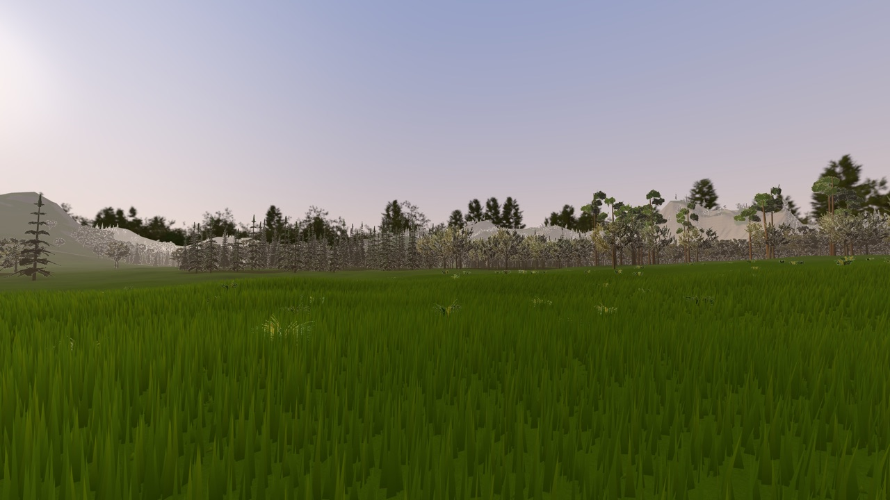
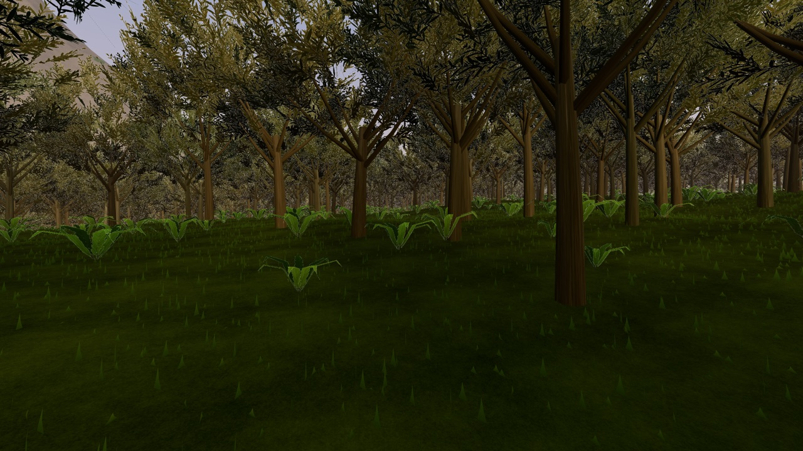
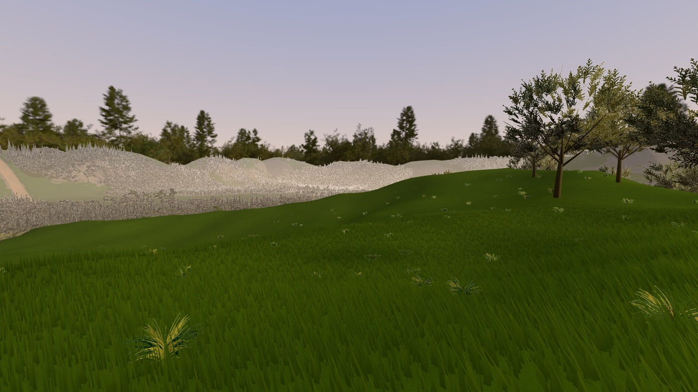
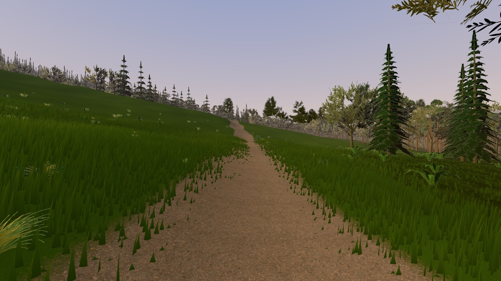
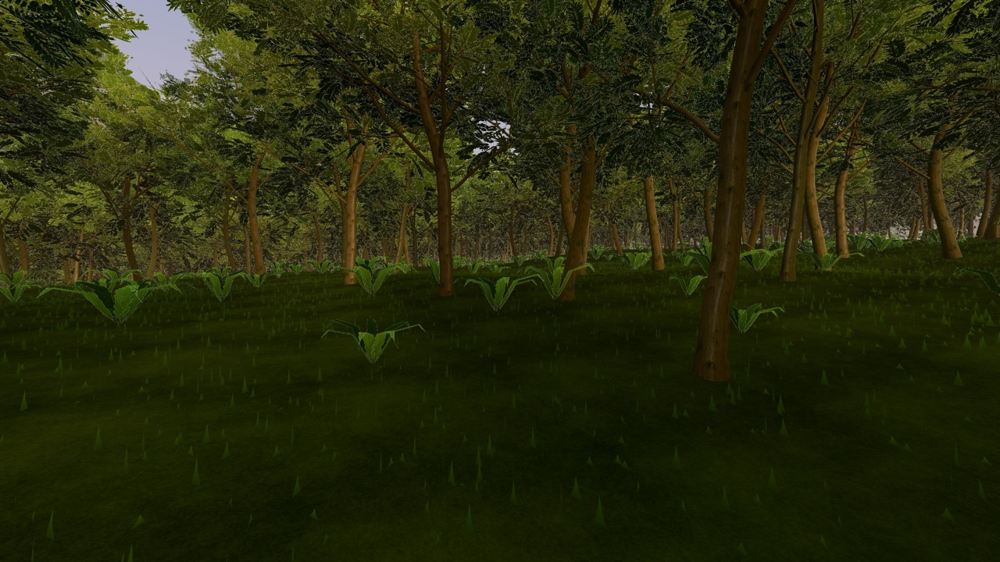
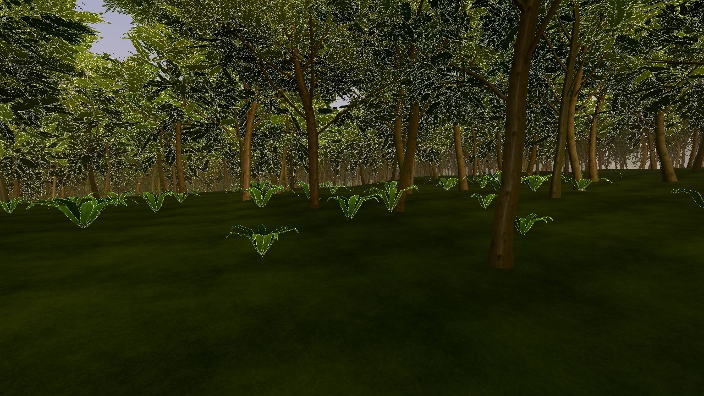
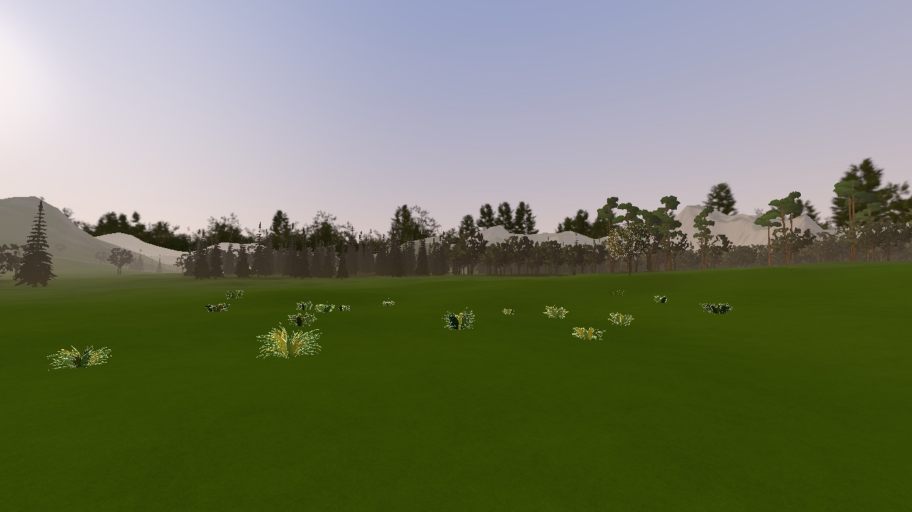
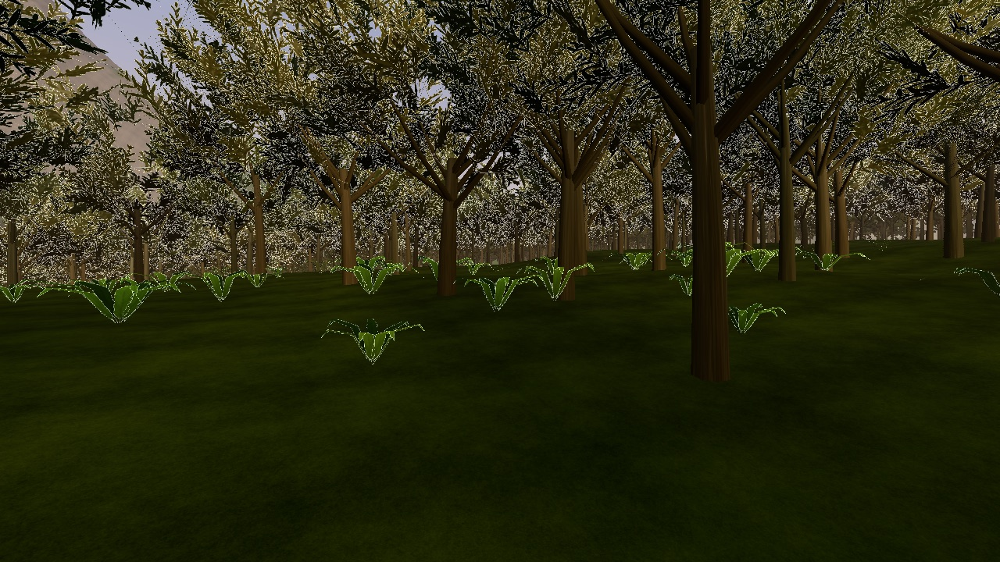
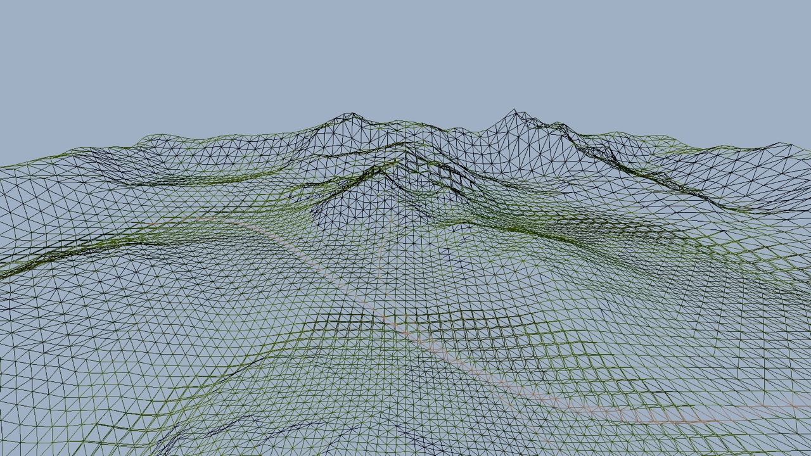

# Wilderness runtime spike (browser, three.js 0.160)

Status: spike, 2026-10-21. Concept-agnostic. Question: can a 1.5-2 km wilderness run in our
three.js stack within a sane budget? It uses synthetic content (a noise heightfield and stand-in trees;
the real terrain and trees come from the other spikes). Nothing is committed, and no existing engine
file was changed.

## Answer

**Yes, with room to spare on a real GPU. On weak hardware it holds only with quality levels.**

- The whole 2 x 2 km world takes **11-14 draw calls** (house: ~296 mean / 850 peak). Terrain is 1
  call. Each tree species takes 3 (near mesh, mid mesh, impostor), each undergrowth plant 1, grass 2
  and the sky 1. Draw calls don't grow with the world or the tree count.
- M4 Pro, Metal, 2400x1350 (the game's 1.5x cap): **~1.7-2.9 ms per frame** for every view.
  That covers 40k trees, 166k undergrowth plants and ~80k grass blades drawn. Triangles peak at
  ~0.6M with the stand-in trees and ~1.8M with the production-weight trees from the vegetation
  spike, and that view still renders in 3.7 ms.
- SwiftShader (no GPU) at 1280x720: **~70-130 ms** at the automatic quality level (q0, MSAA off).
  The house's SwiftShader budget is ~300 ms (timed differently, see Numbers). At full quality with MSAA it's ~340-450 ms. What costs on weak
  hardware is foliage fill (impostors and alpha-tested crowns) and MSAA. Triangles and draw
  calls barely matter there.
- Memory and download: ~80 MB of GPU textures (house: ~375 MB budget). The generated world data
  would ship at ~6.8 MB (heights 4.6, splat + light 0.6, instances 1.6), and it could be ~2 MB (see
  "What doesn't scale").
- The terrain is crack-free. `viewer/tools/wild_cracks.mjs` looks through 120 cameras for background
  showing through seams and finds 0. That took a fix, described under Terrain below.

Numbers and screenshots are below. The recommended budgets are at the end.

## Run it

```
python3 -m http.server 8765        # from the project root (the tools start one if needed)
http://localhost:8765/viewer/wild_proto.html               # click to walk; F fly; 1-4 views; H overlay
http://localhost:8765/viewer/wild_proto.html?veg=1         # production-weight trees (build/wilderness/veg)
node viewer/tools/wild_bench.mjs <label> [--profile gpu,soft] [--views open,forest,ridge,spawn] [--no-walk]
node viewer/tools/wild_cracks.mjs                          # terrain seam test (must print 0)
node viewer/tools/wild_report.mjs <label> ...              # the markdown tables below, from the JSON
```

URL switches (all in the header of `viewer/wild/main.js`): `q=0..3` (quality), `aa=0|1`,
`trees=N` (40000), `bushes=N` (120000), `blades=N` per 8 m grass tile (4500), `res=` / `map=`
(heightfield / mask resolution), `grass=0`, `under=0`, `terrain=0` (for A/B tests), `near=` /
`mid=` (tree LOD metres), `fogd=` (fog density), `t=N` (freeze time), `view=open|forest|ridge|spawn`,
`pos=x,y,z&look=x,y,z`. `wild_bench.mjs` and `wild_cracks.mjs` take a `build/locks/browser_N` slot.

## Architecture

| file | what it does |
|---|---|
| `viewer/wild_proto.html` | the page (import map: three 0.160 from unpkg, as `index.html`) |
| `viewer/wild/world.js` | synthetic world: 2049² heightfield (1 m), 1024² splat and baked-light maps (2 m), tree and undergrowth scatter, named benchmark views. **Its header is the data contract for the real terrain generator** (see Hand-offs) |
| `viewer/wild/terrain.js` | CDLOD terrain: one instanced draw call, geomorphing, splat material |
| `viewer/wild/trees.js` | forest: stand-in tree builders, species atlases, impostor baker, per-cell instancing with distance tiers and dithered cross-fades, trunk colliders, `?veg=1` loader path |
| `viewer/wild/grass.js` | near-only instanced grass with wind |
| `viewer/wild/atmosphere.js` | shared fog / aerial perspective (from `sky.js`'s sky) and the sun + sky lighting term |
| `viewer/wild/player_hf.js` | `viewer/player.js` on a heightfield (subclass, ~30 lines) |
| `viewer/wild/main.js` | wiring, quality levels and governor, walk/fly controls, debug overlay, `window.__wild` |
| `viewer/tools/wild_bench.mjs`, `wild_cracks.mjs`, `wild_report.mjs` | benchmark, seam test, report tables |

### Terrain: CDLOD, one draw call, no cracks
- There is one 8x8-quad grid patch. Each frame it's instanced over the quadtree nodes picked for the
  camera (Strugar's CDLOD: a node is drawn at level *i* inside range *i*, ranges double: 64, 128,
  256, 512, 1024, 2048 m, then the root). The vertex shader displaces the grid from an R32F height
  texture (4 `texelFetch` per vertex, bilinear by hand, so every platform gets identical heights). Near the end
  of its range a node's odd vertices slide onto their even neighbours (geomorphing). At a seam the
  fine side's vertices then sit exactly on the coarse side's: no skirts, no T-junctions, no popping.
- The spacing is 1 m within 64 m, then 2, 4, 8, 16, 32 and 64 m (8 levels). A typical view draws
  290-330 patches of 128 triangles (~40k triangles). Node selection is part of the 0.2-0.4 ms of culling CPU per frame (terrain, trees and grass together).
- **The crack fix, and the rule to keep.** With 32 m leaf nodes the test found holes of 1-15k
  pixels on the synthetic mountains. A node reaches up to its 3D diagonal past its range. Where
  that crosses the next level's morph start, the coarse neighbour is already morphing, so the
  edges disagree. The rule is `node diagonal (3D) < morphStart x range`. With 16 m leaves
  (range0 = 64 m, morph from 60% of each band) there's room for ~2:1 height differences inside a node.
  The test then reports 0 over 120 views. Real terrain with taller cliffs inside one node needs
  either smaller leaves or the test re-run. `wild_cracks.mjs` is the check.
- Ground material: four tiling textures (the project's grass, hedge-as-leaf-litter, garage concrete
  as rock, gravel as packed earth) blended by the splat. Height blending (each layer's brightness is
  its height) keeps transitions crisp at the 2 m mask resolution. Rock is biplanar on steep faces,
  with a macro-variation channel on top. Lighting is **baked into a light map** (r: sun n·l x terrain
  shadow, g: tree shadows, b: sky visibility, a: terrain shadow alone). That's the wilderness
  version of the grounds' vertex bake (`sky.js` `applyOutdoor`): the runtime does no lighting work
  for the ground. The prototype computes the map in JS at load (~0.3 s, soft shadows marched
  toward the golden-hour sun, concavity AO, a soft ellipse per tree for its shadow). Production
  should bake it offline with the terrain (Blender/Cycles or numpy, like `bake.py`).
- Terrain texture reads per pixel: splat + light + 4 layers (+2 for rock on slopes). The low
  quality levels drop the biplanar rock and the height blend.

### Trees: instanced tiers with cross-fades
- Per species: a **near** mesh (0-42 m), a **mid** mesh (42-150 m, ~1/4 of the triangles) and a
  **lit impostor** (150 m to the end of view). Each tier is one instanced draw call. With
  production trees, which have separate bark and leaf materials, it's 2 per mesh tier
  (`?veg=1`: LOD0 0-20 m, LOD1 20-45, LOD2 45-105, then the impostor).
- Instances are bucketed into 64 m cells (sorted once at load). Each frame the visible cells are
  found (frustum test on the cell's box, including tree height), sorted front to back (better early
  depth rejection in forests) and copied into each tier's instance buffer. Cells wholly inside a band
  go in bulk; cells across a boundary are classified per tree. CPU: 0.2-0.4 ms per frame for 40k
  trees and 166k undergrowth plants. GPU: one `bufferSubData` per tier.
- **Cross-fade, no pops.** Neighbouring tiers overlap by a fade band (14 m near/mid, 25 m
  mid/impostor). Both draw there with complementary screen-space dither (interleaved gradient
  noise): every pixel a fading-out tier drops, the fading-in tier keeps. Everything stays opaque
  (alpha-test + alpha-to-coverage, no sorting).
- **Impostors** are baked at load from the near mesh: 8 azimuths into an albedo x AO atlas and an
  object-space normal atlas (256 px tall cells). At runtime they're cylindrical billboards that
  blend the two nearest views and light from the normal atlas with the same sun/sky equation as the
  meshes. A tree changes tier without changing brightness. Alpha keeps its coverage under
  mip-mapping (boosted per mip level, sharpened for alpha-to-coverage, as the vegetation spike found).
- Cheap variety: the per-instance seed stretches the width and height (±20% / ±12%) and tints the
  hue. Wind sway grows with height². Each tree takes its light from the light map at its root:
  terrain shadow on the whole tree, neighbours' shadows only on the lower crown.
- The stand-in meshes are deliberately simple and built in JS. Broadleaf: 7 branches, 230 leaf
  cards from the entry tree's sprig atlas, ~650 triangles. Conifer: 20 whorls of drooping needle
  fronds on a procedural needle texture, ~720. Pine: a bare trunk with tufted clumps, ~320. They
  share the house's leaf and bark textures and look plausible at 20 m+. The real trees come from
  `blender/wilderness/trees.py` (vegetation spike) and plug into the same tiers (`?veg=1`).
- Undergrowth (ferns in the forest, grass tufts in the open) is a near-only tier that fades out at
  48-62 m. It uses the courtyard foliage atlas, one draw call per plant.

### Grass
- One 8 x 8 m tile of 4,500 blades (3 triangles each, ~70 per m²), instanced over the tiles around
  the camera that pass the frustum test (≤38 m). It's two draw calls: the dense ring (every blade,
  ≤15 m) and the outer ring (the first third of the blades, wider). The blades are ordered by their
  random number. Any prefix is then an even subset, so the switch between rings is invisible. A
  density *d* from the splat keeps exactly the first *d* of them, and tiles with no grass at all
  (forest floor, rock, path) are skipped.
- Everything per blade happens in the vertex shader: root height from the heightfield, density
  from the splat, colour from a high mip of the terrain's grass texture (the grass matches the ground
  it grows from), light from the light map, a back-light term, and wind (a travelling gust front
  plus flutter). Beyond 38 m the terrain's own grass layer takes over (blades shrink to nothing
  before the edge).

### Sky, fog and aerial perspective
`viewer/sky.js`'s dome is reused as is (its horizon band still reads as far hills beyond the rim).
Every wilderness shader ends in `applyAtmosphere()`: exponential height fog, integrated
analytically along the view ray (denser in valleys, thinner on ridges). Its colour comes from the
same sky gradient in the same direction (horizon → zenith, sun glow) mixed with the look's haze, so
far ridges melt into the dome without a seam. The look is `mansion.json`'s "golden" (sun 6.0, (1,
0.7, 0.45), 18.7° up), and the house's Neutral tone mapping and exposure (0.95) are used. The world
edge is a 140 m rim of hills: the horizon is your own terrain.

### Walking: `viewer/player.js` on a heightfield
`HeightfieldPlayer` subclasses the house's player unchanged. The terrain becomes the player's
"ramp" (`rampHeight` → highest terrain under the footprint). Gravity, jump, crouch, step-up, coyote
time and the box colliders all keep working. Tree trunks are fixed box colliders (40k boxes in the
player's 4 m grid). Added: a walkable-slope limit (42°), since a heightfield has no walls. Test: a
12 s run along the trail at 6.8 m/s covers 81 m with the feet 0.007-0.127 m above the terrain under
the centre (the box rests on the highest footprint corner, by design).

### Quality levels and the governor
| level | trees: near / mid / impostors end | undergrowth | grass | pixel ratio | terrain / impostor shader |
|---|---|---|---|---|---|
| q3 (real GPU default) | 42 / 150 / 2,700 m | 48-62 m | dense 15 m, outer 38 m | 1.5 | full |
| q2 | 34 / 130 / 1,500 m | 40-51 m | 12 m / 30 m | 1.5 | full |
| q1 | 26 / 100 / 900 m | 30-38 m | 8 m / 20 m | 1 | cheap (no biplanar rock or height blend; impostors 1 view, no normal map) |
| q0 (software renderer default) | 18 / 70 / 500 m | 20-26 m | off | 1 | cheap |

Beyond the last impostor, forested ground fades to a canopy colour in the terrain shader, so the
hills stay wooded without drawing trees. A software renderer is detected before the context is made
(a throwaway WebGL2 context reads `UNMASKED_RENDERER`). It then starts at q0 with **MSAA off**, which
can only be chosen at context creation and is about half of a SwiftShader frame. Otherwise the house's governor
rule applies (inlined): one level down per 2 s window under 50 fps, never back up.

### Debug overlay
Top left (H toggles): fps, frame ms, quality level, draw calls, triangles, terrain patches per LOD
level, instances per species per tier, cells visible, grass tiles and blades, culling CPU ms and
position. `window.__wild.stats()` returns the same, plus triangles per mesh (`trisBy`).

## Numbers

Method: `wild_bench.mjs`. Per view, 20 warm-up frames, then a 2.5 s hold (gpu) / 4 s (soft) and a
360° pan (5 s / 8 s), uncapped. Then 30 (gpu) / 3 (soft) frames, each synced by a 1-pixel readback,
in the view's direction and three quarter turns. That synced time is the headline "render ms".
`gl.finish()` returns at once through ANGLE/SwiftShader, and SwiftShader's rAF intervals are
bimodal, so neither can be trusted. "GPU" is the timer query where the driver reports one. **These
numbers are not comparable 1:1 with `budgets.json`**, which times rAF intervals over the house
route.

Profiles: `gpu` = M4 Pro, Metal, 1600x900 DPR 2 (renders 2400x1350); `soft` = SwiftShader 1280x720
DPR 1. Views (found from the data in `world.js`): **open** (a meadow facing the highest ridge and the
low sun), **forest** (the densest forest cell, ~600 stems/ha at the core), **ridge** (the highest
bare crest, looking out along the most open azimuth), **spawn** (the trail start, forest edge).

| run | profile | q | MSAA | view | render ms mean (worst dir) | GPU p50 ms | draw calls | triangles max | trees drawn near / mid / far | grass blades |
|---|---|---|---|---|---|---|---|---|---|---|
| base | gpu | 3 | on | open | 1.65 (1.98) | 1.21 | 11 | 392k | 0 / 43 / 16507 | 72k |
| base | gpu | 3 | on | forest | 2.94 (3.4) | 2.68 | 12 | 571k | 196 / 663 / 5508 | 50k |
| base | gpu | 3 | on | ridge | 1.78 (2.01) | 1.18 | 11 | 406k | 1 / 39 / 6900 | 83k |
| base | gpu | 3 | on | spawn | 2.1 (2.31) | 1.62 | 14 | 456k | 11 / 300 / 15929 | 83k |
| base | soft | 0 | off | open | 70.46 (75.7) | - | 8 | 53k | 0 / 1 / 1722 | 0 |
| base | soft | 0 | off | forest | 130.11 (148.2) | 119.7 | 10 | 158k | 51 / 331 / 3141 | 0 |
| base | soft | 0 | off | ridge | 76.38 (87.53) | - | 7 | 55k | 0 / 1 / 3245 | 0 |
| base | soft | 0 | off | spawn | 92.38 (104.67) | - | 11 | 83k | 5 / 18 / 4243 | 0 |
| soft_q0_msaa `&q=0&aa=1` | soft | 0 | on | open | 149.35 (162) | - | 8 | 53k | 0 / 1 / 1722 | 0 |
| soft_q0_msaa `&q=0&aa=1` | soft | 0 | on | forest | 226.62 (247.83) | 199.26 | 10 | 157k | 51 / 331 / 3141 | 0 |
| soft_q1 `&q=1` | soft | 1 | off | open | 136.93 (163.4) | 150.27 | 10 | 185k | 0 / 6 / 8150 | 29k |
| soft_q1 `&q=1` | soft | 1 | off | forest | 188.98 (217.03) | 158.07 | 11 | 302k | 90 / 475 / 5533 | 18k |
| soft_q1 `&q=1` | soft | 1 | off | ridge | 153.64 (184.4) | - | 11 | 198k | 1 / 12 / 6817 | 41k |
| soft_q1 `&q=1` | soft | 1 | off | spawn | 139.76 (169.93) | 154.68 | 14 | 240k | 5 / 80 / 7168 | 33k |
| soft_q3 `&q=3&aa=1` | soft | 3 | on | open | 335.02 (470.3) | 477.87 | 11 | 392k | 0 / 43 / 16507 | 72k |
| soft_q3 `&q=3&aa=1` | soft | 3 | on | forest | 448.33 (577.43) | - | 12 | 559k | 196 / 663 / 5508 | 50k |
| soft_q3 `&q=3&aa=1` | soft | 3 | on | ridge | 339.18 (444.5) | - | 11 | 405k | 1 / 39 / 6900 | 83k |
| soft_q3 `&q=3&aa=1` | soft | 3 | on | spawn | 378.93 (554.53) | 561.85 | 14 | 450k | 11 / 300 / 15929 | 83k |
| veg `&veg=1` | gpu | 3 | on | open | 1.77 (2.04) | 1.23 | 14 | 384k | 0 / 0 / 9 / 16526 | 72k |
| veg `&veg=1` | gpu | 3 | on | forest | 3.66 (4.03) | 2.95 | 19 | 1.78M | 59 / 161 / 424 / 5699 | 50k |
| veg `&veg=1` | gpu | 3 | on | ridge | 1.84 (2.14) | 1.21 | 14 | 418k | 0 / 1 / 18 / 6925 | 83k |
| veg `&veg=1` | gpu | 3 | on | spawn | 2.65 (3.56) | 2.19 | 23 | 701k | 5 / 7 / 91 / 16042 | 83k |
| veg `&veg=1` | soft | 0 | off | open | 69.88 (74.2) | - | 6 | 53k | 0 / 0 / 0 / 1722 | 0 |
| veg `&veg=1` | soft | 0 | off | forest | 136.35 (152.03) | 121.63 | 14 | 452k | 13 / 46 / 177 / 3264 | 0 |
| veg `&veg=1` | soft | 0 | off | ridge | 75.68 (87.53) | - | 8 | 56k | 0 / 0 / 1 / 3245 | 0 |
| veg `&veg=1` | soft | 0 | off | spawn | 104.95 (138.97) | - | 17 | 126k | 2 / 5 / 7 / 4247 | 0 |
| trees20k `&trees=20000` | gpu | 3 | on | open | 1.63 (1.84) | 1.08 | 11 | 352k | 0 / 34 / 8407 | 72k |
| trees20k `&trees=20000` | gpu | 3 | on | forest | 2.38 (2.63) | 2.06 | 12 | 399k | 100 / 359 / 2718 | 50k |
| trees20k `&trees=20000` | gpu | 3 | on | ridge | 1.67 (1.79) | 1.01 | 12 | 361k | 1 / 13 / 3447 | 83k |
| trees80k `&trees=80000` | gpu | 3 | on | open | 1.95 (2.31) | 1.52 | 11 | 473k | 0 / 119 / 33179 | 72k |
| trees80k `&trees=80000` | gpu | 3 | on | forest | 3.76 (4.36) | 3.08 | 12 | 920k | 410 / 1436 / 10952 | 50k |
| trees80k `&trees=80000` | gpu | 3 | on | ridge | 1.97 (2.38) | 1.45 | 11 | 493k | 2 / 64 / 13897 | 83k |
| trees80k `&trees=80000` | soft | 0 | off | open | 98.85 (111.43) | 103.55 | 8 | 59k | 0 / 3 / 3520 | 0 |
| trees80k `&trees=80000` | soft | 0 | off | forest | 210.3 (236.07) | 235.2 | 10 | 261k | 95 / 676 / 6357 | 0 |
| trees80k `&trees=80000` | soft | 0 | off | ridge | 104.92 (129.53) | - | 8 | 61k | 1 / 4 / 6586 | 0 |
| blades9k `&blades=9000` | gpu | 3 | on | open | 1.98 (2.28) | 1.53 | 11 | 653k | 0 / 43 / 16507 | 144k |
| blades9k `&blades=9000` | gpu | 3 | on | spawn | 2.28 (2.49) | 1.86 | 14 | 708k | 11 / 300 / 15929 | 165k |
| nograss `&grass=0&under=0` | gpu | 3 | on | open | 1.53 (1.78) | 1 | 8 | 128k | 0 / 43 / 16507 | - |
| nograss `&grass=0&under=0` | gpu | 3 | on | forest | 2.81 (3.26) | 2.56 | 10 | 388k | 196 / 663 / 5508 | - |

| run | profile | load s | world gen ms | download MB | GPU textures MB | JS heap MB | trees | undergrowth | walk: frame p95 ms, feet above ground (m) |
|---|---|---|---|---|---|---|---|---|---|
| base | gpu | 1.4 | 881 | 5.79 | 79.9 | 120 | 40k | 166k | 2.8, 0.007..0.127 over 81 m |
| base | soft | 3.2 | 834 | 5.79 | 79.9 | 118 | 40k | 166k | 191.1, 0.007..0.04 over 26.6 m |
| soft_q0_msaa `&q=0&aa=1` | soft | 3.6 | 845 | 5.79 | 79.9 | 124 | 40k | 166k | - |
| soft_q1 `&q=1` | soft | 3.6 | 829 | 5.79 | 79.9 | 120 | 40k | 166k | - |
| soft_q3 `&q=3&aa=1` | soft | 3.4 | 827 | 5.79 | 79.9 | 121 | 40k | 166k | - |
| veg `&veg=1` | gpu | 1.6 | 881 | 6.91 | 74.5 | 123 | 40k | 166k | - |
| veg `&veg=1` | soft | 3.3 | 835 | 6.91 | 74.5 | 131 | 40k | 166k | - |
| trees20k `&trees=20000` | gpu | 1.3 | 861 | 5.79 | 79.9 | 119 | 20k | 166k | - |
| trees80k `&trees=80000` | gpu | 1.3 | 906 | 5.79 | 79.9 | 138 | 80k | 165k | - |
| trees80k `&trees=80000` | soft | 3.6 | 854 | 5.79 | 79.9 | 137 | 80k | 165k | - |
| blades9k `&blades=9000` | gpu | 1.3 | 870 | 5.79 | 79.9 | 124 | 40k | 166k | - |
| nograss `&grass=0&under=0` | gpu | 1.2 | 865 | 5.79 | 79.9 | 57 | 40k | 0 | - |

Shipping estimate of the generated data: heights 16-bit + gzip 4.59 MB, splat WebP 0.19 MB, light WebP 0.41 MB, 206k instances quantised + gzip 1.6 MB.

Triangles by system (base, gpu):

| view | triangles by mesh (instances x triangles each) |
|---|---|
| open | Grass_dense 108k, Grass_outer 108k, Terrain 42k, broadleaf_far 18k, conifer_far 9k, conifer_mid 6k, pine_far 5k, broadleaf_mid 3k, tuft_under 2k (total 302k) |
| forest | Grass_outer 149k, broadleaf_near 122k, broadleaf_mid 96k, Terrain 37k, fern_under 25k, conifer_mid 13k, pine_mid 7k, broadleaf_far 7k, conifer_near 6k, pine_far 2k, conifer_far 2k (total 465k) |
| ridge | Grass_dense 135k, Grass_outer 113k, Terrain 40k, broadleaf_far 10k, broadleaf_mid 6k, pine_far 2k, conifer_far 2k, tuft_under 2k, conifer_mid 2k, broadleaf_near 648 (total 312k) |
| spawn | Grass_dense 135k, Grass_outer 113k, broadleaf_mid 44k, Terrain 42k, broadleaf_far 16k, conifer_far 10k, conifer_mid 9k, pine_far 6k, broadleaf_near 5k, conifer_near 2k, fern_under 2k, tuft_under 2k, pine_mid 1k (total 387k) |

Reading the tables ("trees drawn" is near / mid / impostor; for `veg` runs it's LOD0 / LOD1 / LOD2 / impostor):
- **gpu**: every view is under 3 ms (synced), and draw calls are 11-14 (19-23 with production
  trees). 80k trees: forest view 920k triangles, 3.8 ms. 9,000 blades per tile (double the grass):
  +0.2-0.3 ms. Grass and undergrowth off: -0.1 ms. The M4 doesn't care about triangles at this scale.
- **soft**: q0 is 70-130 ms. The house is ~300 ms on the same profile. The forest view is the worst
  (alpha-tested crowns layered near the camera). MSAA alone doubles it (q0 with MSAA: 149 / 227
  ms). q3 with MSAA, what a naive port would ship: 335-448 ms. Earlier A/B runs (before the q0 cut-offs
  and the terrain fix; `trees=0&under=0&grass=0` and `terrain=0`): terrain + sky ~50 ms, trees and
  impostors ~280-350 ms, grass ~15% of a q3 frame.
- Load: world generation ~0.85 s in JS (heights 0.15 s, light map 0.33 s, masks + splat 0.25 s). That
  goes away when the data is baked offline and loaded. The forest build (atlases, impostor bakes,
  buffers) takes 86 ms (170 ms with production trees; 240 ms on SwiftShader). First frame at 1.2-1.6
  s on the M4, 3.2-3.6 s on SwiftShader.

## Screenshots

M4, q3 (left to right, top to bottom): open, forest, ridge, spawn (the trail out of the gate):

 
 

Production-weight trees (`?veg=1`: the vegetation spike's ash and fir, LOD0-2 + impostor) in the forest view, M4 q3 and SwiftShader q0:

 

SwiftShader q0 (no grass, impostors from 70 m, trees end at 500 m, then canopy colour), open and forest:

 

Terrain LOD rings (wireframe, no fog, 250 m up looking 25° down). The morphing keeps the
triangle density on screen roughly even, from the 1 m grid at the bottom to the coarse levels on the far hills:



## What scales and what doesn't

Scales (flat or nearly flat cost):
- **Draw calls**: per species x tier (x material), never per tree, per chunk or per km². A 4 km² world
  with 5 plant species is ~14 calls. Ten species with 2-material LODs would be ~50, still far
  under the house.
- **World size**: CDLOD patch count grows with log(size). Culling is per 64 m cell (1,024 cells at 2
  km; 0.2-0.4 ms CPU).
- **Tree count on a GPU**: 20k → 40k → 80k trees costs 2.4 → 2.9 → 3.8 ms in the forest view. Far trees
  are 2-triangle impostors.

Doesn't scale, or needs a decision:
- **Foliage fill on weak hardware.** Every alpha-tested pixel (crowns, impostors, ferns, grass) costs
  per pixel on software and integrated GPUs, and dense forests stack layers of it. The levers are the
  impostor distance and end, the undergrowth radius, grass on/off and MSAA. They're the quality
  levels. Opaque "crown shell" meshes inside dense crowns (vegetation spike idea) would cut the
  overdraw further.
- **Production tree triangles near the camera.** `tris ≈ Σ tiers (trees in band x tris per LOD)`.
  In the forest view (~600 stems/ha core) at q3, 59 trees fall inside the 0-26 m LOD0 band. With
  the vegetation spike's ash (11.5k LOD0) that's ~680k triangles from LOD0 alone, and 1.78M in total. It
  still renders in 3.7 ms on the M4. On SwiftShader (q0, LOD0 within 8-11 m) it's 136 ms. The
  lever is **LOD0 range x stem density**, not LOD0 triangle count. Halving the LOD0 range quarters
  its instances, and so does halving density. Recommended: keep LOD0 ≤ 20 m at real-forest densities
  (250-400 stems/ha), or ≤ 12 m if a concept wants thickets (600+/ha). LOD0 at 8-12k triangles is then fine.
- **The per-frame instance copy** grows with the number of trees visible. It's ~1 MB/frame
  (bulk `TypedArray.set`, 0.3 ms) at 40k trees, and ~2 MB at 80k. Past ~150k trees, keep per-cell
  static buffers and switch only the boundary cells, or stop updating while the camera is still.
- **Collapsed grass blades** still cost vertex work. Tiles with no grass are skipped and sparse
  tiles use the 1/3 subset, but a ~20%-density forest floor still runs the full tile's vertex
  shader on the dense ring.
- **Height data size.** An R32F 2049² height texture is 16.8 MB of GPU memory. As 16-bit gzip it's 4.6
  MB of download, the largest single item. Options: 1025² at 2 m with a procedural detail octave
  in the shader (1.2 MB, 4.2 MB GPU), or a half-float/16-bit-normalised texture (8.4 MB GPU). The
  light map at 2 m is soft near the player. Contact shadows under trees stay blobs (fine at golden hour, weaker at noon).
- **GPU texture memory** (~80 MB): ~17 MB of it is source textures kept only to build the species
  atlases. Dispose them after the bake, or ship the atlases. The tree atlases (3 x 7 MB) would be
  1024² WebP in production.
- **What a heightfield can't do.** Overhangs, caves, tunnels, vertical cliffs, bridges, quarry
  benches with sharp edges. Several concepts depend on these: `gorge`'s 170 m walls and the
  penstock, `karst`'s 1 km cave, `quarry`'s benches, `rewilded`'s culvert. They need meshes on top
  of the terrain: rock-wall kits or cave interiors as ordinary props (prop collision is box-based
  already; caves are rooms). They also need a **hole mask** to cut the terrain where a cave or tunnel
  mouth enters (a splat channel discarded in the terrain fragment shader, plus a collider gap). That
  isn't built yet, but it's cheap. The 42° slope limit becomes a feature there: steep terrain is a
  wall without a single collider.

## Recommended budgets (wilderness, per frame)

| item | budget | notes |
|---|---|---|
| draw calls | ≤ 40 | ~14 today; ≤ 6 species x 3-4 tiers x (1-2 materials) |
| triangles (q3) | ≤ 1.5M peak, ~0.6M typical | production trees in forests are the peak |
| GPU, M4 2400x1350 | ≤ 5 ms synced | today 1.7-2.9 (stand-ins), ≤ 3.7 (production trees) |
| SwiftShader 1280x720 (q0) | ≤ 200 ms synced, i.e. no worse than the house | today 70-130 (stand-ins), 70-136 (production) |
| culling + streaming CPU | ≤ 1 ms | today 0.2-0.4 |
| GPU textures | ≤ 150 MB | today 80 (incl. 17 disposable) |
| download (world data + vegetation) | ≤ 15 MB | today ~6.8 MB generated data + ~4 MB vegetation (veg spike) + textures |

LOD distances (q3; the quality table lowers them):

| | range | notes |
|---|---|---|
| terrain | 1 m to 64 m, doubling per level; 16 m leaves | geomorph over the outer 40% of each band; keep `diagonal < 0.6 x range` |
| trees, stand-in weight (≤1k tris) | near 0-42 m, mid 42-150 m, impostor 150 m+ | fades 14 m / 25 m |
| trees, production weight (8-12k LOD0) | LOD0 ≤ 20 m, LOD1 ≤ 45 m, LOD2 ≤ 105 m, impostor beyond | matches veg.json's lod_dist; 256 px impostor cells hold up from ~100 m at DPR 1.5 |
| undergrowth (ferns, shrubs < 1.5 m) | ≤ 50-60 m, fade 14 m | culled, no impostor |
| grass | dense ≤ 15 m, outer ≤ 38 m | ~70 blades/m² near; the terrain texture beyond |
| impostor end | 2.7 km (q3) / 1.5 km / 900 m / 500 m (q0) | canopy colour beyond |
| fog | density 0.0007/m at the valley floor, height falloff 0.006/m | 1 km ≈ 50% haze in valleys |

## Hand-offs

**Terrain generator → runtime.** `world.js`'s header is the contract. Today's in-memory fields map
directly to files:
- `heights`: a square, vertex-aligned grid (2049² at 1 m, or 1025² at 2 m), shipped as a 16-bit PNG or
  raw + gzip with a min/max in a JSON;
- `splat` RGBA8 (r grass, g forest floor, b rock, 1 - r - g - b scree/path, a macro variation): WebP;
- `light` RGBA8 (r sun n·l x terrain shadow, g tree shadows, b sky visibility, a terrain shadow):
  baked offline with the trees placed, WebP;
- `species`: per species Float32 (x, y, z, scale, rotY, seed), quantised to 16 bits + gzip (40k trees
  + 166k plants = 1.6 MB);
- `views` (optional): named camera spots for the benchmark.
Also expected: the world size and origin, and the hole mask when a concept needs caves or tunnels.

**Vegetation → runtime** (`?veg=1` is the working path). glTF per species with
`Veg_<Species>_LOD0..2` nodes, each a bark and a leaf primitive (2 draw calls per tier), AO in `COLOR_0`
(read as the per-vertex `ao`), crown-bent normals (not flipped on back faces). Trunk colliders come
from the instance data. Not used yet: `_WIND` (the runtime sways by height, so wiring it in is a
shader change), and the spike's 8x8 hemi-octahedral impostor atlases. The runtime bakes its own
8-azimuth atlas from LOD0 at load (part of the 86-170 ms forest build). **Converge on the spike's hemi-octahedral
atlas, baked offline.** It handles views from above (ridges, the gorge rims), where azimuth-only
billboards look thin. It moves the bake out of the load, and its normal atlas already matches.
The runtime's tiering, dither cross-fade and lighting stay as they are.

## Known gaps

- The trees are stand-ins, and the forest's spacing is a jittered grid (it reads as planted up close).
  Real scatter wants clustering, gaps and age classes. Several mesh variants per species would cost
  draw calls. Today's variety is per-instance stretch and tint.
- There's no hole mask, no rocks or boulders (they'd be another instanced tier), no water, no
  real-time shadows (all light is baked; only the sun-lit side of trees is computed live).
- The light map is computed at load. Production bakes it with the terrain.
- Grass doesn't bend around the player, and there's no footstep or material lookup for sound yet
  (the splat gives it for free).
- The governor only steps down. It can't turn MSAA off mid-game (context flag), so a slow real GPU
  keeps paying for MSAA. Ship SMAA like the house's `fx.js` if that matters.
