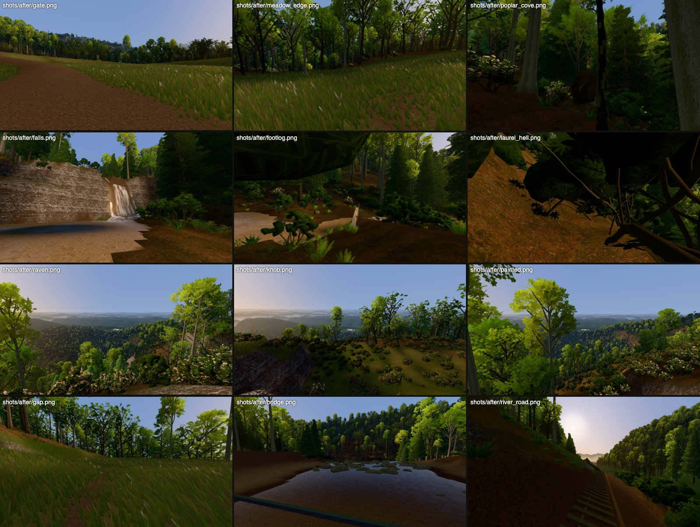
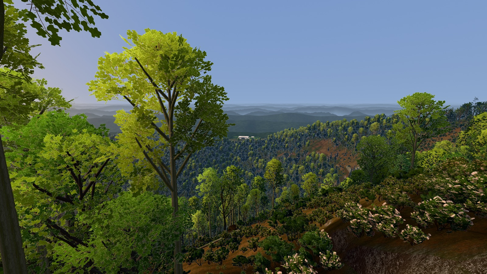
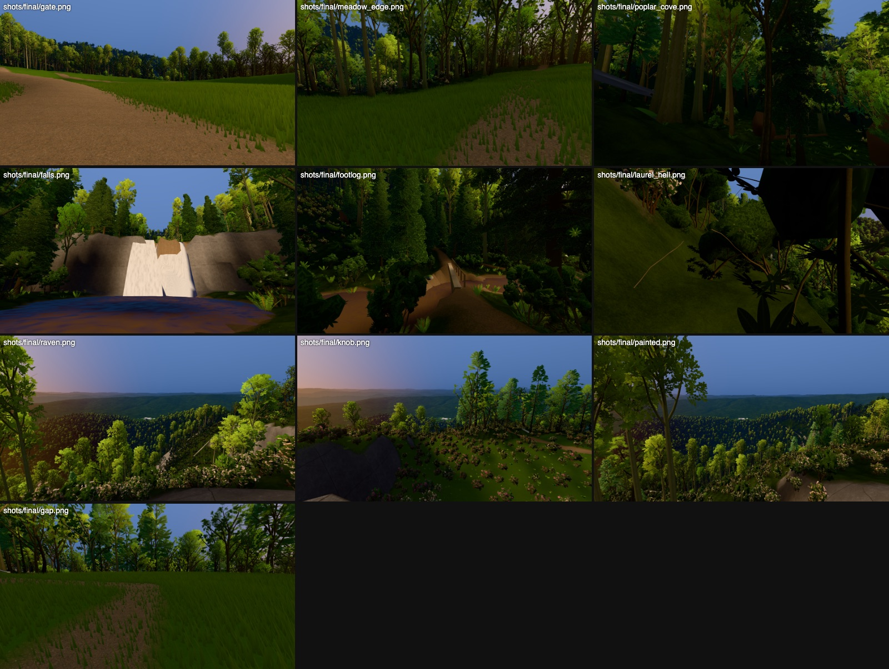
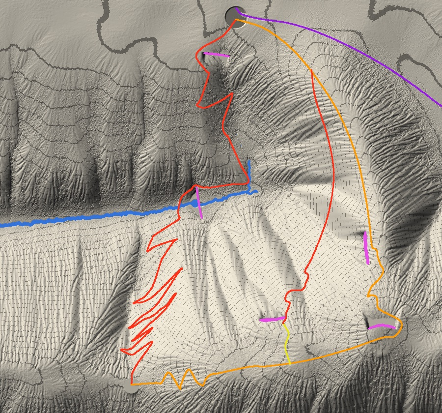
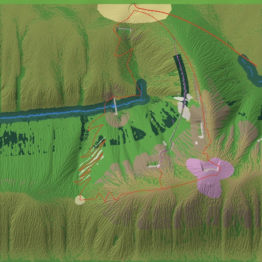

# Laurel Fork Cove: walkable blockout

Status: blockout, pass 2 (2026-10-22). Pass 1 (2026-10-21, sections 1-7 below) built the brief: terrain, forest, creek, falls, footlog, routes and lookouts. Pass 2 did four things:
- integrated the finished plant kit;
- added the Laurel River, the bridge, the river road and the first signs of the town (the user's feedback);
- did the land pass from pass 1's "doesn't work yet" list;
- re-ran every check.

Nothing is committed, and no house or engine file outside `viewer/wild*` was changed.

```sh
PY=/Applications/Blender.app/Contents/Resources/5.0/python/bin/python3.11
$PY blender/wilderness/levels/laurel_fork.py            # terrain (2 passes) + checks + world, ~70 s (numpy only, no Blender, no slot)
python3 -I blender/wilderness/ground_textures.py         # once: the Poly Haven ground scans -> build/wilderness/ground/
python3 -m http.server 8765                              # from the project root
http://localhost:8765/viewer/wild.html                   # click to walk (WASD, Shift run, Space, C crouch); F fly; H overlay
http://localhost:8765/viewer/wild.html?view=bridge       # views: gate meadow_edge poplar_cove falls footlog laurel_hell raven knob
                                                         #   painted gap bridge cascade river_gorge river_road (keys 1-9, 0: the first ten)
                                                         # veg=0 stand-ins; q=0..3; variants=1; shell=0; ground=0; kitprops=0; split=1
node viewer/tools/wild_routes.mjs                        # walks routes A, B, C and D with the real player
node viewer/tools/wild_cracks.mjs --world laurel_fork    # terrain seam test (must print 0)
WILD_QS="&world=laurel_fork" node viewer/tools/wild_bench.mjs <label>
node viewer/tools/wild_shots.mjs <label>                 # every view + stats.json (draw calls by mesh, textures, download by folder)
```



*Pass 2, Metal, q3, 2400x1350. Left to right, top to bottom: the gate; the meadow edge; Poplar Cove; the falls; the footlog; inside the laurel hell; Raven Rock, the Knob and Painted Rock looking back at the house; the Gap; on the swinging bridge over the Laurel River; the river road looking down the valley to the town.*

**Before and after.** Each row is pass 1 (left) beside pass 2 (right): [blockout/after_before_after.jpg](blockout/after_before_after.jpg). The river views are in [blockout/after_river.jpg](blockout/after_river.jpg): the bridge, the Narrows cascade, the gorge from the rail grade and the valley to the town. The plan of the river and the routes is [blockout/after_relief_river.jpg](blockout/after_relief_river.jpg). The full-size views are in `build/wilderness/laurel_fork/shots/{before,after}/`.



*The view back from Painted Rock. The house sits on its rise at 1 km. Behind it, the ring's valley and two low ridges, then the sky's ridgelines to 48 km, each paler and bluer, with haze pooled in the valleys.*

## Pass 2 numbers

| | pass 1 | pass 2 | budget (runtime.md) |
|---|---|---|---|
| draw calls, q3, the bench's 4 views (meadow edge / Poplar Cove / Painted Rock / gate) | 65 / 87 / 85 / 36 | **32 / 50 / 42 / 19** | ≤ 40-50 |
| draw calls, q3, all 14 shot views | 36-98 | **19-48** | |
| draw calls, SwiftShader q0 | 38 / 67 / 60 / 21 | 20 / 36 / 28 / 12 | |
| GPU textures | 214 MB | **126 MB** | ≤ 150 MB |
| download | 20.3 MB (≈28 MB measured per request) | **13.8 MB** (q3; 13.2 at q0) | ≤ 15 MB |
| M4 Metal 2400x1350 q3, render ms (synced) | 2.2 / 3.5 / 2.1 / 1.7 | 1.6 / 3.7 / 2.0 / 2.0 (max dir 4.1) | ≤ 5 ms |
| triangles, q3 | 0.55 / 0.72 / 1.48 / 0.47M | 0.72 / 1.03 / 1.11 / 0.69M | ≤ 1.5M |
| SwiftShader 1280x720 q0, render ms | 32 / 104 / 72 / 62 | 38 / **167** (max dir 196) / 73 / 68 | ≤ 200 ms |
| walk: frame p95 (M4 / SwiftShader) | 2.9 / 191 ms | 3.0 / 202 ms | |
| load (M4 / SwiftShader) | 1.0 / 3.2 s | 1.2 / 3.3 s | |

Bench files: `build/wilderness/laurel_fork/bench/lf_after/stats-{gpu,soft}.json`.

The download is made of:
- world data: 6.0 MB;
- kit glTF + bin: 3.2 MB;
- kit base-colour maps: 2.5 MB;
- ground scans: 1.5 MB;
- page + sky: 0.5 MB.

SwiftShader's Poplar Cove view is the tight one. A/B runs on that view (`&canopy=0` 49 ms, `&shrubs=0` 162, `&under=0` 165, `&terrain=0` 146, `&split=1` 152) put about 115 ms in the canopy. At q0 that is mostly the ~2,300 impostors drawn looking up into the cove, the known foliage-fill cost. It is under budget. The next levers are q0's impostor start distance and a canopy-only impostor LOD.

**Checks.**
- **Routes** (`wild_routes.mjs`; real player, 60 Hz, running):

  | route | length | time | crouched | wading | notes |
  |---|---|---|---|---|---|
  | A, down the creek | 2,713 m | 7.6 min | 2 m | 0 s | |
  | B, the ridge | 2,216 m | 5.4 min | | | |
  | C, the laurel hell | 1,922 m | 8.3 min | 328 m | | |
  | D (new): to the bridge and down the river road out of the square | 1,989 m | 5.0 min | | 0 s | on the bridge deck 5.4 m over the water |

  All four reach the end, with 0 falls. A and D each log one "stuck" at the Poplar Cove propped ghost, where the walker stops, crouches and crawls under (the designed crawl-under). Thicket checks: walking into the hell standing moves 0.5 m; crouched in a tunnel, the player can't stand.
- **Seams**: `wild_cracks.mjs --world laurel_fork`, 0 of 120 views; the prototype is also 0.
- **Sight to the house** (over the trees actually placed; terrain-only in brackets). It is checked after every rebuild:

  | lookout | clearance | pass 1 |
  |---|---|---|
  | Raven Rock | 2.96 m (2.96) | 2.96 |
  | the Knob | 5.5 m (7.52) | 6.24 |
  | Painted Rock | 4.75 m (4.75) | 4.69 |

  The footlog, the plunge pool, the meadow and the Gap stay hidden from all three lookouts (−10 to −83 m). The vista cut is now 24 trees.
- **Falls**: 18.7 m. Pool 488 m². The footlog's deck is 2.8 m over the water.

## Pass 2, what changed

### 1. The plant kit, integrated (`viewer/wild/veg.js` new, `trees.js`, `main.js`)

**Loading.** The kit's glTFs are parsed for geometry only. Their images, normal maps and samplers are stripped from the JSON before GLTFLoader sees them.
- Base-colour maps are fetched once per image URI across every species and variant, then capped at 1024. Pass 1's de-dup silently failed: the kit puts the image under `EXT_texture_webp.source`, so every species uploaded its own leaf atlases.
- Node names come from `veg.json`.
- Each glTF is loaded once.
- Only the placed species are loaded. Variants are loaded only for the three that fill the near views (poplar, hemlock, red oak), and only at q3 (`?variants=`).

**Hulls.** Each LOD's primitives are sorted by material:
- **leaf**: alphaMode MASK;
- **hull**: `*_Shell`, plus the moss tile on dead wood and rock;
- **wood**: bark and rock;
- **soil**: a root plate.

A heath's LOD0 draws its **hull and wood as one opaque material with renderOrder −1**, before its cards, which have their own alpha-tested material. That is two draw calls. Far LODs merge hull, wood and cards into one draw, with the hull's triangles first. Thicket tiles are double-sided, so the tunnel sees the roof's underside.

**One impostor draw for the whole forest.** Every kit tree and shrub's LOD0 is baked from 8 azimuths into one shelf-packed atlas:
- albedo is 2048x1856, the normal atlas half that;
- a species takes 128-256 px rows by height;
- the instance's slot picks its rectangle, its size and its own fade band.

**Draw calls cut, by tier:**

| | tiers |
|---|---|
| canopy | LOD0 / LOD1 / LOD2 / shared impostor |
| understory trees (< 15 m) | LOD0 / LOD1 / impostor |
| snags | one LOD1 tier |
| heaths | LOD0 (hull + cards) / LOD1 / impostor |
| thicket tiles | LOD0 / LOD1 / their 160 m hull LOD2 |
| ground cover | LOD0 to its cull distance (40-144 tris) |

**Stand-ins replaced:**
- **New kit species** (`species/blue_ridge.py`, cards in a new 1024 `br_understory` atlas, so no existing atlas or species changed). One `trees.py --kit blue_ridge --species ...` run each, ~1 min:
  - `flowering_dogwood`: 8 m, a layered flat crown, opposite ovate leaves with arcuate veins, green June fruit;
  - `sourwood`: 13 m, leaning and narrow, serrate leaves, racemes in creamy bud;
  - `flame_azalea`: 2.4 m, open and deciduous, orange funnel trusses with a yellow blotch.
- **`bald_grass` dropped**: the bald's grass is the grass system's blades (the splat already carried it).
- **Props from the kit:**
  - ghost logs are `chestnut_log_2`;
  - blowdowns are `blowdown_log`, root plate included, which replaces the separate root-wad draw;
  - boulders are `creek_boulder` (gneiss + moss).

  They are instanced props with a kit material (`kitPropMaterial`).

**Smaller download** (the world files):

| file | change |
|---|---|
| `light.png` 2.6 MB | `light.webp` 0.57 MB (lossy colour, lossless alpha; GPU-only, decoded unpremultiplied) |
| `colliders.bin` | uint16 over its own range, 0.49 MB (mins round down, maxes round up) |
| ground-cover instances | "xz4" format (y from the heightfield at load): a third smaller |
| `world.json` | prop floats rounded: 0.55 → 0.32 MB |

### 2. The Laurel River and the way to the town (user feedback)

The cove is closed by ridges on three sides, and all three routes cross its rim. A big river coming in from the east would have to cut Raven Spur and route B. So the main stem comes in from the south, through a gorge cut in Laurel Ridge 300 m west of the Gap. No route crosses that crest.

**The river.**
- Laurel River: Nantahala-sized, a 320 km² catchment outside the square (new `hydro.inflows` in `terrain.py`), 25-34 m wide.
- It runs north at about 1.5% through a rocky gorge with long pools and a shoal.
- It meets Laurel Fork below the falls. There it drops about 18 m through the **Narrows cascade** into the Narrows (the falls' knick band), over the ledge at the Narrows' head, and out of the square to the west.
- Laurel Fork keeps its falls and footlog as a steep tributary (the user allowed it). It now runs about 10% from the plunge pool down to the confluence.
- Generator additions in `terrain.py`, all off by default, so the demo is unchanged:
  - `hydro.inflows`;
  - `hydro.floodplain`: levelled cobble bars and flats beside big channels, exported as `masks/bars.png`;
  - `hydro.meander`: the D8 network carved in warped coordinates, 30 m over 110 m, pinned to zero at the falls, the pool, the fords and the bridge site;
  - riverside paths graded off the river's water level (`river_offset`, `grade_from: "start"`);
  - a level-side "falls notch" that pins Laurel Fork to the lip (the droplet erosion is chaotic).
- `laurel_fork.py` builds the terrain twice. The first pass shows where the river actually went (`fit_river` → `river_fit.json`). The road and the bridge are then fitted to it; paths come after the hydrology, so the river doesn't move.

**The crossing.** A 67 m swinging footbridge (`swing_bridge`) spans the main stem from high bank to high bank, upstream of the cascade:
- a plank deck on cables 5.4 m over the water, sagging 0.9 m;
- timber towers and cribs, and steps where a bank is low;
- walkable colliders, kept clear of thickets.

**Route D** (to the town, the level beyond): footlog → the river trail down Laurel Fork's south bank → the bridge → the **river road**. The road is an old rail grade with ties and rails, graded at 3% off the river. It cuts through the spurs, holds its line above the Narrows, and runs out of the square on a gravel embankment down to the valley floor.

**The town.**
- The valley opens downstream: the ring's framing hills are held open along the river's corridor and in a basin.
- The cove's own species forest the ring's valley walls: about 4,000 trees outside the square, with their own instance bounds, sharing the cove species' draw calls.
- The river continues as a ribbon to the basin.
- From the rail grade at the square's edge you see the town at its end, against the low sun. A vista is kept open, like the lookouts'.
- What shows: a water tower, a white steeple, the steel truss bridge where the line enters town, a brick mill with its stack, and 38 houses on the flats. It is merged into the estate mesh, so it costs no draw call.

**Town zone (for the next level).**
- Estate frame x −2300..−1450, y −1150..−480, centred on (−1900, −800), on the river flats at −191 m (about 850 m above sea level). That is 0.7-1.5 km downstream of the square's west edge.
- It is a flat basin in the backdrop ring now, with a held-open corridor along the river (y −790..−728, from x −900 to −1500).
- The rail grade and the river are its two ways in from Laurel Fork Cove.
- Design note (user): a small mountain town that seems safe at first but is in cahoots with the invaders.
- `world.json` "town" has the rect and the glimpse props, and "river" has the inflow, confluence, cascade, bridge, rapids and the ribbon.

### 3. The land pass (pass 1's list)

**The view back.** Ridge after ridge going blue (pass 1's top item, fixed by three changes):
- **A colour bug.** The haze colours were linearised twice (three's `Color('#hex')` already converts), so the 32 km haze rendered dark navy instead of #8FA6C4.
- **North of the estate the ring is reshaped** (`north_valley` in the world step): a valley, a low ridge about 1 km behind the house and another at the ring's edge, all below the lookouts' eye.
- **The sky's ridgelines are restacked** below the horizon: 8 layers at 3.3-48 km, so each farther ridge peeks over the last. Each crest reads dark, with haze pooled in the valley under it. A hair of dither removes the sky's banding.

**Canopy from the lookouts.** Between the far impostors the terrain shader now draws a canopy shell: from 140 m, forested ground under a closed canopy takes a sunlit canopy colour. The cove below reads as a green sea instead of crowns over dark gaps.

**Water** (`level.js`):
- Tea-clear over the Poly Haven `river_small_rocks` bed, absorbed by depth (green-tea dark when deep).
- Sky reflection only where the sky is open (the light map's sky visibility). Elsewhere it reflects the gorge's forest, so the pool is no longer blue.
- Flow-mapped ripples. Whitewater on riffles, the shoals, the ledge and the cascade, broken by noise.
- Rocks that break the surface.
- A dithered shallow margin, so there is no cell staircase at the banks.

**The falls.**
- A translucent, ballistic sheet of streaming ropes, fitted to where the water actually drops.
- 10 additive spray cards (no lights, no textures).
- A churning foam ring on the pool.
- A wet, dark rock face and spray zone, from the new wet mask.

**Meandering creek and river**: `hydro.meander` (above).

**Ground** (`ground_textures.py`, new). Poly Haven CC0 scans at 1024 WebP, 1.5 MB:

| scan | used for |
|---|---|
| `forest_leaves_02` | litter |
| `leafy_grass` | meadow / moss base |
| `lichen_rock` | gneiss |
| `rocky_trail` | trail |
| `river_small_rocks` | bed and cobble bars |

- Each scan is desaturated, then tinted to the brief's palette from its own mean colour, measured at load.
- In the shader:
  - the grass layer becomes moss (#4F7A2A) under the canopy;
  - moss patches in the litter and on shaded rock tops;
  - cobble bars beside the river;
  - wet darkening on the banks and in the falls' spray.
- The wet/cobble mask is computed at load by a chamfer distance from the water raster.

**The hay meadow** (`grass.js` HAY):
- 6,500 blades per tile, 0.3-0.95 m, patchy;
- wider, softer blades that bow over;
- June greens from blue-green to yellow-green;
- a quarter carry straw or purple seed heads, and a few are ox-eye daisies.

**Poplar Cove.**
- Bark keeps its own colour (no leaf tint, desaturated: the scans run olive) with a neutral bounce and contact darkening at the base.
- A faint "forest air" under the canopy: a dim green-grey, 160 m scale, faded out by 400 m, strength from the forest under the camera. It separates the trunks in depth. It is a slight departure from the brief's "clear within 1.3 km", limited to under the canopy.
- Christmas ferns: denser in coves and knee-high (136k).

## What still doesn't work (pass 2)

- **Poplar Cove still reads dark and olive at the floor.** The boles are columns now, but the fern carpet is thinner on screen than in Joyce Kilmer. The `cove_floor_light` statistic rose from 0.19 to 0.25 because the river gorge's open corridor is now in the cove community; Poplar Cove itself is unchanged.
- **The cascade and rapids are a shader on the water mesh.** There is no spray on the river, and the foam pattern reads as sweeping bands up close.
- **Ring trees sit on the 24 m backdrop mesh, lit as full sun** (outside the light map), so the downstream valley walls look planted from close by.
- **The town is a glimpse, not a level**: boxes and cones at 0.7-1.5 km. The tunnel-portal idea was dropped, because the corridor has no hillside for it.
- **The river is wadeable everywhere** (2.8 m deep pools included). Swimming or deep water isn't modelled.
- **Route D ends at the square's west edge.** The heightfield clamps there while the drawn ring falls away, so a player following the rail walks onto a flat ledge. There is no level boundary or exit to the town yet.
- **Checks re-run on the final build**: routes A-D (table above), cracks 0/120. The demo terrain (`terrain.py`) rebuilds with identical heights, fords and paths; its hydrology info only gains the new `inflows: []` and `bar_cells: 0` keys.
- **Housekeeping**: the prototype's seam test rewrote `build/wild_bench/cracks/` (the tool's default, as in pass 1). The prototype regression bench was moved to `build/wilderness/laurel_fork/bench/proto_check_pass2/`.
- **SwiftShader q0 Poplar Cove**: 167 ms, max direction 196 ms. Inside the budget, but the tightest number.
- **Not built yet** (from pass 1's list, still open): creek noise masking; the sight rule; crouch-in-hay; stepping stones; the parkway at the Gap; a Cycles light bake; audio. The house's own `horizon.py` band is house-side and untouched.

---

# Pass 1 (2026-10-21)

Pass 1's run commands (superseded above):


```sh
PY=/Applications/Blender.app/Contents/Resources/5.0/python/bin/python3.11
$PY blender/wilderness/levels/laurel_fork.py            # terrain + checks + world, ~40 s (numpy only, no Blender, no slot)
python3 -m http.server 8765                              # from the project root
http://localhost:8765/viewer/wild.html                   # click to walk (WASD, Shift run, Space, C crouch); F fly; H overlay
http://localhost:8765/viewer/wild.html?view=painted      # any view: gate meadow_edge poplar_cove falls footlog laurel_hell raven knob painted gap
                                                         # (keys 1-9, 0 jump between them); veg=0 stand-in trees; q=0..3 quality
node viewer/tools/wild_routes.mjs                        # walks routes A, B, C with the real player
node viewer/tools/wild_cracks.mjs --world laurel_fork    # terrain seam test (must print 0)
WILD_QS="&world=laurel_fork" node viewer/tools/wild_bench.mjs laurel_fork
node viewer/tools/wild_shots.mjs <label>                 # eye-height shots of every view -> build/wilderness/laurel_fork/shots/<label>/
```

`viewer/wild_proto.html?world=laurel_fork` is the same page. Without `world` it is still the synthetic prototype.



*Top to bottom, left to right: the gate looking out; the meadow edge; Poplar Cove; the falls from the pool's rim; the footlog; inside the laurel hell (crouched, route C's tunnel); Raven Rock, the Knob and Painted Rock looking back at the house (the white box at about 1 km); the Gap. Metal, q3, 2400x1350.*

| | |
|---|---|
|  |  |
| Hillshade, 10 m contours, creek and pool, the routed trails: creek trail (red), ridge trail (orange), Painted spur (yellow), route C (purple); cliffs magenta | Communities from the masks: meadow, cove, creekside, laurel hell (dark), oak-hickory, dry crest, slick/talus, heath bald (pink), rock; trails red, tunnels violet |

## 1. Generator fixes (`blender/wilderness/terrain.py`)

| brief finding | fix | result |
|---|---|---|
| Pads have no reach (a summit pad buried the creek 440 m away) | `pads[].reach`, default radius + 2 falloff + 20 m, faded over its last 15%. Pads can also be rectangles (`half=(hx, hy)`), used for the estate lawn strip. | The demo's overlook pad now stops 49 m out. |
| No river steps | `knicks` hook. It runs after erosion and before the cliffs; plunge pools are dug after the cliffs. It is the brief's recipe, native (run_knick.py's monkey-patch is no longer needed). Rebuilding `br_full9` from br_features with it gave **bit-identical** heights. | Laurel Fork Falls: water −115.8 → pool −133.4 = **17.5 m**, dropping over about 8 m horizontally. Pool 488 m² (brief: 16 m, 450 m²). |
| Switchback cut/fill 26-29 m | **Auto-switchbacks** (`paths[].switchbacks`). It finds the stretch where the ground climbs faster than `max_grade` allows (largest of hs[j] − hs[i] − g·Δs). That stretch is replaced by a stack laid by a grade-limited A* over (cell, heading): 32 headings, a band of ±half_width around the line, turn cost so there are few hairpins, water avoided, steeper allowed within 15 m of the ends. It repeats until the excess is ≤ 3 m. The brief's Hemlock Hollow legs crossed the draw E-W, so the level now gives only waypoints. | Creek trail: **29.3 → 4.7 m max, p95 1.6 m**. Ridge trail: **26.3 → 3.8 m, p95 2.1 m**. The demo trail (now `switchbacks=True`): 20.3 → 15.3 m max, p95 14.7 → 8.1 m. The brief's ≤ 3 m holds at p95, not at the max. |
| Rock colour hard-coded at 36-48° | `masks.rock_deg` (level: 48-58°) plus `masks.cliff_rock` (rock on the faces the cliff hook cut, new `masks/cliff.png`); the backdrop's band is `backdrop.rock_deg` | Forested 45° slopes stay forest floor. |
| Droplets too strong at 1.5 m | default `erosion.droplets.per_cell` 0.8 → **0.15** | (the demo still builds; its relief is softer) |
| *(found while building)* Cliff hook raised flat half-discs past a cliff's ends and dug bowls below cliffs on hillsides | The cliff weight now fades with `ends`. The low side is natural ground lowered by an amount that runs out over `runout` (3 × height), never below a talus line from the foot (the old run-out *rose* from the foot, digging a trench that the 2° apron fill flooded flat). | The Knob and Painted Rock discs are gone. The brief's "Knob west rock" view stood on one of them (7.4 m of artifact), so the Knob lookout moved to the top of its north face (444, −1042). |

Also new: `backdrop.holes` (rects held flat outside the square: the estate lawn), and `stats.json` records per path the routed points, `max_cut_fill_at`, `cut_fill_p95_m` and a switchback report. `apply_cliffs` now returns the cliff mask. The demo (`$PY blender/wilderness/terrain.py`) builds in 21 s.

## 2. The level config and its checks

- `blender/wilderness/levels/laurel_fork.py`: every authored feature from the brief in the estate frame (ridges, valleys, knick and pool, cliffs, pads, trails, landmarks, lookouts, meadow, bald). It is generated at 1.5 m (1025², the brief's resolution; 19.7 s).
- Changes against the brief, all forced by the checks:
  - The creek trail goes around Gate Rock's west end, where the ledge fades, instead of down its 18 m face.
  - The ridge trail goes around the east end of the Knob's 30 m north face.
  - The ridge trail's max grade is 0.30 (steep spur trails are normal in the Smokies; walkability is set by the 40° slope limit).
  - Route C is now a faint corridor (3 m, 45%, switchbacks, 6 m reach), because the raw lane was 42° at p50, with 558 of its 810 m over the walking limit.
  - Added the estate road (gravel, 10%, east along the bench).
- `laurel_fork_checks.py` → `build/wilderness/laurel_fork/checks.json`. It covers sight lines, creek and falls, trail grades, and route C's slopes.

| lookout → house (z 7) | distance | over terrain only | brief canopy model | **over the trees actually placed** |
|---|---|---|---|---|
| Raven Rock (384, −880), +178 | 960 m | 2.96 m | 2.96 m | **2.96 m** |
| Knob, north-face top (444, −1042), +253 | 1,133 m | 7.52 m | 5.29 m | **6.24 m** |
| Painted Rock (162, −1018), +174 | 1,031 m | 4.69 m | −2.85 m (talus trees) | **4.69 m** |

The views hold because of vista clearing (`vista_clear`). Any tree whose crown would come within 2.5 m of a lookout's line to the house is cut; 11 trees were cut. Real overlooks are kept open the same way. From all three lookouts the footlog, the plunge pool, the meadow and the Gap stay hidden (−7 to −74 m), as do the lookouts from each other, which is the green tunnel the brief is built on. **Re-run after every terrain change.** The step prints these.

Creek: 2.74 km, up to 9.1 m wide. Fords: the footlog's (6.0 m at −155, −671; the deck sits 3.3 m over the water) and one on the Poplar branch. Trails: creek trail 2.84 km (grade p50 13%, p99 39%), ridge trail 2.20 km (21% / 44%), Painted spur 133 m, route C 860 m (34% / 48%). Terrain: slope p50 26.8°, p90 40.1°. 11.3% of the play area is over 40°, where the slope limit blocks.

## 3. Vegetation placement (`blender/wilderness/levels/laurel_fork_world.py`)

- **Communities.** These are Appendix C's rules on the final masks (ported from make_map.py):

  | community | share of the play area |
  |---|---|
  | cove | 36% |
  | oak-hickory | 36% |
  | slick / talus | 8.4% |
  | dry crest | 5.9% |
  | laurel hell | 3.2% |
  | creekside | 3.0% |
  | meadow | 2.6% |
  | bald | 2.5% |
  | rock | 1.0% |

  Laurel hell's share includes route C's 45 m band, which covers only the 320 m stretch dropping into the cove head, so the route has about 300 m of crouching (as the brief asks).
- **Trees.** 26,045 trees, 174 stems/ha of forest, in 9 canopy species and a snag (see the species list below). They are placed by:
  - per-community density and species mix (Appendix B shares);
  - a jittered 3 m grid thinned to crown spacing, big trees first;
  - clustering and gaps from noise;
  - old growth in Poplar Cove: fewer, 1.15-1.2× bigger poplars;
  - age classes (18% young);
  - species rules: buckeye above −40; white pine on south faces, spurs and crests; hemlock near water.
- **Clearances.** Trunks are kept 3.2 m from trails, 5 m from the creek (so the low sun lights the corridor) and off route C's lane.
- **Shrubs.** 48,398, plus 126,268 ground plants:
  - laurel hell: `rhodo_thicket` tiles on a 6.5 m grid, and `rhodo_tunnel` tiles chained every 7 m along the tunnels, both placed from the thicket mask so what blocks is what shows;
  - rosebay on creek banks;
  - mountain laurel on crests and slicks;
  - Catawba on the bald, with flame azalea at its edge;
  - christmas fern on the cove floor (densest in coves);
  - cinnamon fern in the seeps;
  - doghobble on the creek banks;
  - grass tufts on the bald and at the Gap.
- **Props.**
  - 521 logs: chestnut ghosts on convex upper slopes; blowdowns with root wads in coves;
  - 2,280 boulders: cove fields, creek banks, and 1.4-2.6 m blocks in the Narrows;
  - the footlog (16 m, handrail);
  - the Poplar Cove chestnut ghost across the creek trail, propped on a boulder with 1.25 m under it to crawl through;
  - the Gap's stone overlook wall;
  - lookout slabs, placed behind each lookout so the view stays open;
  - the Knob's summit rock, as steps of ≤ 0.9 m;
  - the falls sheet.
- **Light.** It is computed in numpy:
  - sun = n·l × terrain shadow;
  - a canopy shadow marched toward the sun through the placed crowns (leaf density 0.09/m), so sunflecks come through the gaps;
  - sky visibility = terrain horizon × local canopy cover.

  Results: the cove floor gets **0.19 of open light** (the brief: "about a fifth"), the creek 0.62, the meadow 0.76.
- **Species ids are the vegetation agent's** (`veg.json`, kits.blue_ridge):
  - canopy: `tulip_poplar`, `eastern_hemlock`, `northern_red_oak`, `white_oak`, `chestnut_oak`, `shagbark_hickory`, `sugar_maple`, `yellow_buckeye`, `white_pine`, `hemlock_snag`;
  - shrubs and thickets: `rosebay_rhododendron`, `rhodo_thicket`, `rhodo_tunnel`, `mountain_laurel`, `catawba_rhododendron`, `doghobble`;
  - ferns: `christmas_fern`, `cinnamon_fern`.

  The runtime loads whichever of these veg.json has. The stand-ins by kind fill in anything else: `understory`, `flame_azalea` and `bald_grass` have no model yet.
- **Output.** `build/wilderness/laurel_fork/world/`, the format in `viewer/wild/load_world.js`'s header: heights, splat, light, thicket and tunnel mask, water, backdrop, instances as uint16 × 6, colliders as float32 AABBs, and world.json. The step takes 10 s and writes 11 MB.

## 4. Runtime (`viewer/wild.html`, `viewer/wild/`)

- `load_world.js` streams a level in the World shape (`png.js` decodes the generator's PNGs exactly).
- `main.js` adds `world=`. Each piece:

  | piece | how it's done |
  |---|---|
  | terrain | CDLOD with 12 m leaves × 4 quads, i.e. the 1.5 m cells exactly |
  | forest | the vegetation agent's models by id (LOD0 ≤ 20 m, ≤ 12 m for shrubs and thickets; impostors baked at load), else stand-ins |
  | stand-ins | grouped by kind, with the species' size, tint and bloom per instance (`trees.js`) |
  | water | `level.js`: tea-coloured creek and pool; the falls is a white, scrolling sheet from the lip to the pool |
  | backdrop | the 4.6 km ring, 24 m mesh with a skirt at the seam |
  | props | instanced, distance-culled |
  | estate stand-in | about 5k tris: lawn, terrace, the white house (two floors, courtyard open, glass bands), hedge with the open gate, pool, 41 Italian cypresses |
  | haze | aerial perspective only: extinction 3.912 / 32 km (T = 0.89 at 1 km, 0.38 at 8 km), blue #8FA6C4 away from the sun and peach #E6C49A toward it. No fog. |
  | sky | `sky_wild.js`: the house's golden-hour colours (mansion_sky.json), with six procedural ridgelines at 3-21 km, each hazed by its distance |
- **Player** (`player_hf.js`):
  - the brief's 40° slope limit;
  - trunk, log, boulder and prop colliders (colliders.bin) plus the hedge and house;
  - laurel-hell cells are solid;
  - tunnel cells have a ceiling at 1.35 m, so standing blocks and the 1.1 m crouch fits; you can't stand up inside;
  - wading is ×0.6;
  - the terrain is a hard floor.
- You spawn at the gate looking south.

## 5. Verification

**Routes** (`wild_routes.mjs`). These use the real player stepped at 60 Hz, running except when crouched; the results are in `routes.json`:

| route | length | time (run) | stuck | fell through | crouched | brief |
|---|---|---|---|---|---|---|
| A down the creek (footlog, Hemlock Hollow stack) | 2,867 m | 7.5 min | 0 | 0 | 1 m (under the propped ghost) | 1.76 km, 6-7 min |
| B along the ridge (Raven Rock, the Knob) | 2,231 m | 5.4 min | 0 | 0 | 0 | 1.92 km, 5-6 min |
| C through the laurel hell | 1,940 m | 7.9 min | 0 | 0 | 274 m | 1.43 km, 6-8 min, ~300 m crouching |

- On route A the feet were up to 4.66 m above the terrain: that is on the footlog's deck, over the creek.
- Thicket checks: walking into the hell standing moves 0.5 m and stops; crouched in a tunnel, letting go of C keeps you down.
- Route A is longer than the brief's because the switchback stack up Hemlock Hollow is real: the brief's own numbers (220 m up at 22%) need about 1 km of trail.

**Seams.** `wild_cracks.mjs --world laurel_fork`: 120 views, **0** with background showing (terrain and backdrop ring drawn).

**Bench.** `wild_bench.mjs`. Production models are the default; `&veg=0` uses stand-ins. Render ms is the synced time, mean over 4 directions.

| | view | render ms | draw calls | triangles |
|---|---|---|---|---|
| **M4 Metal 2400x1350 q3** | meadow edge / Poplar Cove / Painted Rock / gate | 2.2 / 3.5 / 2.1 / 1.7 | 65 / 87 / 85 / 36 | 0.55M / 0.72M / 1.48M / 0.47M |
| same, stand-ins | | 1.3 / 3.0 / 1.5 / 1.6 | 21 / 22 / 20 / 18 | 0.44-0.49M |
| **SwiftShader 1280x720 q0** | | 32 / 104 / 72 / 62 | 38 / 67 / 60 / 21 | 0.15-0.44M |
| same, stand-ins | | 33 / 111 / 63 / 61 | 17-20 | 0.14-0.28M |

Load takes 1.0 s (M4) and 3.2 s (SwiftShader). The player walk runs at 2.9 ms p95 on the M4. Against the runtime budgets (runtime.md):
- **met:**
  - GPU ≤ 5 ms;
  - SwiftShader ≤ 200 ms;
  - triangles ≤ 1.5M;
  - culling ≤ 1 ms.
- **over, with production models:**
  - draw calls, 36-91 against ≤ 40, because each species has 3 LODs × 2-3 materials plus an impostor (still under the house's 276 mean);
  - GPU textures, 214 MB against 150 (it was 489 MB before the runtime shared textures across glTFs and capped the leaf atlases at 1024, `?vegtex=`);
  - download, 20.3 MB against 15.

  With stand-ins, every budget is met: 21 calls, 70 MB, 14.8 MB.

## 6. Art-director pass (against the real places)

References, from memory (nothing fetched):
- **Joyce Kilmer / Albright Grove:** grey ruler-straight poplar boles 1-2 m thick, the first limbs 25 m up, a knee-high fern floor, dim green light with a few sunflecks.
- **Wiseman's View and Craggy / Roan overlooks:** the canopy below as a lumpy green sea, ridge after ridge going paler blue.
- **Grotto / Laurel Falls:** a white ribbon over dark wet gneiss into an amber pool, hemmed in by rhododendron.
- **Kephart Prong / Big Creek footlogs:** a sawn log with one handrail over boulders.
- **Laurel hells from inside:** grey twisted stems and a leathery roof at 2-4 m.

What works:
- The green tunnel: the meadow edge to Poplar Cove drops to a fifth of the light, and nothing across the cove is visible from inside it.
- The falls reads: a white drop into a pool in a rock amphitheatre.
- The footlog crossing.
- The hell from inside: stems, leaf whorls and the first white rosebay trusses.
- The Knob bald dotted with Catawba.
- The lookout payoff: the house is a white box at 1 km, below a forested rise, with hazed ridges toward the sun.

What doesn't yet:
1. **The near views back** have one dark, dull backdrop rise behind the house rather than layered blue ridges. The 32 km haze is honest but subtle within 3 km. The ridge layers only show toward the sun. A rendered horizon band (like `horizon.py`) or lower framing hills would let the layering read. This is the brief's "view back" signature moment, the top item for the next pass.
2. **Poplar boles read thin and dark.** The cove at 0.19 of open light is correct but murky on screen. Real coves have brighter moss and fern patches and silver-grey bark. Raise the bark albedo and the sky term's bounce under the canopy, and add sunfleck contrast in the light map; don't raise the overall level.
3. **Water** is still too blue in the pool (sky reflection). The creek bed and trails are a uniform beige tile up close: the splat textures are the house's (gravel, hedge-as-litter, concrete-as-rock). Litter, moss, gneiss and cobble sets are the brief's next item.
4. **The falls sheet** is a flat white plank. It needs spray (additive cards like `fire.js`), a darker wet rock face and foam on the pool.
5. **The hay meadow** reads as green spikes. It needs seed heads and ox-eye daisies, plus the 10 m edge belt (blackberry, sumac, sassafras) the brief describes.
6. **The thicket tiles' inner shell** (the vegetation agent's opaque crown shell) looks faceted within 2 m. That's for them.

The land itself holds up from the lookouts: rounded, soil-mantled ridges, dendritic hollows, rock only at the cliff bands. The 1.5 m surface is smooth at eye height (the "dunes" terrain.md mentions), which detail textures and ground cover hide.

## 7. Known gaps and next steps

- Not built from the brief:
  - creek noise masking;
  - the vegetation sight rule (λ per community: `world.json` `communities.sight_lambda` is ready);
  - crouch-in-hay concealment;
  - ramps up the propped log's root end;
  - stepping stones;
  - the parkway road at the Gap;
  - the canopy shell beyond 120 m (the impostors carry it);
  - the Blue Ridge splat textures;
  - mist at the falls;
  - the Grimble's tree wake;
  - audio.
- **House-side items** (not touched, per the rules): the house's own `horizon.py` band still shows fields, so its windows see the wrong horizon. Swapping the olives and re-rendering that band are the brief's recommendations 2 and 4.
- **Light map** is 1.5 m and numpy. A Cycles bake (`bake.py`'s outdoor path) would add bounce and prop shadows.
- **Switchbacks.** The router minimises turns inside a band, so legs come out long and diagonal (Hemlock Hollow has about 6-8). Authored waypoints still steer it.
- **Instances** ship as uint16 + 1.6 MB (gzip). Most of it is ferns (1.3 MB raw); they could be generated at runtime from the masks.
- **Tunnel collision vs visuals.** The tunnel collision is about 3.2 m wide (two cells; one cell pinched on diagonals). The `rhodo_tunnel` tile's visual tunnel is 1.3 m, so you can brush through stems at the edges, and the straight 7 m tiles chain along a curved lane.
- **The creek** is still a D8 channel: straight at 45° and with no meanders. The iteration went into the falls, the pool and the footlog, not the channel. A spline fit with meander noise before carving (terrain.md) is the fix.
- **Tool housekeeping:**
  - `wild_shots.mjs` logs one 404 per run (benign; the page has no favicon).
  - `wild_bench.mjs` writes to `build/wild_bench/<label>` by default; this pass's runs were moved to `build/wilderness/laurel_fork/bench/`.
  - The prototype regression run of `wild_cracks.mjs` rewrote `build/wild_bench/cracks/` (same 0 result).
- **Files:**
  - `blender/wilderness/terrain.py` (fixes)
  - `blender/wilderness/levels/{laurel_fork,laurel_fork_checks,laurel_fork_world,lf_viz}.py`
  - `viewer/wild.html`
  - `viewer/wild/{load_world,png,level,sky_wild}.js` (new)
  - `viewer/wild/{main,trees,terrain,grass,atmosphere,player_hf}.js` (extended; the synthetic prototype is unchanged by default)
  - `viewer/tools/{wild_routes,wild_shots}.mjs` (new)
  - `viewer/tools/{wild_cracks,wild_bench}.mjs` (`--world` / route walk)
  - outputs in `build/wilderness/laurel_fork/`
