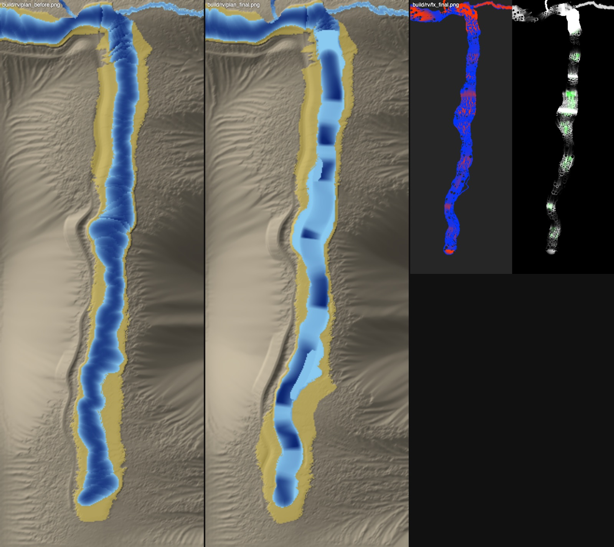
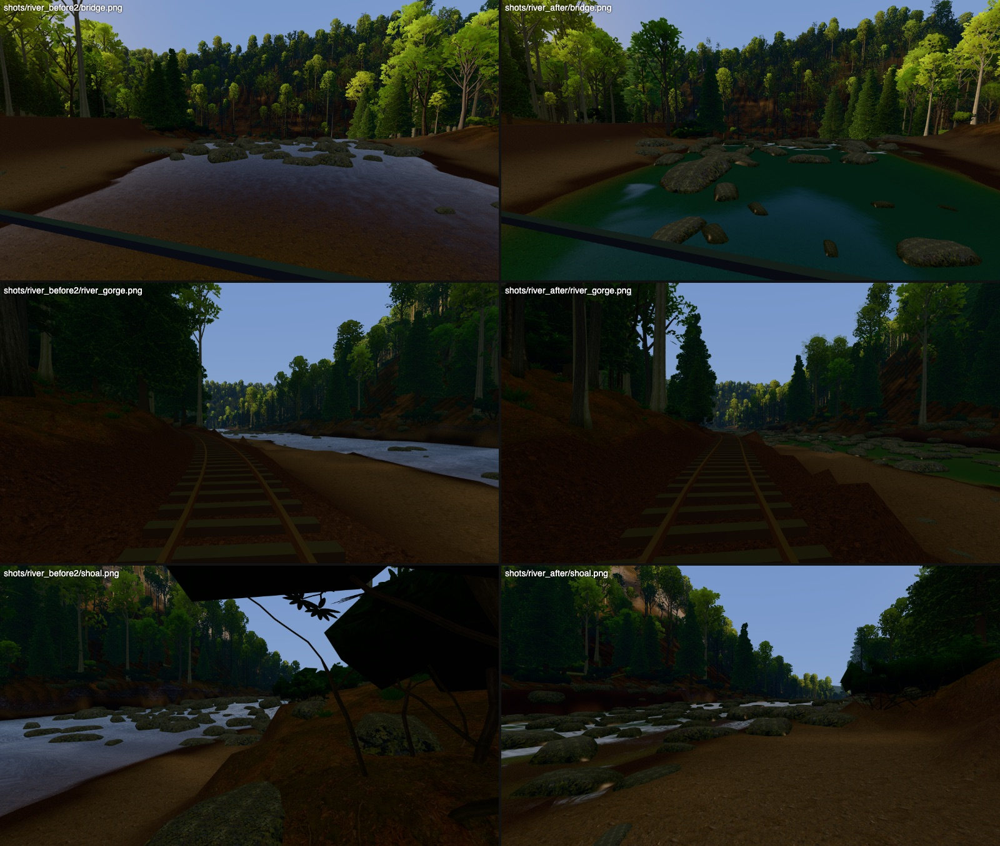
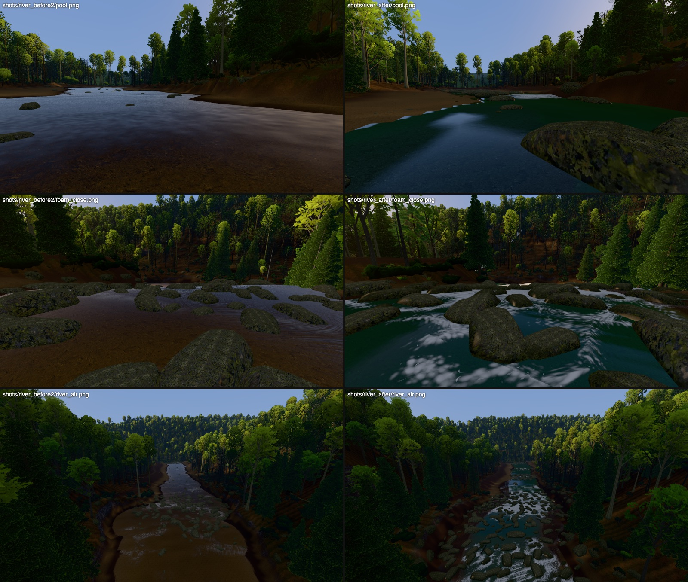
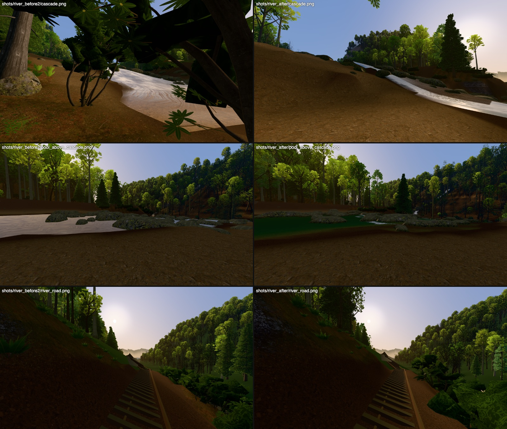

# Laurel Fork Cove: the water (the Laurel River's look)

Status: wave 2, the river-look pass (2026-10-22). The user's note was "the river needs to be
improved": 25-34 m wide but dark and flat from the bridge, little life, and the cascade's foam
showing sweeping bands up close.

```sh
PY=/Applications/Blender.app/Contents/Resources/5.0/python/bin/python3.11
$PY blender/wilderness/levels/laurel_fork.py                 # terrain + checks + world, ~2 min (the water data included)
http://localhost:8765/viewer/wild.html?world=laurel_fork&view=bridge
node viewer/tools/wild_water.mjs                              # the water-query API + the reaches' speeds and depths
node viewer/tools/wild_water_cost.mjs --profile soft          # the water's own render cost (in-page A/B)
node viewer/tools/wild_shots.mjs <label> --extra viewer/tools/wild_river_views.json \
  --views bridge,cascade,river_gorge,river_road,shoal,pool,pool_above_cascade,river_air,foam_close
```

## Water-query API (`viewer/wild/water.js`)

One CPU field per loaded world, shared by the renderer and the player. Coordinates are the
runtime's terrain-local three.js metres (the same as `world.heightAt(x, z)`): x east, y up,
z = -(estate y + 810).

```js
import { prepareWater, waterField } from './water.js';
await prepareWater(world);         // main.js does this right after loadWorld (the level's water data)
const water = waterField(world);   // cached on the world (world.waterField): every caller gets the same one
// also window.__water once the level is built (main.js)

water.surfaceAt(x, z)          // -> water surface height y (m), NaN where dry
water.depthAt(x, z)            // -> surface - bed (m), 0 where dry (bed = world.heightAt)
water.flowAt(x, z, out?)       // -> { x, z, speed }: surface current in m/s (three.js x/z), {0,0,0} where dry;
                               //    writes into `out` if given (no allocation per call)
water.wet(x, z)                // -> true where there is water (depth > 0.02)
```

- The surface is sampled exactly as the mesh draws it: the 1.5 m water raster (`world.water`,
  NaN = dry), a quad for every cell with at least 2 wet corners (a dry corner takes the mean of the
  wet ones), split along the same diagonal. So `surfaceAt` is continuous where the water is drawn.
- `flowAt` is the current the shader draws. It comes from the level's `water_flow.png` (below).
  Without that file, it falls back to the surface's slope.
- Beyond the square (the ribbon down the valley to the town) the API returns dry.
- Nothing here needs three.js or the GPU: it works on the loaded world alone.

Measured by `wild_water.mjs` on the final build. The river-interaction workstream's thresholds
are bridge pool <= 0.8 m/s, shoals >= 2.1, Narrows >= 3.2, and pools flowing downstream.

| reach (estate box) | speed p50 / p90 (m/s) | depth p50 (m) | flowing downstream |
|---|---|---|---|
| bridge pool (y -860..-815) | 0.29 / 0.50 | 2.42 | 99% |
| the Shoals (y -1065..-1005) | 0.90 / 3.05 | **0.63**: wadeable | 88% (the rest is eddies behind rocks) |
| the Narrows (y -770..-735) | 0.66 / 3.37 | 2.20 | 92% |
| the long pool (y -1345..-1290) | 0.24 / 0.58 | 1.58 | 99% |

Every 10 m row's mean current runs downstream from y -1500 to -800. Eddies run upstream by design,
in a small lee behind each emergent rock. The surface never jumps (0.000 m over 5 cm).

## References (from memory, nothing fetched)

- **Nantahala Gorge in June, on a release (~800-1000 cfs):** a green river, clear over cobbles at
  the edges and bottle-green in the slots. Continuous Class II with pools between. Wave trains in
  the tongue below each drop. Rhododendron and hemlock hard down to wet black rock.
- **French Broad below Hot Springs:** wide, glassy, slow pools that mirror the forested ridges, so
  the banks show as dark green bands and the sky as a pale stripe down the middle. Riffles across
  broad cobble bars.
- **Linville Gorge, the river below the falls:** big grey gneiss boulders 3-6 m across, choked
  rapids, white water torn into streaks around the rocks, plunge pools with foam lines drifting out
  of them, wet dark rock up to the splash line.
- **New River Gorge:** long pools against bedrock shelves and ledges, cobble bars on the insides of
  bends, driftwood strainers pinned on the rocks.

What the pass matches from these: the clear-to-deep colour ramp, the mirrored banks with the sky
down the middle, flow-direction ripples, white water torn around rocks into streaks and lines, wave
trains, the pool-drop rhythm, big boulders, cobble bars and bedrock shelves, driftwood, the wet
line, and mist over the cascade.

## What changed

### 1. The channel (`terrain.py` `channels`, off by default; `laurel_fork.py` `RIVER_CHANNEL`)



*Left, before: 3 m deep everywhere (dark blue), one even fall. Middle, after: the pool-drop
sequence, with an S-bend and its cobble bar (yellow: bars). Right: the baked current (blue slow to
red fast) and the foam (white) and standing waves (green).*

Before, the bed was `depth0 + depth_k * width`, clamped to 3.0 m for 800 m. The cross-section was
one symmetric parabola and the surface one even 2.6% fall, so there were no shallows and no
riffles. Two new generator hooks fix this, both after the hydrology. (Done before it, the
flattened pools filled up as lakes.)

- **`apply_channel_profiles`** turns the main stem's fall into a staircase along its line, from
  the inflow to the lip of the Narrows cascade:
  - each pool is flat at the level of its tail;
  - each step falls to the next pool over its length (a ledge as an S-curve);
  - the water and the ground within 40 m of the channel's edge are lowered together, so the water
    keeps its width, banks and bars;
  - `river_level` is updated in place, so the rail grade still grades off it;
  - the reach's total fall is unchanged (max lowering 1.7 m);
  - the cascade, the confluence and the reach downstream toward the town are untouched (the
    planned valley road keeps its terrace).
- **`apply_channel_beds`** shapes the bed under the water:
  - deep scour below each drop, the pool shallowing to a gravel tailout at the next crest;
  - riffles and rapids 0.45-0.7 m deep over the cobbles, flat-bottomed;
  - a lip and a 3.6-3.8 m plunge hole at each ledge;
  - the thalweg pushed toward the outside of bends, leaving a point bar inside;
  - two bedrock shelves (0.22-0.28 m deep, a sharp edge to the deep water);
  - steep 62° cut banks on the outsides of bends (rock colour, with the shelves, through the cliff
    mask). A heightfield can't undercut: deep water runs hard against a steep, dark, wet bank
    instead.
- **The sequence**, downstream:
  1. the Inflow rapid;
  2. the first ledge;
  3. the long pool (the S-bend: `laurel_river` valley points moved, east cut bank, cobble bar
     inside, a shelf);
  4. a tailout riffle;
  5. a rapid;
  6. the Shoals (78 m, 6.4 m of fall);
  7. Laurel Ledge (1.9 m);
  8. a riffle into the bridge pool;
  9. the Narrows cascade (as before).
- **Checks re-run on the final build:**
  - routes A-D all reach the end, 0 stuck, 0 falls (A 2,644 m, B 2,241, C 1,947 with 325 m
    crouched, D 1,938 over the bridge);
  - seams: 0 of 120 views;
  - sight to the house over the placed trees: Raven 2.96 m, Knob 5.91, Painted 4.75;
  - the footlog, pool, meadow and Gap stay hidden from all three lookouts;
  - rail grade: 3%, cut/fill as before.

### 2. The water's data (`levels/laurel_fork_water.py`, new; three files, 236 KB)

- **`water_flow.png`: the current**, in m/s:
  - its direction runs down the surface, along the carved centreline in the flat pools, and
    parallel to the banks near them;
  - its speed comes from continuity on the main stem (Q = 24 m³/s over each section's area,
    spread across it as h^(2/3), so shallow riffles run fast and deep pools slow), from Manning's
    formula elsewhere, and never slower than a steep surface's own;
  - it parts around every rock standing in the water (superposed potential flow round a
    cylinder), with a small reversed eddy in each lee.
- **Foam potential** (the same file): where the flow is supercritical (Froude number), where the
  surface is steep, shallow quick riffles, and each rock's pillow, eddy lines and V-wake. It is
  carried downstream with an 8 s half-life, so foam lines run out of every rapid into the pool
  below. Standing-wave strength is where the Froude number is 0.5-2 in the tongue.
- **`water_aux16.png`**: the standing waves' phase along the main stem (crests every 2πv²/g) and
  the bed kind (bedrock / cobbles).
- **`water_env.png`: the skyline over the water** in 8 directions: the highest of the terrain and
  the placed canopy tops, out to 650 m. This is what the surface reflects, forest or sky,
  position-correct along the whole river, with no reflection pass.
- **Rocks** (`river_rocks`, its own random stream), sized to what the channel does:

  | where | size |
  |---|---|
  | lines across each ledge's lip | 1.8-4.5 m |
  | through the rapids | 1.0-3.5 m |
  | huge gneiss blocks beside the deep pools | 3-5.5 m |
  | breaking the surface elsewhere | 0.4-2.2 m |
  | cobble bars | 0.3-0.9 m |

  Every rock in the channel clears the water by about a third of its height. There are 14
  driftwood strainers (silver chestnut ghosts pinned on the big rocks' upstream faces, angled
  across the current).

### 3. The runtime (`viewer/wild/water.js`)

Three draw calls: the surface, the falls sheet and the mist. There are no lights and no extra
passes. The noise is one 256² texture made at load instead of about 14 procedural value-noise
calls per pixel.

- **Colour:**
  - the cobble scan is seen through tea-green water, absorbed along the view path (red goes
    first, then blue) toward the water's own lit green-brown;
  - grey gneiss on the bedrock, silt and algae in the pools;
  - sun caustics in the sunlit shallows.
- **Reflection:** Fresnel reflection of the sky above the baked skyline and the gorge's forest
  below it, lit on the side the sun reaches. The banks mirror along the edges of a pool, with the
  open sky down the middle.
- **The current:** a flow map. Two layers of ripple and foam noise are advected along the current
  and cross-faded, each place on its own phase, rougher where it's fast. The old shader's
  sweeping bands came from rotating world coordinates by the local flow direction and advecting
  them up to 60 m per cycle; the new one advects at most about 9 m per cycle in world coordinates,
  never rotated.
- **Standing waves:** stationary crests with foam on them.
- **White water:** the baked potential thresholds bubbly foam cells, streaked along the flow by a
  second tap and broken into tongues. It is blue-grey in shade. On steep water (the drops, the
  cascade) the surface's own tilt makes it white whatever the raster's depth.
- **Sun glints** where the light map has sun.
- **Mist** (one draw with the falls' spray): cards over the cascade, the ledges and the big
  rapids, placed from the foam and the surface's fall, glowing when backlit by the low sun.
- **The wet line:** rock and driftwood darken below the nearest water's level plus a splash
  height (higher where the river is white), with algae at the line and a wet sheen
  (`level.js` `kitPropMaterial`). The terrain's wet banks are wider where the river splashes
  (`waterWetTexture` replaces main.js's `wetTexture`).
- **The low quality levels (q0-1):** drop the fine ripple layer, the foam streak, the caustics,
  one breakup tap and half the mist cards.





*Before (left) is pass 2 as committed, served from b82ebe1 with its world; after (right) is the
final build. Metal, q3, 2400x1350. The views are in `viewer/tools/wild_river_views.json`, plus the
world's own bridge, cascade, river_gorge and river_road views. Full size:
`build/wilderness/laurel_fork/shots/{river_before2,river_after}/`.*

## Cost

| | before | after |
|---|---|---|
| draw calls (the water) | 3 (surface, falls, spray) | 3 (surface, falls sheet, mist) |
| download | 13.78 MB | 14.09 MB (+0.24 MB water data; the rest is the world's rebuilt light map and colliders) |
| GPU textures | 125.8 MB | 127.2 MB (+0.25 noise, +0.4 wet-line half float; the rest is the light map) |
| M4 Metal 2400x1350 q3, render ms: bridge / gorge / cascade / meadow / Poplar Cove | 2.08 / 2.71 / 3.05 / 1.56 / 3.81 | 1.64 / 2.38 / 3.50 / 1.54 / 3.66 |

**SwiftShader.** The machine was shared with other agents during the run (load average 24-49), and
the absolute timings came out 2-4x their quiet values even on views without water. The water's own
cost was therefore measured in-page (`wild_water_cost.mjs`: the same frame with the water shown and
hidden, alternated). At q0 it adds 6-13% to the frames where it fills the view:

| view | frame with water | without | water's share |
|---|---|---|---|
| bridge | 324 ms | 287 | +37 ms |
| gorge | 433 ms | 387 | +46 ms |
| shoal | 255 ms | 240 | +15 ms |
| at the cascade lip | 380 ms | 350 | +30 ms |

Those are contended numbers, roughly 4x quiet. The cascade view's pass-2 bench was 179 ms
(budget 200); re-bench it on a quiet machine before merging.

## What doesn't work yet

- **The world's cascade view** (make_views picks the lowest dry spot north-east of it) looks along
  the cascade from a mound. It reads as a white chute, not a stepped cascade. A view from the
  Narrows looking up would show it better.
- **Sky reflections** in the calm pools have soft but blobby edges. The skyline is per vertex, so a
  far ridge's notch is only as sharp as the 1.5 m mesh.
- **The kit's creek_boulder** stretched to 3-5 m reads as smooth, mossy "loaves". A bigger, angular
  gneiss block model would sell the Linville look.
- **Swimming and wading** are the other workstream's (it reads this API). Deep water is modelled
  there, not here.
- **The SwiftShader budget** needs the quiet-machine re-bench above.
