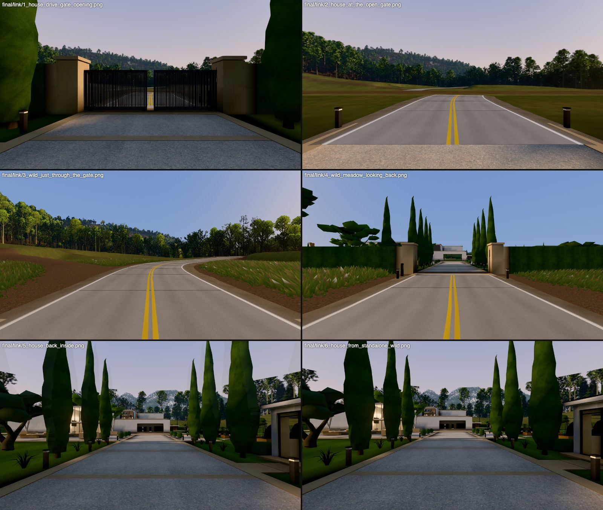
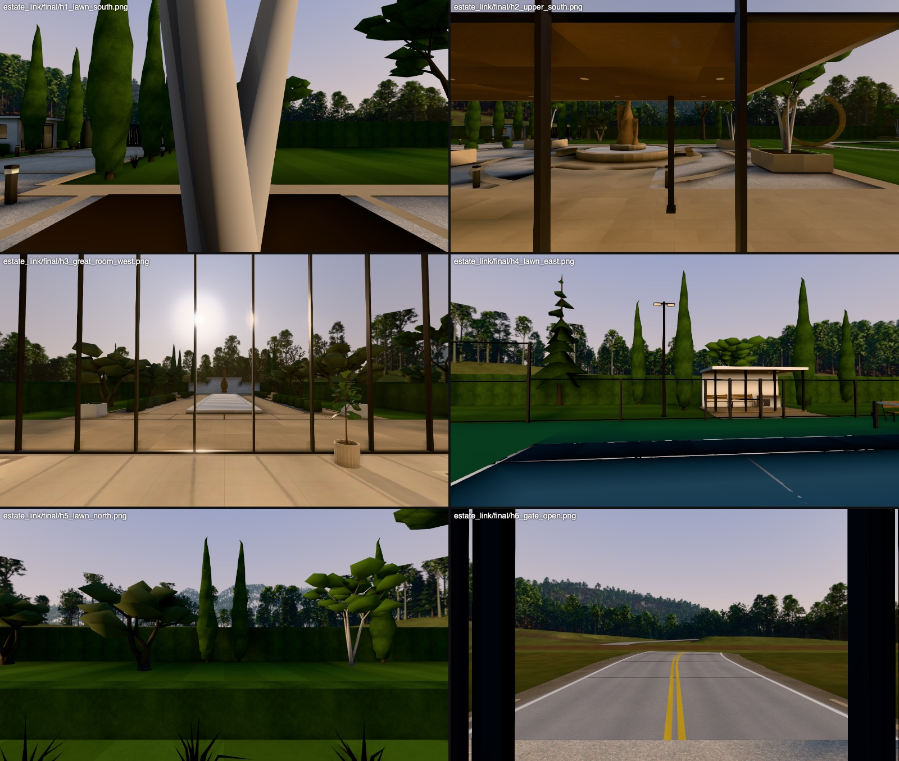
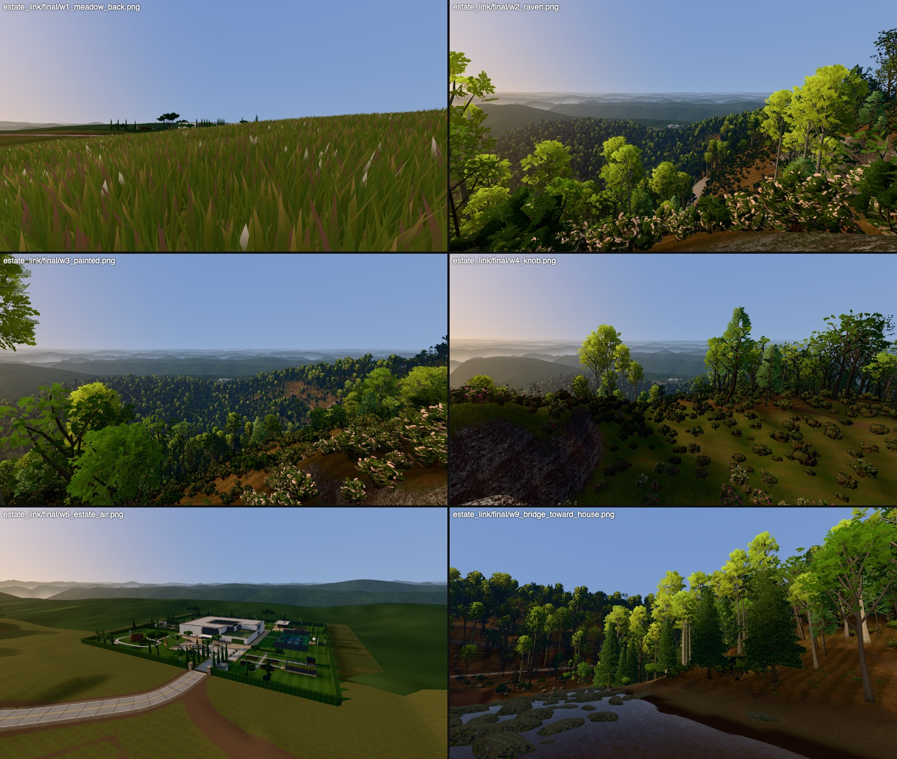
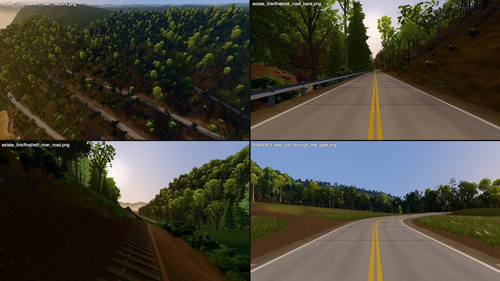

# The estate in the landscape (wave 2: situating the mansion)

Status: prototype, 2026-10-22. The house level (`viewer/index.html?level=mansion`) and Laurel Fork Cove
(`viewer/wild.html?world=laurel_fork`) are now one place. Each level shows the other, and the gate
in the hedge carries the player across in both directions. A county road leaves the gate for the
town (the user's request, added mid-wave).

```sh
# the band the house sees (Cycles, ~3 min at 128 samples; needs the Laurel Fork world built)
/Applications/Blender.app/Contents/MacOS/Blender -b --factory-startup --python blender/levels/horizon.py -- 128
# the wilderness world, the road included (numpy, ~90 s, no slot)
/Applications/Blender.app/Contents/Resources/5.0/python/bin/python3.11 blender/wilderness/levels/laurel_fork.py
node viewer/tools/estate_link.mjs            # the handoff, end to end (both ways + stand-alone)
node viewer/tools/estate_shots.mjs <dir> name=url ...   # screenshots of any page views
```



*Top: the house. The gate opens as the player comes down the drive, then stands open with the county road
running on into the hay. Middle: the wilderness, just through the gate and looking back from the
meadow at the real estate. Bottom: back in the house, inside the gate (the in-tab handoff and the
stand-alone fallback).*

## 1. The architecture: two levels, one tab, a seam at the gate

**Proposal (where this should end up): one runtime, two level modules.** The house and the
wilderness already share the player (`player.js`), the tone mapping, the sun and sky (mansion.json
`golden`) and the frame (wild z = house z − 810). The clean end state is one renderer, one player, one
inventory, one combat and invader system, with the two levels as modules. Each module adds and
removes its scene, colliders and per-frame update. The level manager keeps the current level live and
the neighbouring one loaded. At the gate it swaps the active level in one frame. Today that would mean
refactoring two monolithic page scripts that other workstreams are editing (index.html, wild/main.js),
so it is the next step, not this one.

**Rejected: one world with the house as a dense zone.** Every wilderness frame would pay for the
house's ~300-850 draw calls, its 375 MB of textures and its lightmaps. Every house frame would pay
for the forest. The forest's alpha-card overdraw and the house's baked interiors want different render
setups (fx.js post passes in the house, none in the wild).

**Rejected: two pages and a navigation.** It loses everything the house remembers: open doors, picked-up items,
broken glass, power, the Grimble, the invaders. Serialising all of it means hooks into every
system.

**Built (prototype): the house page is the game's shell, and the wilderness lives in an iframe.**
`viewer/estate_gate.js`, `viewer/estate_link.js`, `viewer/wild/estate.js`, with small marked hooks in
`index.html` and `wild/main.js`:

- **The gate opens by itself** when the player comes down the drive within 10 m of it (an exit sensor,
  as on any electric estate gate). The two baked leaves are split out of the grounds mesh. They keep
  their baked vertex colours and slide 3.95 m into the wing walls over 3 s, and their colliders go.
- **Opening the gate loads the wilderness** (`wild.html?embed=1`) into a hidden full-window iframe on the
  same origin. It takes about 1.0-1.4 s on the M4 while the leaves run. Once loaded it is paused, with no
  frames drawn. It loads only when the player actually goes to the gate, never during the house's own
  load and never on a bench run.
- **Crossing the gate line** (house z 62.7, between the piers) suspends the house: no update, no frames, the
  keys released (`window.__suspended`). The wilderness gets the player's state: feet position mapped
  into its frame, velocity, crouch, the camera's look, the carried inventory (ids, names, counts,
  defs), the flashlight, and anything a system registered. The iframe is then shown. While the house
  page holds the pointer lock, its keys and mouse are forwarded (the wilderness's `__wildGate.look`).
  A click in the wilderness takes the lock directly.
- **Walking back in through the gate** (after going at least 2 m out onto the apron) does the reverse. The
  wilderness pauses, the house resumes exactly as it was left, and the player stands inside the gate. A
  second trip out takes 20 ms, because both levels stay loaded.
- **Stand-alone fallback:** `wild.html` opened on its own (no house around it) walks back by navigating to
  `index.html?level=mansion&from=wild`, with the state in sessionStorage. The house then loads with the
  player inside the open gate. Only the player's transform is restored that way.
- **What crosses the gate** is an open registry, so the invader and weapon workstreams can plug in
  without touching these files: `window.__estateLink.provide(name, () => data)` on the side being left,
  and `window.__estateLink.accept(name, fn)` on the side being entered (each page has its own
  `__estateLink`). Use it for the invaders following the player out (who, where, how far behind) and
  for `__combat`'s player health. The wilderness keeps the carried inventory as `__wildGate.carried`. It has
  no inventory UI yet. The house's inventory stays authoritative, so nothing is lost on the way back.

**Costs, and what to watch.** Both WebGL contexts stay alive once the player has been out, so GPU memory
is the house's plus the wilderness's (about 375 + 130 MB of textures on the M4 budgets). The suspended
level draws nothing. On weak hardware the first crossing is the slow one: the wild loads in 3-4 s
under SwiftShader, and if it isn't ready the player is held at the gate with the house dimmed. The
seam itself is a cut. The house's band is a panorama from the house, so at the gate the forest wall
it shows sits farther away than the real one does in the wilderness. The cut happens where the leaves
frame the view.

## 2. The wilderness: the real estate on the rim

`viewer/wild/estate.js` replaces level.js's stand-in boxes. It removes their triangles from the
merged `Wild_Estate` mesh, and the town's glimpses stay. In their place it loads the house level's own
exported grounds:

- `mansion_outdoor.gltf` (about 76k triangles, 1.6 MB): the white render facades and roofs, the
  terrace, hedge, gate and piers, pool and pool house, the tennis court, and every zone's planting and
  furniture. The house's baked lighting is already in its vertex colours.
- The shell's glazing and window frames only, from `mansion_shell.gltf` with its images stripped. The
  interior isn't loaded.

The estate sits exactly where the house level has it (z − 810).

It is drawn the way the house draws its grounds: unlit, texture × baked vertex colour × the bake's
scale, with the wilderness's aerial perspective added. So it reads the same at the gate as from inside,
and it fades into the 32 km haze from the lookouts. The glass is opaque and dark, with the sky in it by
Fresnel. The cost is about 11 draw calls (see §6). `?estate=0` brings back the stand-in, and
`?estate=far` skips the five 512 px textures.

Two fixes in the wilderness's own data were needed for this:
- **The `estate_lawn` pad never did anything** (`laurel_fork.py`). `apply_pads` measures a rectangle
  pad's reach from its half-size (`d + size`), so a 60 m reach on a 90 m rect reached nothing. The cove's
  terrain stood 3-8 m over the house's lawn inside the hedge, and the stand-in hid it. The pad now has
  reach 150, a 35 m falloff and 14° banks and cuts, so the lawn rect holds at −0.08 as the brief says.
  The rising ground east of the lawn (8-12 m up at x 100-150) becomes a graded grass berm. With a 10 m
  falloff it was a bare 8 m cut, seen from the office and gym windows.
- **No hay inside the hedge** (`laurel_fork_world.py`). The house's grounds are drawn there.
- **Vista clearing missed broad crowns** (`laurel_fork_world.py vista_clear`). The lateral band now adds
  each tree's crown half-width. Before the fix, a re-scatter (any terrain change re-rolls the trees)
  put a red oak's crown 17 m into the Knob's view. The Knob is now at 5.43 m clearance with 36 trees cut.

The grounds' lawn south of the hedge is dropped in the wilderness, because the cove's own meadow and
hay grow there. North, east and west of the hedge it is drawn as hay (`estate_link.js` HAY_GLSL), as
the house does.

## 3. The house: the Blue Ridge out of every window

`blender/levels/horizon.py` is rewritten. It renders the band from the actual Laurel Fork world,
using the same approach as before (a Cycles equirect strip, 4096 × 296 px, latitude −10..16°, eye 3 m
over the lawn, alpha where the sky shows). The band is the same size as before, so the GPU cost is
unchanged:

| layer | from | how |
|---|---|---|
| cove terrain | `height16.png` (every 2nd sample, 3 m) | lit by Cycles; colour from the splat in the wild's palette (grass / litter / gneiss / trail); hay where the meadow is; a 2.5 / 11 m mottle |
| the 4.6 km ring | `backdrop16.png` | within 3 km lit by Cycles (hay on flat, low valley floors, forest floor under the trees); beyond that, the wild's own baked colour as emission (colour × light_scale × 1.15 with its crown mottle) |
| the forest | every tree and big shrub the wild places (`inst_*.bin`, about 75k, the ring's river-valley trees included) | instanced by geometry nodes from the vegetation kit's LOD1 glTFs (`build/wilderness/veg`) |
| ring forest | band only | about 114k more crowns on the ring's slopes 0.16-3 km out. From the house, sitting low in the gap, the ring's near ridges are the skyline north, east and west, and the wild draws them as canopy colour (fine from its lookouts 1 km up, bald from the meadow) |
| water, road, town | `water16.png`, `road.json`, world.json town | dark glossy water; the concrete road; the town's glimpse props as boxes |
| far ridges | `sky_wild.js`'s eight layers | composited after the render, same formula; from the house they all sit behind the ring (it's honest: nothing shows) |
| haze | the brief: extinction 3.912 / 32 km, air light blue (#8FA6C4) away from the sun and peach (#E6C49A) toward it, × 1.25 | in every material (atmosphere.js's hazeAlong) |

Everything inside the house's lawn rect (x ±90, y ±80) is left out, because the house's real grounds are in front of
it. `build/horizon_preview.png` is the band over the house's sky dome, for looking at.

**Beyond the hedge** in the house level (`estate_gate.js`):
- **The lawn outside the hedge is hay meadow.** It uses the same baked texture and vertex colours, has no
  mowing stripes, and runs June greens toward straw. That is 1 draw call.
- **The county road's first stretch** runs from the gate to the lawn's edge, using the wilderness's own slab
  shader (`road.js` ROAD_SURFACE), lit by the level's sun and sky. That is 1 draw call. The band has the rest of the road.
- **The gate leaves** are 2 draw calls (split out of the merged grounds mesh).

**Bake:** none needed. The sun, sky and LOOK are unchanged (`golden`). The band is not part of the outdoor bake (`bake.py`
doesn't read it). At 19° the sun clears the western skyline, which tops out at about 14° (the Knob from the house is
about 12°), so the grounds' baked light is still right.

**What the house sees now.** To the south (out of the gate, the south lawn and the upper south rooms)
are the hay meadow, the forest wall at 120-180 m, Laurel Ridge's crest and its rock faces at 1-1.2 km,
and Raven Spur to the south-east. To the west (the great room glass) the sun sits over the forested
ring and the low river valley toward the town. To the north are pastures, then forested ridges.

## 4. The county road (added mid-wave: "a road a car can drive, leading to the town")

`blender/wilderness/levels/laurel_fork_road.py` holds the alignment, the corridor and `road.json`.
`viewer/wild/road.js` draws it. The hooks are `laurel_fork.py` (PATHS gets the corridor, plus a `road`
step), `terrain.py` (`culverts=True` paths keep their fill over streams: no ford re-cut), and
`laurel_fork_world.py` (a wide road keeps trees and rocks off its full width).

The road is engineered like a real mountain road:
- **Cross-section:** 7.0 m of concrete (two 3.35 m lanes) between 1.2 m gravel shoulders.
- **Profile:** the generator's grade cap holds it at ≤ 10 % (measured p95 10.0 %, max 10.1 %). It runs
  2,880 m in the square and drops 176 m from the gate to the Laurel River. The cut and fill banks are
  30° fill and 45° cut (max 15.7 m at the hairpins, p95 10.4 m).
- **Alignment:**
  - from the gate, west along the meadow's north edge (nearly level);
  - a long diagonal down the plateau's west end;
  - four hairpins of 17 m centreline radius on the cove's north wall. They are laid as true circles with tangent legs, not the trail router's lattice V's;
  - a final run west along the river's north bank, 10-20 m above the Narrows, to the square's edge.
- **Beyond the square:** 680 m more on the ring's held-open river corridor to the town zone's edge
  (x −1450), on a low embankment over the flood plain. The town-layout agent continues it as main street.
- **Markings and furniture:**
  - **markings:** a double yellow centre line, white edge lines and saw-cut joints every 4.5 m, with darker wheel paths;
  - **guardrails:** galvanised W-beam on posts every 1.9 m, 20 runs, wherever the fill side drops more than 1.5 m;
  - **culverts:** 13 of them, a concrete headwall and pipe mouth at each end, wherever water gathers to cross (the stream channels and the hollows it fills across);
  - **bridges:** none are needed. The alignment stays north of Laurel Fork and the river.
- **Drivable later:** `window.__road.userData` has the centreline (three.js frame) and `sAt(s)` for the estate's
  `car_ev`. The road sits on the corridor's flat core, so the heightfield is already its surface.
- **Kept working:**
  - the four foot routes (re-walked, §6);
  - the sight checks: Raven Rock 2.96 m, the Knob 5.43 m (5.5 before), Painted Rock 4.75 m. Footlog, pool, meadow and Gap stay hidden;
  - the river: the road is a separate corridor, applied after the hydrology, and keeps 10+ m off the main channels.

The town is now a modern, quaint town (user), not a mill town. The road ends at its edge, and its
look is the town agent's.

## 5. The planting question (the brief's olives)

**Decision: the brief's recommendations 1 and 2.**
- **The hedge is the climate line.** Inside it is the billionaire's imported Mediterranean garden: Italian
  cypress (marginal at 1,000 m but alive in shelter, and its black spikes are the story from the lookouts),
  lavender, box and grasses. Outside is Appalachia: the hay meadow, the edge belt, the forest.
- **The olives go, because a zone 6b-7a winter kills them.** The 13 outdoor olives (7 in `planting.py`, 6 in the
  `west_garden.py` allée) become the multistem tree, read as river birch: native, hardy, with the same
  silhouette budget.

The courtyard's olive (a room asset, lightmapped with the courtyard) stays for now, as the one
sheltered specimen. Swap it when the courtyard is next rebaked.

**This needs a house rebuild and an outdoor bake (the orchestrator's).** Until then the exported grounds
still have olives, in both levels.

## 6. Checks and costs

**The handoff** (`node viewer/tools/estate_link.mjs`): all 8 checks pass.
- Down the drive, the gate opens and the wilderness loads into its iframe in 1.0-1.4 s.
- Crossing the line suspends the house. The player arrives in the wilderness at the gate (19.75, −747.15).
- Walking back in resumes the house with the player inside the gate (z 62.5), and the wilderness is paused.
- A second trip out takes 20 ms.
- Stand-alone `wild.html`, walked in through the gate, loads the house with the player inside the gate.

**House quality loop.** The before run is the wave-2 base, served from a `git archive` of b82ebe1. The
after run is this branch. M4 Pro, 1600x900 @2.

| | before | after | budget |
|---|---|---|---|
| frame p95 ms | 7.6 | 7.7 | 7.0 (over in both: 8 agents share the machine; +1.3 % is noise) |
| GPU p50 / p95 ms | 14.01 / 17.67 | 13.95 / 17.53 | 14 / 20 |
| draw calls mean / max | 288.2 / 824 | 290.6 / 827 | 296 / 850 |
| triangles max | 970,138 | 970,138 | 977,000 |
| download MB | 22.24 | 22.47 (+0.23: road.json, the new modules) | 23 |
| GPU textures MB | 364 | 364 (the band is the same 4096 x 296) | 375 |

- The extra draw calls are the gate leaves (2), the hay (1) and the road stretch (1), and only near the gate.
- SwiftShader was unusable on the loaded machine (0.9-1.8 fps in both runs), so there is no soft
  comparison from this wave. Rerun it when the machine is quiet.
- These runs used an earlier render of the band (same size and cost). The committed band fixes its
  holes and the eastern cut bank.
- The shots differ only through windows: 17 of 32 views change by more than 0.5 % of pixels, up to 12.6 %
  (`build/bench/el_after/compare.html`). The before/after pairs are in `estate_link/windows.jpg`.

**Wilderness** (`wild_bench`). Before = `&estate=0&road=0` on the same world. M4 at 2400x1350, holding
each view:

| view | calls | triangles | GPU p50 ms |
|---|---|---|---|
| gate (spawn) | 19 → 30 | 631k → 748k | 1.98 → 1.97 |
| meadow edge | 30 → 32 | 709k → 753k | 1.49 → 1.17 |
| Poplar Cove | 48 → 50 | 861k → 887k | 4.61 → 4.68 |
| Painted Rock | 41 → 42 | 1.04M → 1.08M | 1.38 → 1.53 |

- **Download:** 13.87 → 16.09 MB. That is **over the wilderness's 15 MB target** (runtime.md): the grounds
  are 1.6 MB, the shell's glazing 0.36 MB, road.json 0.2 MB.
- **GPU textures:** 125.8 → 132.8 MB, against a 150 MB budget.
- **SwiftShader q0** (render+finish ms):
  - meadow edge: 52 → 90, the estate in view at about 120 m;
  - Poplar Cove: 320 → 285;
  - Painted Rock: 112 → 111;
  - gate: 117 → 125.
- **Lever for the download:** a pre-baked far estate. The same grounds, merged, decimated, with no normals
  or UVs and the texture means in the vertex colours, should come to about 0.5 MB. Use it beyond about
  150 m, and the full grounds only near the gate.

**Wilderness checks after the road and pad changes:**
- **Routes** (`wild_routes.mjs`): all four routes reach the end with 0 falls.
  - A: 2,713 m, 7.6 min;
  - B: 2,216 m, 5.4 min;
  - C: 1,922 m, 8.3 min, 325 m crouched;
  - D: 1,989 m, 5.0 min.
  - A and D log the designed crawl under the propped ghost, as before.
- **Thickets:** walking into the hell moves 0.5 m, and the player can't stand in a tunnel.
- **Seams** (`wild_cracks.mjs`): 0 of 120 views.
- **Sight to the house:** Raven 2.96, Knob 5.43, Painted 4.75 m. The footlog, pool, meadow and Gap stay
  hidden from all three lookouts.







The band itself, over the house's sky (`build/horizon_preview.png`): [estate_link/band.jpg](estate_link/band.jpg).

**House regression tests** on this branch:
- `outside.mjs`: all pass, the drive, the gate and the doors included.
- `walls.mjs`: 3,488 runs, 1 impossible position, in the south_lawn zone at (−39, 43). The base
  (b82ebe1) gives the identical result, so it predates this work.
- If the wilderness can't load (no generated world, an error), the gate says "The road is closed" and the
  house plays on (`?wildworld=nope` tests it).

**Known gaps:**
- The swap at the gate is a cut. The band's forest wall at the gate sits about 60 m farther than the real one.
- The wilderness has no inventory UI yet; it only carries the items.
- There are no colliders for the estate's piers and wing walls in the wilderness: the stand-in's hedge
  boxes leave the 11.5 m gap open.
- From inside the house the house sky (peach horizon) and the wilderness sky (haze-coloured horizon) differ.
  This keeps the house's look.
- The far ridgelines are hidden behind the ring everywhere from the house, which sits low in the gap. That is
  honest: you see layered ridges from the lookouts, not from the lawn.

## 7. For the orchestrator

- **Rebuild the wilderness world** (`laurel_fork.py`, about 90 s: the road and the estate_lawn pad change the
  terrain). Then re-render the band with `horizon.py` (128 samples, about 3 min, after the world). The
  committed band matches the committed config.
- **Rebuild the house and run the outdoor bake** for the olive swap (`planting.py`, `west_garden.py`). That
  is the only house-side change that needs one. Nothing else in this workstream needs a bake.
- **Merge order:**
  - The river-look agent's channel edits and this road share `laurel_fork.py`. The road is one
    `PATHS.append` plus a step. Re-run `laurel_fork_road.py --plan` after their river lands, to check the
    north-bank leg's clearance to the water. It prints any fill toe that reaches a channel.
  - The town agent continues `road.json`'s `ring` into main street.
- **Hooks in shared files:**
  - `index.html`: an import, the `EstateGate`, `estateGate?.update(dt)`, `if (window.__suspended) return;` in the loop;
  - `wild/main.js`: imports, `buildRoad`, `loadEstate`, `wildGate` and `gate?.update()`;
  - `terrain.py`: the culverts block;
  - `laurel_fork.py`: the pad reach, the road and the step;
  - `laurel_fork_world.py`: the road clearance and no hay inside the hedge.
- **For the invader and weapon workstreams:** `window.__estateLink.provide / accept` (§1) carries their state
  across the gate.
